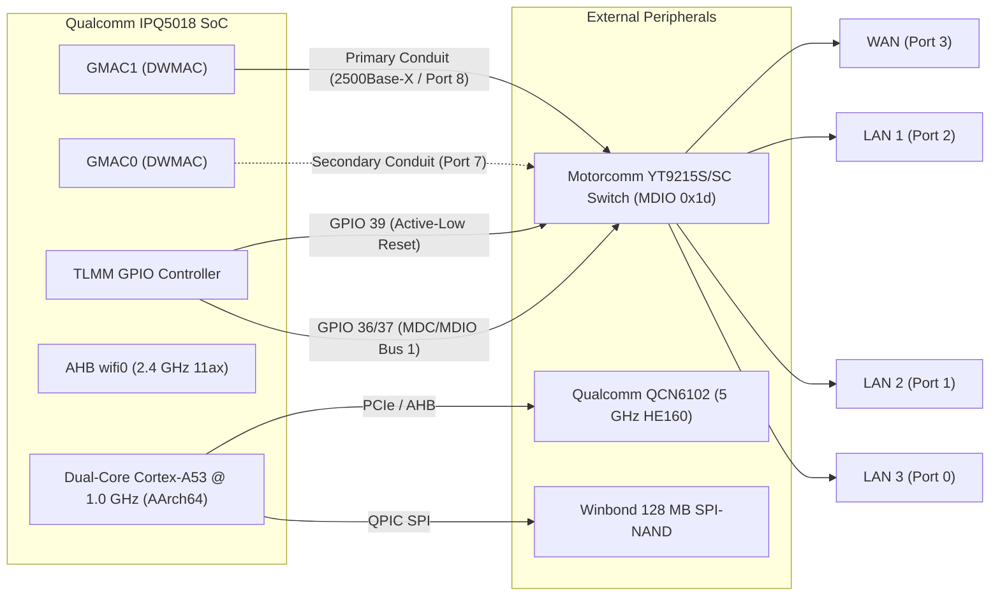
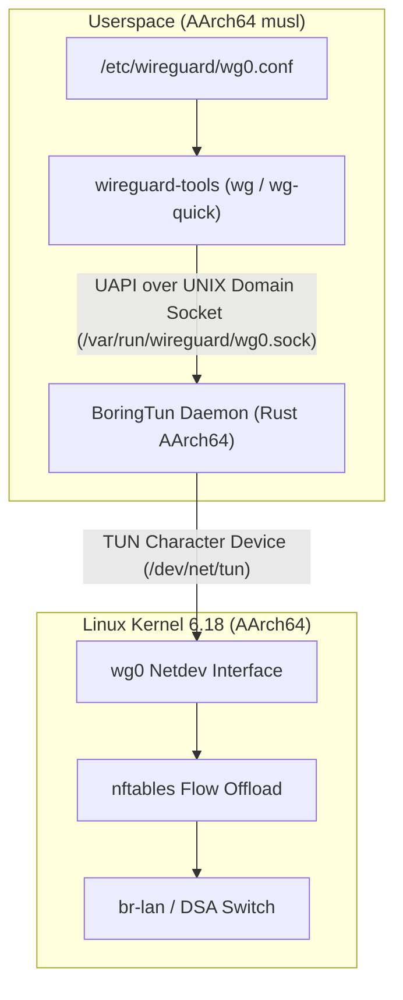

# Architecture Design: Clean DSA Baseline (Linux 6.18 without NSS)

- **Document ID:** `docs/DSA_BASELINE_DESIGN.md`
- **Project:** `CR8808-CUSTOM-FIRMWARE` (v0.1.0-dev.2)
- **Target Hardware:** Xiaomi CR8808 Ver.B (Codename `CR8818`, Qualcomm IPQ5018 dual-core Cortex-A53 + Motorcomm YT9215S/SC)
- **Target Platform:** OpenWrt / ImmortalWrt Clean DSA Baseline (Linux 6.18, `qualcommax/ipq50xx`, AArch64 userspace)
- **Architecture Lead Decision:** Phase 1 Baseline — Clean DSA without NSS
- **Status:** Approved Baseline Architecture Specification
- **Revision:** Round 2 Review (DSA Driver Mapping & AArch64 ABI Target)

---

## 1. Architectural Motivation

In accordance with the **Architecture Gate G1 Final Review**, the initial custom firmware baseline must establish a **clean, reproducible, and verifiable Distributed Switch Architecture (DSA) operating on modern Linux 6.18, without Qualcomm NSS packet-processing acceleration**.

### Key Rationale:
1. **Isolation of Variables:** Attempting to simultaneously bring up new switch hardware, modern Linux 6.18, `ath11k` Wi-Fi, BoringTun Rust, and experimental NSS offload introduces too many failure vectors. If an Ethernet blackout or reboot loop occurs, isolating whether the fault lies in the NSS firmware IPC, memory exhaustion, or switch SerDes timing is nearly impossible.
2. **Deterministic Baseline:** The dual-core 1.0 GHz Cortex-A53 CPU running Linux software flow offload (`nftables flowtable`) is capable of routing gigabit line-rate IPv4 TCP (~940 Mbps) with ~50–65% CPU utilization. This provides a rock-solid, fully functional daily-driver foundation.
3. **RAM Preservation:** Running without NSS saves 8–16 MiB of contiguous physical SDRAM otherwise required for the NSS NPU firmware load region, maximizing available memory for Linux network buffers and userspace services on this 256 MB device.

---

## 2. Hardware Subsystem Specifications & DTS Mapping

### 2.1 Ethernet & Switch Subsystem (DTS: `target/linux/qualcommax/dts/ipq5018-cr881x.dts`)
- **Ethernet MAC Driver:** Upstream Synopsys DesignWare MAC (`dwmac-ipq5018` / `stmmac`).
- **Primary Conduit:** IPQ5018 GMAC1 binds to Motorcomm YT9215 CPU Port 8 via 2500Base-X SerDes (`phy-mode = "2500base-x"`).
- **Secondary Conduit:** IPQ5018 GMAC0 binds to Port 7 (`motorcomm,conduit-role = "secondary-conduit"`).
- **MDIO Management:** MDIO Bus 1 using GPIO 36 (MDC) and GPIO 37 (MDIO). Switch sits at MDIO address `0x1d`.
- **Switch Hardware Reset:** GPIO 39 (`reset-gpios = <&tlmm 39 GPIO_ACTIVE_LOW>`), with 10 ms assertion and 50 ms deassertion delay.
- **Internal SoC PHY:** Qualcomm IPQ5018 Internal GE PHY sits separately at MDIO `88000.mdio:07` (PHY ID `0x004dd0c0`), distinct from the external switch.
- **User Ports Exposed:**
  - `lan1` (Switch Port 2, internal PHY 2)
  - `lan2` (Switch Port 1, internal PHY 1)
  - `lan3` (Switch Port 0, internal PHY 0)
  - `wan`  (Switch Port 3, internal PHY 3)

### 2.2 DSA Driver Compatibility & Driver Divergence Analysis

There are two primary implementations for Motorcomm YT9215 DSA switching in the OpenWrt ecosystem:

1. **Upstream Linux Baseline (Linux 6.19+ & Backports on 6.18):**
   - Compatible string: `compatible = "motorcomm,yt9215";`
   - Upstream location: `drivers/net/dsa/motorcomm/` (merged in Linux 6.19).
   - OpenWrt backport: `target/linux/generic/backport-6.18/967-net-dsa-motorcomm.patch`.
   - Driver model: Standard Linux DSA switchdev, single CPU conduit binding, standard tag protocol `DSA_TAG_PROTO_YT9215`.
   - Advantages: Clean upstream code, strict Linux network subsystem conventions, zero out-of-tree maintenance burden.
   - Risks: Multi-conduit (dual GMAC) aggregation not supported in upstream baseline; hardware VLAN offload depends on standard switchdev ops.

2. **`zcop` Out-of-Tree Enhanced Overlay (`target/linux/qualcommax/files/`):**
   - Compatible string: `compatible = "motorcomm,yt9215-enhanced";`
   - Components: `drivers/net/dsa/yt921x_driver.c`, `net/dsa/tag_yt921x_enhanced.c`.
   - Driver model: Custom enhanced tag protocol supporting hardware accelerated port isolation and dual GMAC conduit distribution (GMAC1 primary, GMAC0 secondary).
   - Advantages: Specifically tuned and verified by zcop for IPQ5018 CR881x boards.
   - Risks: Out-of-tree patch drift; potential symbol breakages on minor kernel updates.

**Architectural Plan:**
In Phase P4/P5, we build the clean DSA baseline with the backported upstream driver (`motorcomm,yt9215`) as the primary target. If dual-conduit routing or SerDes link initialization requires the vendor-specific enhanced tagging, we will fall back to `motorcomm,yt9215-enhanced` as a controlled patch set.

### 2.3 Wireless Subsystem (`ath11k`)
- **2.4 GHz Radio:** `wifi0` (Integrated IPQ5018 AHB radio, 2x2 802.11b/g/n/ax).
- **5 GHz Radio:** `wifi1` (Qualcomm QCN6102 / QCN6122, 2x2 802.11a/n/ac/ax, HE160 up to 2402 Mbps).
- **Calibration & BDF:** Board Data File loaded from physical partition `0:art` via nvmem layout (`qcom,bdf-addr = <0x4d100000>`).
- **Operating Modes:** Channel 36–64 (160 MHz continuous), DFS radar detection, WPA2/WPA3 Mixed and WPA3-SAE.

### 2.4 Memory Profile Configuration (256 MB Physical RAM)
To prevent OOM kernel panics on 256 MB RAM:
- `CONFIG_ATH11K_MEM_PROFILE_256M=y` (scales down internal ring buffer sizes in `package/kernel/mac80211/ath.mk`).
- `qcom,ath11k-fw-memory-mode = <1>` configured in DTS.
- NSS heap reservation completely removed from DTS in this baseline (`cr881x_nss_region` omitted), freeing ~16 MiB of contiguous physical memory for Linux slab and userspace buffers.

---

## 3. VPN Subsystem: BoringTun Rust Integration

### 3.1 Architecture & ABI Target
In this clean baseline, WireGuard connectivity is managed by **BoringTun 0.7.1** compiled natively for **`aarch64-unknown-linux-musl`**.

> **ABI Architecture Clarification:**
> While stock Xiaomi RA82 Linux 4.4 ran a 32-bit ARMv7 musleabi userspace, custom OpenWrt on `qualcommax/ipq50xx` runs a modern **64-bit AArch64 kernel and userspace**. The IPQ5018 dual-core Cortex-A53 CPU natively supports AArch64. Consequently, the BoringTun Rust daemon for custom firmware will be compiled for target **`aarch64-unknown-linux-musl`** (not `armv7-unknown-linux-musleabi`).

### 3.2 Service Lifecycle & Daemon Control
- **Startup Script:** `/etc/init.d/boringtun` manages the lifecycle under OpenWrt `procd`.
- **Socket Path:** `/var/run/wireguard/wg0.sock` created for standard WireGuard UAPI commands (`wg setconf`, `wg show`).
- **Signal Handling:** Fixed via POSIX `sigaction` + `eventfd` fallback in `epoll.rs` (mitigating kernel `signalfd` `ENOSYS 38` failures observed on legacy kernels), ensuring clean exit within ~1.1s without leaving dangling socket files.

### 3.3 Empirical Memory & Performance Evaluation Protocol
Earlier comparisons cited Go's `VmSize = 522 MB` as memory usage. This has been corrected:
- `VmSize` reflects **virtual address space reservation** (goroutine thread stacks, heap pre-allocations), not actual physical DRAM usage.
- In stock firmware testing, Go's physical resident memory (`VmRSS`) measured **~3.7 MB**.
- However, Go runtime's garbage collection cycles, stop-the-world pauses, and background runtime threads introduce latency jitter under high packet rates on constrained dual-core CPUs.
- **Empirical Evaluation Metrics for BoringTun Rust vs. Go:**
  1. **Peak `VmRSS`:** Resident physical memory under continuous 500 Mbps encrypted traffic.
  2. **`VmHWM` (High Water Mark):** Peak physical memory observed over a 24-hour soak period.
  3. **PSS (Proportional Set Size):** Actual unique memory burden accounting for shared libraries.
  4. **Throughput & CPU Utilization:** Max sustained Mbps and % CPU load per core during bidirectional `iperf3`.
  5. **Handshake & RTT Jitter:** Time required for initial 1-RTT handshake and round-trip ping jitter under load.

---

## 4. Acceptance & Verification Gates for Baseline

Before this DSA baseline is considered ready for testing, it must pass the following checks:
1. **Static Build Verification:** Compiles cleanly to a signed sysupgrade image without missing kernel symbols or unresolved package dependencies.
2. **Switch Probe Cleanliness:** Kernel dmesg logs confirm Motorcomm switch probes cleanly at MDIO `0x1d` on MDIO Bus 1 with zero failed reset timeouts. Qualcomm internal GE PHY probes separately at `88000.mdio:07`.
3. **Link State & DSA Bridging:** Physical insertion of Ethernet cables triggers instant PHY state transitions on `lan1`-`lan3` and `wan` with zero softirq storm.
4. **Wireless Association:** Client successfully associates at 5 GHz HE160 (160 MHz channel width) and passes bidirectional traffic.
5. **BoringTun Tunnel Traffic:** Successfully establishes handshake, routes encrypted IP packets, and maintains tunnel connection across simulated interface restarts with peak VmRSS < 15 MB.
