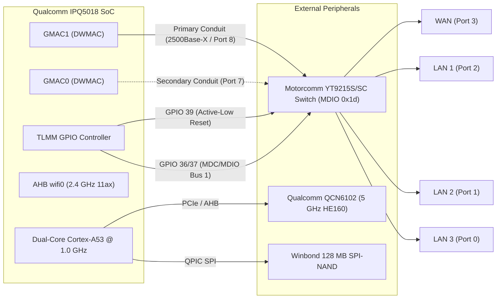
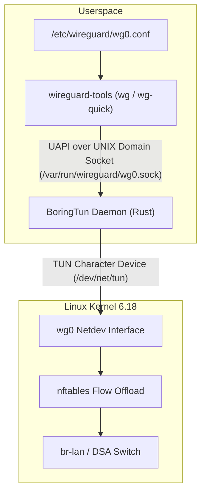

# Architecture Design: Clean DSA Baseline (Linux 6.18 without NSS)

- **Document ID:** `docs/DSA_BASELINE_DESIGN.md`
- **Project:** `CR8808-CUSTOM-FIRMWARE` (v0.1.0-dev.2)
- **Target Hardware:** Xiaomi CR8808 Ver.B (Codename `CR8818`, Qualcomm IPQ5018 + Motorcomm YT9215S/SC)
- **Architecture Lead Decision:** Phase 1 Baseline — Clean DSA without NSS
- **Status:** Approved Baseline Architecture Specification

---

## 1. Architectural Motivation

In accordance with the **Architecture Gate G1 Final Review**, the initial custom firmware baseline must establish a **clean, reproducible, and verifiable Distributed Switch Architecture (DSA) operating on modern Linux 6.18, without Qualcomm NSS packet-processing acceleration**.

### Key Rationale:
1. **Isolation of Variables:** Attempting to simultaneously bring up new switch hardware, modern Linux 6.18, `ath11k` Wi-Fi, BoringTun Rust, and experimental NSS offload introduces too many failure vectors. If an Ethernet blackout or reboot loop occurs, isolating whether the fault lies in the NSS firmware IPC, memory exhaustion, or switch SerDes timing is nearly impossible.
2. **Deterministic Baseline:** The dual-core 1.0 GHz Cortex-A53 CPU running Linux software flow offload (`nftables flowtable`) is capable of routing gigabit line-rate IPv4 TCP (~940 Mbps) with ~50–65% CPU utilization. This provides a rock-solid, fully functional daily-driver foundation.
3. **RAM Preservation:** Running without NSS saves 8–16 MiB of contiguous physical SDRAM otherwise required for the NSS NPU firmware load region, maximizing available memory for Linux network buffers and userspace services on this 256 MB device.

---

## 2. Hardware Subsystem Specifications & DTS Mapping

### 2.1 Ethernet & Switch Subsystem (DTS: `target/linux/qualcommax/dts/ipq5018-cr881x.dts`)
- **Ethernet MAC Driver:** Upstream Synopsys DesignWare MAC (`dwmac-ipq5018` / `stmmac`).
- **Primary Conduit:** IPQ5018 GMAC1 binds to Motorcomm YT9215 CPU Port 8 via 2500Base-X SerDes (`phy-mode = "2500base-x"`).
- **Secondary Conduit:** IPQ5018 GMAC0 binds to Port 7 (`motorcomm,conduit-role = "secondary-conduit"`).
- **MDIO Management:** MDIO Bus 1 using GPIO 36 (MDC) and GPIO 37 (MDIO).
- **Switch Hardware Reset:** GPIO 39 (`reset-gpios = <&tlmm 39 GPIO_ACTIVE_LOW>`), with 10 ms assertion and 50 ms deassertion delay.
- **DSA Switch Driver:** `motorcomm,yt9215-enhanced` (`drivers/net/dsa/yt921x.c`) and enhanced egress tagger `tag_yt921x_enhanced.c`.
- **User Ports Exposed:**
  - `lan1` (Switch Port 2, internal PHY 2)
  - `lan2` (Switch Port 1, internal PHY 1)
  - `lan3` (Switch Port 0, internal PHY 0)
  - `wan`  (Switch Port 3, internal PHY 3)

### 2.2 Wireless Subsystem (`ath11k`)
- **2.4 GHz Radio:** `wifi0` (Integrated IPQ5018 AHB radio, 2x2 802.11b/g/n/ax).
- **5 GHz Radio:** `wifi1` (Qualcomm QCN6102 / QCN6122, 2x2 802.11a/n/ac/ax, HE160 up to 2402 Mbps).
- **Calibration & BDF:** Board Data File loaded from physical partition `0:art` via nvmem layout (`qcom,bdf-addr = <0x4d100000>`).
- **Operating Modes:** Channel 36–64 (160 MHz continuous), DFS radar detection, WPA2/WPA3 Mixed and WPA3-SAE.

### 2.3 Memory Profile Configuration (256 MB Physical RAM)
To prevent OOM kernel panics on 256 MB RAM:
- `CONFIG_ATH11K_MEM_PROFILE_256M=y` (scales down internal ring buffer sizes in `package/kernel/mac80211/ath.mk`).
- `qcom,ath11k-fw-memory-mode = <1>` configured in DTS.
- NSS heap reservation completely removed from DTS in this baseline (`cr881x_nss_region` omitted), freeing ~16 MiB of contiguous physical memory for Linux slab and userspace buffers.

---

## 3. VPN Subsystem: BoringTun Rust Integration

### 3.1 Architecture Overview
In this clean baseline, WireGuard connectivity is managed exclusively by **BoringTun 0.7.1** compiled for `armv7-unknown-linux-musleabi` (or `aarch64-unknown-linux-musl` depending on kernel ABI mode).

### 3.2 Service Lifecycle & Daemon Control
- **Startup Script:** `/etc/init.d/boringtun` manages the lifecycle under OpenWrt `procd`.
- **Socket Path:** `/var/run/wireguard/wg0.sock` created for standard WireGuard UAPI commands (`wg setconf`, `wg show`).
- **Signal Handling:** Fixed via POSIX `sigaction` + `eventfd` fallback in `epoll.rs` (proven in lab tests), ensuring clean exit within ~1.1s without leaving dangling socket files.
- **Resource Footprint:** Resident memory (`VmRSS`) constrained to ~3.7 MB; zero dependency on the 522 MB virtual memory overhead or multi-threaded GC assist of Go runtime.

---

## 4. Acceptance & Verification Gates for Baseline

Before this DSA baseline is considered ready for testing, it must pass the following checks:
1. **Static Build Verification:** Compiles cleanly to a signed sysupgrade image without missing kernel symbols or unresolved package dependencies.
2. **Switch Probe Cleanliness:** Kernel dmesg logs confirm Motorcomm switch probes cleanly at MDIO `0x1d` with internal PHY IDs `0x004dd0c0` and zero failed reset timeouts.
3. **Link State & DSA Bridging:** Physical insertion of Ethernet cables triggers instant PHY state transitions on `lan1`-`lan3` and `wan` with zero softirq storm.
4. **Wireless Association:** Client successfully associates at 5 GHz HE160 (160 MHz channel width) and passes bidirectional traffic.
5. **BoringTun Tunnel Traffic:** Successfully establishes handshake, routes encrypted IP packets, and maintains tunnel connection across simulated interface restarts.
