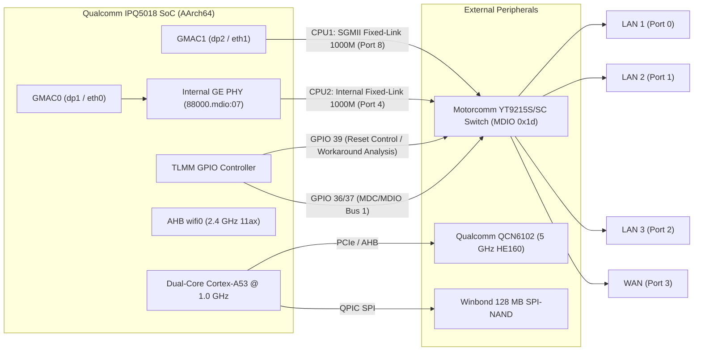
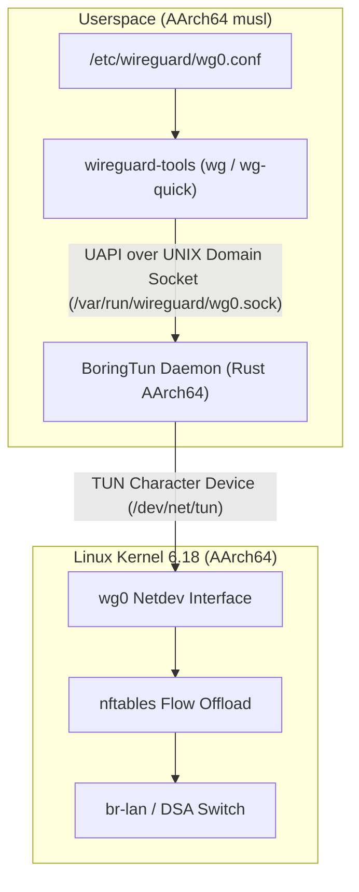

# Architecture Design: Clean DSA Baseline (Linux 6.18 without NSS)

- **Document ID:** `docs/DSA_BASELINE_DESIGN.md`
- **Project:** `CR8808-CUSTOM-FIRMWARE` (v0.1.0-dev.2)
- **Target Hardware:** Xiaomi CR8808 Ver.B (Codename `CR8818`, Qualcomm IPQ5018 dual-core Cortex-A53 + Motorcomm YT9215S/SC)
- **Target Platform:** OpenWrt / ImmortalWrt Clean DSA Baseline (Linux 6.18, `qualcommax/ipq50xx`, AArch64 userspace)
- **Architecture Lead Decision:** Phase 1 Baseline — Clean DSA without NSS
- **Status:** Approved Baseline Architecture Specification
- **Revision:** Round 3 Review (Correct Port Mapping, SGMII 1000M, and GPIO39 Initialization Analysis)

---

## 1. Architectural Motivation

In accordance with the **Architecture Gate G1 Final Review**, the initial custom firmware baseline must establish a **clean, reproducible, and verifiable Distributed Switch Architecture (DSA) operating on modern Linux 6.18, without Qualcomm NSS packet-processing acceleration**.

### Key Rationale:
1. **Isolation of Variables:** Attempting to simultaneously bring up new switch hardware, modern Linux 6.18, `ath11k` Wi-Fi, BoringTun Rust, and experimental NSS offload introduces too many failure vectors. If an Ethernet blackout or reboot loop occurs, isolating whether the fault lies in the NSS firmware IPC, memory exhaustion, or switch SerDes timing is nearly impossible.
2. **Deterministic Baseline:** The dual-core 1.0 GHz Cortex-A53 CPU running Linux software flow offload (`nftables flowtable`) is capable of routing gigabit line-rate IPv4 TCP (~940 Mbps) with ~50–65% CPU utilization. This provides a rock-solid, fully functional daily-driver foundation.
3. **RAM Preservation:** Running without NSS saves 8–16 MiB of contiguous physical SDRAM otherwise required for the NSS NPU firmware load region, maximizing available memory for Linux network buffers and userspace services on this 256 MB device.

---

## 2. Hardware Subsystem Specifications & DTS Mapping



### 2.1 Authoritative Switch Port Mapping (Source: `target/linux/qualcommax/dts/ipq5018-cr881x.dts`)

Direct inspection of `ipq5018-cr881x.dts` in the reference tree establishes the exact hardware port assignments:

| Switch Port | Internal PHY | Interface Label | Connected Subsystem / Role | Operational Parameters |
|---|---|---|---|---|
| **`port@0`** | `sw_phy0` (addr 0) | `lan1` | Physical LAN Port 1 | 10/100/1000BASE-T auto-negotiation (`phy-mode = "internal"`). |
| **`port@1`** | `sw_phy1` (addr 1) | `lan2` | Physical LAN Port 2 | 10/100/1000BASE-T auto-negotiation (`phy-mode = "internal"`). |
| **`port@2`** | `sw_phy2` (addr 2) | `lan3` | Physical LAN Port 3 | 10/100/1000BASE-T auto-negotiation (`phy-mode = "internal"`). |
| **`port@3`** | `sw_phy3` (addr 3) | `wan` | Physical WAN Port | 10/100/1000BASE-T auto-negotiation (`phy-mode = "internal"`). |
| **`port@4`** | `sw_phy4` (addr 4) | `cpu` (Secondary) | CPU Conduit 2 (`dp1` / `eth0`) | Connected to Qualcomm Internal GE PHY (`phy-handle = <&ge_phy>`), fixed-link 1000 Mbps full-duplex. Constrained to WAN traffic via `motorcomm,secondary-conduit-user-mask = <0x8>`. |
| **`port@8`** | SerDes MAC8 | CPU (Primary) | CPU Conduit 1 (`dp2` / `eth1`) | **SGMII fixed-link 1000 Mbps full-duplex** (`phy-mode = "sgmii"`, `speed = <1000>`). Primary conduit for all LAN user ports. **NOT 2500Base-X.** |
| **`port@10`**| N/A | `mcu` | Internal MCU Channel | Internal switch hardware state and management channel. |

---

### 2.2 SGMII Link Configuration vs. Erroneous 2500Base-X Claims

- **DTS Ground Truth:** In `ipq5018-cr881x.dts`, Port 8 is declared as:
  ```dts
  port@8 {
      reg = <8>;
      phy-mode = "sgmii";
      ethernet = <&dp2>;
      fixed-link {
          speed = <1000>;
          full-duplex;
          pause;
          asym-pause;
      };
  };
  ```
- **Correction:** Prior documentation rounds incorrectly asserted a `2500base-x` SerDes link. The Xiaomi CR8818 board design couples the IPQ5018 UNIPHY to Motorcomm Port 8 strictly at **1000 Mbps SGMII**. Any attempt to configure `2500base-x` will result in SerDes clock mismatch and total link loss.

---

### 2.3 GPIO 39 Switch Initialization & The "No Ethernet" Bug (Issue #5 Analysis)

Investigation of empirical data from `https://github.com/zcop/immortalwrt/issues/5` ("CR880X M79 B no ethernet") reveals a critical hardware initialization vulnerability on CR880x/CR881x Ver.B hardware:

#### The Failure Symptom:
When booting generic or improperly sequenced CR881x firmware, all Ethernet ports are completely dead. Dmesg inspection reveals:
```text
yt921x 90000.mdio-1:1d: Unexpected chipid 0xffff
```
Because the MDIO bus read returns `0xffff`, the Motorcomm DSA driver fails to probe, no netdevs are created, and only Wi-Fi operates.

#### Root-Cause Mechanics:
1. **Reset Pin Sequencing:** GPIO 39 controls the hardware reset line of the Motorcomm switch.
2. In stock firmware and the default DTS (`reset-gpios = <&tlmm 39 GPIO_ACTIVE_LOW>; reset-assert-us = <10000>; reset-deassert-us = <50000>;`), the active-low pulse duration or LDO power ramp-up timing is insufficient on cold boot or warm reboot. The switch is either held in reset or in an undefined power state when the MDIO bus controller begins device enumeration.
3. **Userspace Workaround:** Community user Gaojianli proved that setting GPIO 39 (`gpio551`) to `1` (HIGH) manually and triggering a driver rebind (`echo "90000.mdio-1:1d" > /sys/bus/mdio_bus/drivers/yt921x/bind`) immediately revived all Ethernet ports. However, ports disappeared again on warm reboot.
4. **GPIO Hog Workaround:** Gaojianli verified that configuring a TLMM `gpio-hog` forced HIGH (`output-high`) on GPIO 39 and removing `reset-gpios` from `ethernet-switch@1d` allowed Ethernet to survive initial boot.

#### Architectural Mitigation & Test Suite:
We must NOT simply apply a workaround blindly. We define three candidate approaches to be evaluated during hardware validation:
- **Approach A (Extended Reset Timing):** Increase deassert delay in DTS (`reset-assert-us = <50000>; reset-deassert-us = <250000>;`) to give the switch internal PLL and LDO time to stabilize before MDIO probe.
- **Approach B (GPIO Hog):** Lock GPIO 39 to HIGH at the pin controller level (`gpio-hog`), relying on hardware power-on-reset circuitry rather than driver-pulsed software reset.
- **Approach C (Early Userspace Procd Hook):** Pre-probe GPIO initialization script in `procd` before network service startup.

#### Mandatory Hardware Reboot Test Protocol:
Before any firmware build is considered functionally verified, it must pass a **4-part reboot validation suite**:
1. **Cold Boot Test:** Complete power cut for 30 seconds; power on; verify all 4 ports probe with valid chip ID (not `0xffff`).
2. **Warm Reboot Test:** Issue software `reboot` command; verify Ethernet links re-establish without power cycle.
3. **Reset Button Test:** Pulse physical reset button while running; verify switch recovers cleanly.
4. **20-Cycle Automated Reboot Soak Test:** Execute 20 consecutive automated reboots via test script, logging dmesg on each cycle. Acceptance criteria: **0 failures out of 20 cycles** (100% Ethernet probe success).

---

### 2.4 Wireless Subsystem & BDF Staging Reality

- **2.4 GHz Radio:** `wifi0` (Integrated IPQ5018 AHB radio, 2x2 802.11ax, up to 574 Mbps).
- **5 GHz Radio:** `wifi1` (Qualcomm QCN6102 / QCN6122, 2x2 802.11ax, **HE160 mandatory up to 2402 Mbps**).
- **Strict HE160 Mandate:** Channel 36–64 continuous 160 MHz width must be maintained. Lowering to 80 MHz is strictly prohibited.
- **DRAM BDF Staging vs. Physical NAND Flash:**
  - Physical calibration lives in NAND partition `0:ART` at offset `0x00780000` (length 1 MiB).
  - DTS declares `qcom,bdf-addr = <0x4c400000>` for 2.4 GHz and `qcom,bdf-addr = <0x4d100000>` for 5 GHz.
  - These are **DRAM memory staging addresses** where the ath11k Q6 WCSS remote processor loads the calibration data, NOT raw offsets in NAND flash.

---

## 3. VPN Subsystem: BoringTun Rust Architecture

### 3.1 Architecture & Single Engine Mandate
In accordance with Architecture Lead instructions, **BoringTun Rust is the SOLE WireGuard engine** for this project.
- In-kernel WireGuard (`kmod-wireguard`) is **`NOT_SELECTED`** to prevent kernel bloat and maintain a unified userspace cryptographic architecture.
- **Target ABI:** Modern 64-bit **`aarch64-unknown-linux-musl`** (matching Cortex-A53 CPU on OpenWrt `qualcommax/ipq50xx`).
- **Current Evidence Status:** `SOURCE_VERIFIED (Target ABI AArch64)` / `NOT_BUILD_VERIFIED (AArch64)`. The AArch64 binary will be compiled and verified on PC in Phase P4.



### 3.2 Empirical AArch64 Benchmarking Protocol
To replace prior speculative memory comparisons, BoringTun will be evaluated against strict empirical metrics on target hardware:
1. **Single-Client & 4-Client Saturated Throughput:** Bidirectional `iperf3 -P 4` over tunnel; record sustained throughput.
2. **Resident Memory Profile:** Measure `VmRSS`, `VmHWM` (High Water Mark), and PSS over a continuous 24-hour soak test. Acceptance threshold: Peak `VmRSS < 15 MB`.
3. **CPU Utilization:** Per-core CPU load under 300 Mbps encrypted traffic.
4. **Handshake & RTT Jitter:** Time required for 1-RTT handshake and round-trip ping jitter under saturated link.
