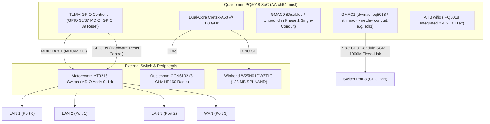
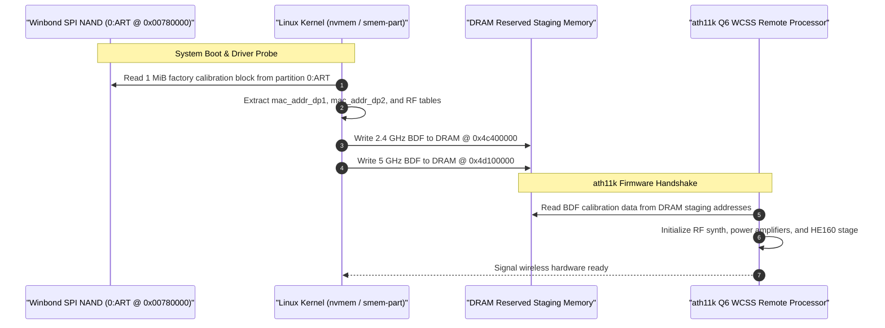

# Architecture Design: Clean DSA Baseline (Linux 6.18 Upstream stmmac)

- **Document ID:** `docs/DSA_BASELINE_DESIGN.md`
- **Project:** `CR8808-CUSTOM-FIRMWARE` (v0.1.0-dev.2)
- **Target Hardware:** Xiaomi CR8808 Ver.B (Codename `CR8818`, Qualcomm IPQ5018 dual-core Cortex-A53 + Motorcomm YT9215S/SC)
- **Target Platform:** OpenWrt Clean DSA Baseline (Linux 6.18, `qualcommax/ipq50xx`, AArch64 userspace)
- **Architecture Lead Decision:** Phase 1 Baseline — Pure Upstream stmmac DSA without NSS
- **Status:** Approved Baseline Architecture Specification
- **Revision:** Round 5 Review (Linux 6.18 Backported Upstream DSA Driver Paths, Logical GMAC Naming, and DT Aliases)

---

## 1. Architectural Motivation & Strict Scope Separation

In accordance with the **Architecture Gate G1 Final Review & Round 5 Consistency Audit**, the initial custom firmware baseline (Phase 1) is strictly defined as a **Linux Distributed Switch Architecture (DSA) operating on Linux 6.18 with Synopsys DesignWare MAC (`stmmac`), using an upstream-derived backport of the Linux 6.19 Motorcomm driver (`drivers/net/dsa/yt921x.c` and `net/dsa/tag_yt921x.c`), completely free of Qualcomm NSS Datapath (`qcom,nss-dp`) and NSS firmware**.

```mermaid
flowchart TD
    subgraph "Phase 1: Clean DSA Baseline (CURRENT GOAL)"
        P1_MAC["Synopsys DesignWare MAC (stmmac / dwmac-ipq5018)"]
        P1_CONDUIT["Single CPU Conduit: GMAC1 (conduit netdev) over SGMII 1000M to Port 8"]
        P1_DSA["DSA Core (net/dsa/) + Motorcomm yt921x.c (backported from 6.19)"]
        P1_PORTS["DSA Slave Netdevs: lan1 (P0), lan2 (P1), lan3 (P2), wan (P3)"]
        P1_OFFLOAD["Linux In-Kernel Software Flowtable (nftables flow_offload)"]
        P1_MEM["Zero NSS Reservation (~182 MB usable RAM for Linux)"]
        P1_MAC --> P1_CONDUIT --> P1_DSA --> P1_PORTS --> P1_OFFLOAD
    end

    subgraph "Phase 2: Qualcomm NSS Datapath (EXPERIMENTAL POST-BASELINE)"
        P2_DP["Qualcomm NSS Datapath (qcom,nss-dp / qca-nss-dp.ko)"]
        P2_CONDUIT["Dual CPU Conduit: dp2 (GMAC1 Port 8 SGMII) + dp1 (GMAC0 Port 4 Internal GE PHY)"]
        P2_TAG["Out-of-Tree Enhanced DSA Tagger (tag_yt921x_enhanced.c)"]
        P2_NSS["Qualcomm NSS NPU Firmware (retail_router0.bin @ 1 GHz)"]
        P2_ECM["Enhanced Connection Manager (qca-nss-ecm.ko)"]
        P2_MEM["8–16 MiB Pinned DRAM Heap (nss_region) + qca-nss-pbuf"]
        P2_DP --> P2_CONDUIT --> P2_TAG --> P2_ECM --> P2_NSS
    end
```



### Key Architectural Rules:
1. **Zero NSS Datapath in Phase 1:** Phase 1 does NOT use `qcom,nss-dp`, does NOT declare `dp1` or `dp2`, does NOT load `qca-nss-drv.ko` or `qca-nss-ecm.ko`, and does NOT allocate the NSS DRAM memory region (`cr881x_nss_region`).
2. **Upstream MAC Ownership & Logical Hardware Naming:** Hardware GMAC1 is owned strictly by the Synopsys DesignWare MAC driver (`dwmac-ipq5018` / `stmmac`). Netdev naming depends on the Device Tree `aliases` node (e.g. `ethernet1 = &gmac1;` yields `eth1`). Architectural specifications reference hardware controllers logically as **GMAC0** and **GMAC1**, and switch interfaces as **Port 4** and **Port 8** to avoid hardcoded interface assumptions.
3. **Isolation of Confounding Variables:** By validating the switch, PHY, wireless subsystem, and userspace software on upstream `stmmac` first, any hardware issues (such as switch reset timing or SerDes negotiation) can be debugged without interference from NSS firmware IPC or NPU ring buffer panics.

---

## 2. Phase 1 Hardware Subsystem Specifications & Single-Conduit Datapath



### 2.1 Authoritative Switch Port Mapping (Phase 1 Baseline)
In Phase 1, the switch ports are mapped as follows:

| Switch Port | Internal PHY | Interface Netdev | Connected Subsystem / Role | Phase 1 Operational Configuration |
|---|---|---|---|---|
| **`port@0`** | `sw_phy0` (addr 0) | `lan1` | Physical LAN Port 1 | Slave netdev bridged into `br-lan` (`phy-mode = "internal"`). |
| **`port@1`** | `sw_phy1` (addr 1) | `lan2` | Physical LAN Port 2 | Slave netdev bridged into `br-lan` (`phy-mode = "internal"`). |
| **`port@2`** | `sw_phy2` (addr 2) | `lan3` | Physical LAN Port 3 | Slave netdev bridged into `br-lan` (`phy-mode = "internal"`). |
| **`port@3`** | `sw_phy3` (addr 3) | `wan` | Physical WAN Port | Slave netdev assigned to WAN firewall zone (`phy-mode = "internal"`). |
| **`port@4`** | `sw_phy4` (addr 4) | N/A | Connected to Internal GE PHY | **Disabled / Unconfigured in Phase 1.** (Reserved for Phase 2 dual-conduit). |
| **`port@8`** | SerDes MAC8 | `eth1` (Conduit Master) | **Sole CPU Conduit (Primary)** | **SGMII fixed-link 1000 Mbps full-duplex** (`phy-mode = "sgmii"`, `speed = <1000>`). Conduit for all 4 user ports. |
| **`port@10`**| N/A | N/A | Internal MCU Channel | Internal switch hardware state and management channel. |

---

### 2.2 Single-Conduit WAN/LAN Traffic Demultiplexing & Tagging

#### How 4 Ports Function Over a Single CPU Conduit:
In pure upstream DSA without secondary conduits:
1. **Master Netdev:** GMAC1 initializes under `stmmac` as master interface `eth1` with SGMII 1000 Mbps link.
2. **DSA Slave Netdev Creation:** The Linux DSA core registers independent virtual network devices: `lan1`, `lan2`, `lan3`, and `wan`.
3. **Egress Path (CPU $
ightarrow$ Switch):**
   - When a packet is transmitted on `wan` or `lan1`, the DSA tagger appends a Motorcomm DSA header containing the destination port index (0, 1, 2, or 3).
   - The master interface (`eth1`) transmits the tagged frame over the SGMII 1000 Mbps link to Port 8.
   - Switch Port 8 strips the DSA tag and forwards the frame to the corresponding physical port.
4. **Ingress Path (Switch $
ightarrow$ CPU):**
   - Packets arriving at physical Port 3 (WAN) or Ports 0–2 (LAN) are tagged by the switch hardware with ingress port metadata.
   - The frame is forwarded across SGMII Port 8 to master netdev `eth1`.
   - The kernel DSA core strips the tag and demultiplexes the packet into the appropriate slave netdev (`wan` or `lanX`).
5. **VLAN & Firewall Isolation:**
   - LAN ports (`lan1-lan3`) are enrolled into Linux bridge `br-lan`.
   - WAN (`wan`) is kept completely unbridged and assigned to firewall zone `wan`.
   - The Linux network stack ensures 100% layer-2 and layer-3 isolation between WAN and LAN.

#### Driver Parser & Property Reality:
- In upstream Linux 6.19+ DSA (and our Linux 6.18 backport: `drivers/net/dsa/yt921x.c` and `net/dsa/tag_yt921x.c`), standard DSA tag operations apply.
- The custom property `motorcomm,secondary-conduit-user-mask = <0x8>` is parsed **ONLY** by `zcop`'s out-of-tree enhanced driver (`tag_yt921x_enhanced.c`). Upstream Linux DSA ignores or rejects this property. Phase 1 relies strictly on standard upstream single-conduit tagging.

---

## 3. Investigation of GPIO 39 Switch Initialization & The "No Ethernet" Bug

### 3.1 Empirical Facts vs. Hypotheses (zcop Issue #5 Analysis)

| Category | Finding / Telemetry | Technical Significance |
|---|---|---|
| **Observed Empirical Fact** | `yt921x 90000.mdio-1:1d: Unexpected chipid 0xffff` | On initial boot with default DTS, the switch MDIO read returns `0xffff`. Driver probe fails; all Ethernet ports are missing; Wi-Fi works. |
| **Observed Empirical Fact** | User Gaojianli exported GPIO 39 (`gpio551`) in userspace, set value to `1` (HIGH), and issued driver rebind: `echo "90000.mdio-1:1d" > /sys/bus/mdio_bus/drivers/yt921x/bind`. | All Ethernet ports immediately came UP and operated normally. However, after software reboot, ports were lost again. |
| **Observed Empirical Fact** | Configuring TLMM `gpio-hog` forced HIGH on GPIO 39 with `reset-gpios` commented out allowed Ethernet to survive initial boot. | Proves GPIO 39 must be maintained HIGH for switch operation. |
| **Technical Hypothesis** | LDO power-rail sequencing / internal PLL clock settling time. | **Do NOT state as fact that GPIO 39 is an "LDO enable" pin** without physical board schematics; DTS explicitly labels it `reset-gpios`. The failure is likely caused by active-low reset assertion timing or power-on delay before MDIO enumeration. |
| **Flawed Proposed Workaround** | Userspace `procd` pre-init GPIO toggle hook. | **INVALID / REJECTED:** Kernel dmesg logs show the driver probe occurs at kernel timestamp ~5.6s, well before userspace `procd` starts. A userspace script cannot retroactively fix a built-in kernel driver probe failure unless module loading order is fundamentally restructured. |

### 3.2 Candidate Solutions for Hardware Validation
During future hardware verification (Phase P5), three specific kernel-level approaches will be evaluated:
1. **Approach 1 (Extended Reset Timing in DTS):** Retain `reset-gpios = <&tlmm 39 GPIO_ACTIVE_LOW>` with extended deassert delay:
   ```dts
   reset-assert-us = <50000>;  /* 50ms */
   reset-deassert-us = <250000>; /* 250ms */
   ```
2. **Approach 2 (TLMM GPIO Hog):** Lock GPIO 39 HIGH at the pinctrl driver level:
   ```dts
   switch_rst_hog: switch_rst_hog {
       gpio-hog;
       gpios = <39 GPIO_ACTIVE_HIGH>;
       output-high;
       line-name = "switch_rst";
   };
   ```
3. **Approach 3 (Out-of-Tree Modular Driver):** Compile `yt921x` as a loadable module (`.ko`), allowing an early userspace script to sequence GPIO 39 before `insmod`.

### 3.3 Mandatory Hardware Reboot Test Protocol (Phase P5)
> [!IMPORTANT]
> **NO live hardware tests will be executed in this phase.** When hardware validation is authorized in Phase P5, the build must pass:
> 1. **Cold Boot Test:** 30s complete power cut $
ightarrow$ boot $
ightarrow$ verify 0 `0xffff` errors in dmesg.
> 2. **Warm Reboot Test:** Issue `reboot` command $
ightarrow$ verify Ethernet links re-establish without power cycle.
> 3. **Reset Button Test:** Pulse physical reset button $
ightarrow$ verify switch recovers cleanly.
> 4. **20-Cycle Automated Reboot Soak Test:** 20 consecutive automated reboot cycles logging dmesg. Passing threshold: **0 failures out of 20 cycles** (100% Ethernet probe success).

---

## 4. Wireless Subsystem: Calibration Dataflow & HE160 Architecture

### 4.1 Calibration Dataflow from NAND Flash to Q6 WCSS Firmware



### 4.2 Silicon Disambiguation: QCN6102 vs. QCN6122
- **DTS Ground Truth:** `ipq5018-cr881x.dts` includes `"ipq5018-qcn6122.dtsi"`, while the node is commented `// QCN6102` with `qcom,board_id = <0x60>;` and firmware `ath11k/QCN6122/hw1.0/m3_fw.mdt`.
- **Silicon Demarcation:** Qualcomm's QCN6102 and QCN6122 belong to the same Pine/Waikiki hardware family. QCN6122 is the dual-band/multi-radio SoC variant, whereas QCN6102 is the dedicated 5 GHz variant deployed on the CR8818 board. Both utilize the identical `ath11k` driver codebase and QCN6122 firmware line.
- **Empirical Validation Rule:** Defining `qcom,bdf-addr = <0x4d100000>` in DTS does NOT prove that extraction from `0:ART` succeeded. Successful loading must be empirically certified by inspecting dmesg for `ath11k_pci ... fw_version ... calibration loaded` during Phase P5.
- **Strict HE160 Mandate:** 5 GHz Wi-Fi 6 HE160 (160 MHz continuous channel width, 2402 Mbps theoretical PHY rate) is a **non-negotiable MUST requirement** and will not be degraded to 80 MHz.

---

## 5. VPN Subsystem: BoringTun Rust Architecture

- **Sole WireGuard Engine:** BoringTun Rust is the **ONLY** WireGuard implementation in target firmware; in-kernel WireGuard (`kmod-wireguard`) is classified as **`NOT_SELECTED`**.
- **Target ABI:** Modern 64-bit **`aarch64-unknown-linux-musl`** (matching Cortex-A53 CPU on OpenWrt `qualcommax/ipq50xx`).
- **Current Evidence Status:** `NOT_BUILD_VERIFIED` (ARMv7 tested in lab; AArch64 compilation scheduled for Phase P4).
- **Target Acceptance Criteria:**
  - Peak resident memory under load: `VmRSS < 15 MB` (`ACCEPTANCE_TARGET`).
  - Sustained throughput: >350 Mbps over encrypted tunnel (`ACCEPTANCE_TARGET`).
  - Handshake latency: <15 ms (`ACCEPTANCE_TARGET`).
  - 24-hour soak test with zero memory leaks or thread crashes (`ACCEPTANCE_TARGET`).
