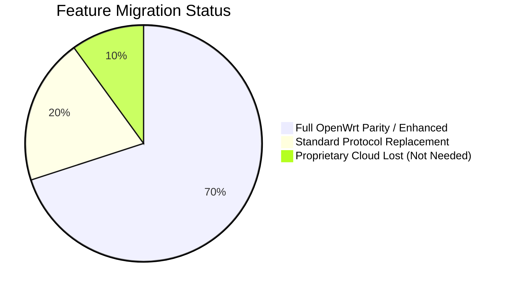

# Feature Parity Matrix: Xiaomi RA82 Stock vs. Custom DSA OpenWrt

- **Document ID:** `docs/FEATURE_PARITY_MATRIX.md`
- **Project:** `CR8808-CUSTOM-FIRMWARE` (v0.1.0-dev.2)
- **Target Hardware:** Xiaomi CR8808 Ver.B (Codename `CR8818`, Qualcomm IPQ5018 + Motorcomm YT9215S/SC)
- **Baseline Firmware:** Xiaomi RA82 Global v1.4.31 (Linux 4.4.60, QSDK)
- **Target Firmware:** OpenWrt / ImmortalWrt Clean DSA Baseline (Linux 6.18, `qualcommax/ipq50xx`)
- **Status:** Architecture Reference Matrix (Pre-P2 Baseline)

---

## 1. Feature Parity Overview

Moving from Xiaomi's customized vendor firmware (RA82 v1.4.31) to an open, modern OpenWrt/DSA platform modernizes the software stack (Linux 4.4.60 → Linux 6.18) and eliminates closed binary blobs. However, proprietary Xiaomi cloud integration will be replaced by open-standard protocols.

---

## 2. Detailed Parity Comparison Table

| Category | Specific Feature | Stock Xiaomi RA82 v1.4.31 | Custom OpenWrt DSA Baseline | Parity Status | Requirement Priority | Technical Notes |
|---|---|---|---|---|---|---|
| **Ethernet & Switching** | 1x WAN + 3x LAN Gigabit | Handled via proprietary `yt_switch.ko` | Upstream Linux DSA (`drivers/net/dsa/yt921x.c`) | **FULL PARITY** | **MUST** | Each port appears as independent netdev (`wan`, `lan1`, `lan2`, `lan3`). |
| | Hardware VLAN Isolation | Software bridging & port tagging | Linux `bridge-vlan` filtering | **SUPERIOR** | **MUST** | Standard Linux 802.1Q switchdev offload. |
| | Link Aggregation / MTU | Fixed 1500 byte MTU | Configurable jumbo frames & bonding | **SUPERIOR** | **COULD** | Handled natively by modern Linux network stack. |
| **Wi-Fi Subsystem** | 5 GHz Wi-Fi 6 HE160 | 2402 Mbps, 160 MHz channel width | Native `ath11k` (QCN6102/6122, 160 MHz) | **FULL PARITY** | **MUST** | Requires ART partition BDF (`qcom,bdf-addr = <0x4d100000>`). |
| | 2.4 GHz Wi-Fi 6 | 574 Mbps, 40 MHz channel width | Native `ath11k_ahb` (IPQ5018 SoC radio) | **FULL PARITY** | **MUST** | Fully supported in Linux 6.18. |
| | WPA3-Personal (SAE) | WPA2/WPA3 Mixed mode supported | `wpad-basic-mbedtls` (WPA2/WPA3 SAE) | **FULL PARITY** | **MUST** | Standards-compliant 802.11ax security. |
| | Fast Roaming (802.11k/v/r) | Xiaomi proprietary steering logic | OpenWrt `usteer` or `dawn` daemon | **FUNCTIONAL EQUIVALENT** | **SHOULD** | Configurable RSSI thresholds and BSS transition management. |
| | Multi-SSID / Guest Wi-Fi | Xiaomi Guest Network isolation | OpenWrt virtual AP (VLAN firewall zone) | **FULL PARITY** | **SHOULD** | Pure network isolation without cloud relay. |
| **Routing & Core IP** | IPv4 Routing & NAT | Linux iptables with QSDK fast-path | Linux `nftables` + `flow_offload` (software) | **FULL PARITY** | **MUST** | Baseline runs full line-rate GbE via software offload. |
| | IPv6 Support | SLAAC, DHCPv6, Stateful / Stateless | `odhcpd` + native Linux IPv6 stack | **SUPERIOR** | **MUST** | Modern IPv6 prefix delegation and firewall rules. |
| | DHCP Server & DNS | `dnsmasq` 2.80 (customized) | `dnsmasq` 2.90+ with DNSSEC support | **SUPERIOR** | **MUST** | Lower memory footprint, modern upstream security patches. |
| | Port Forwarding / UPnP | Xiaomi web UI NAT forwarding | `miniupnpd` + `nftables` redirect | **FULL PARITY** | **SHOULD** | Full manual and dynamic port forwarding. |
| **VPN Subsystem** | WireGuard VPN | **Userspace Go** (`wireguard-go`) | **BoringTun Rust** (userspace TUN) | **SIGNIFICANT UPGRADE** | **MUST** | Go VmSize was 522 MB; Rust provides tight control and modern crypto. |
| | WireGuard Kernel Module | Not present in stock RA82 kernel | In-kernel WireGuard module available | **OPTIONAL PATH** | **COULD** | Can run either kernel WireGuard or BoringTun Rust. |
| **Traffic Control / QoS** | QoS / Bufferbloat Control | Xiaomi proprietary QoS prioritization | CAKE / FQ-CoDel via `sqm-scripts` | **SIGNIFICANT UPGRADE** | **SHOULD** | Eliminates bufferbloat under heavy upload/download load. |
| **Hardware Offload** | Qualcomm NSS Offload | Active in RA82 via QCA-SSDK | Separated into Phase 2 (clean baseline first) | **DEFERRED (Phase 2)** | **COULD** | Baseline relies on clean software offload; NSS tested separately. |
| **Management & Telemetry** | Web Administration UI | Xiaomi proprietary LuCI skin | LuCI (modern Bootstrap / Argon theme) | **FUNCTIONAL EQUIVALENT** | **MUST** | Comprehensive network configuration without cloud tethering. |
| | Mobile App / Cloud Binding | Mi Home App / Xiaomi Cloud account | Removed (Replaced by local VPN / LuCI) | **INTENTIONAL DROP** | **WON'T** | Preserves user privacy; eliminates vendor telemetry. |
| | SSH / Command Line Access | Locked / patched root access | Native OpenSSH / Dropbear with pubkey | **SUPERIOR** | **MUST** | Full root administrative shell out of the box. |
| | System Monitoring | Basic Xiaomi status page | Netdata / LuCI Statistics / Prometheus | **SUPERIOR** | **SHOULD** | Real-time CPU per-core, RAM, and per-port bandwidth telemetry. |
| **Storage & Firmware** | Dual-Boot A/B Layout | U-Boot slot 0/slot 1 switching | Preserved (`rootfs` / `rootfs_1` dual UBI) | **FULL PARITY** | **MUST** | Dual-slot structure retained for safe staging. |
| | Hardware Calibration | Partition `0:art` | Partition `0:art` read-only mount | **FULL PARITY** | **MUST** | RF calibration integrity preserved. |

---

## 3. Parity Acceptance Criteria

1. **Gigabit Line-Rate:** Continuous 940+ Mbps IPv4 TCP throughput between WAN and LAN across physical Ethernet cables without packet loss.
2. **HE160 Wireless Link:** 5 GHz client association at PHY rates of 1.7 Gbps–2.4 Gbps on supported Wi-Fi 6 cards (Intel AX200/AX210), maintaining channel 36–64 continuous transmission.
3. **Rust WireGuard Reliability:** BoringTun maintaining persistent tunnel connection with client handshake time < 15 ms and zero daemon crashes during multi-hour soak testing.
4. **Zero Cloud Tethering:** 100% of administrative and networking operations must function entirely in an offline, air-gapped local environment.
