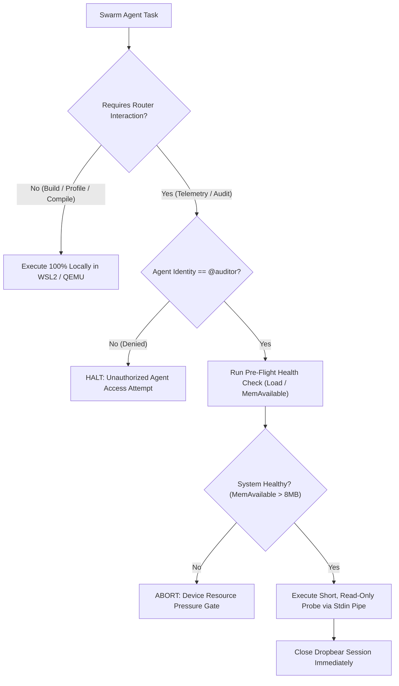

# M12 Router Access Safety Specification: Live Device Operational Protocol

- **Target Hardware:** Xiaomi CR8808 / RA82 (Qualcomm IPQ5018 + QCN6102)
- **Production IP / Management:** `192.168.31.1:56789` (Dropbear SSH)
- **Governing Milestone:** M12 (RA82 Performance & Modernization Program)
- **Document Version:** 1.0.0
- **Applicability:** All Swarm Agents (`@coordinator`, `@auditor`, `@optimizer`, `@wg-rust`, `@firmware-builder`)

---

## 1. Purpose & Scope

The Xiaomi RA82 router functions as the primary live residential gateway for the user's local network, routing real-time traffic for multiple critical end-user devices (workstations, mobile devices, IoT equipment). Because the router operates in active production with limited hardware resources (256 MB RAM total, of which only ~10–15 MB is free unreserved Linux memory), uncoordinated or heavy remote operations risk causing service disruption, buffer starvation, or unintended reboots.

This document establishes the mandatory operational boundaries, technical controls, and safety protocols governing all live hardware interactions. Compliance with this specification is strictly enforced across all automated agents and human operators.

---

## 2. Core Operational Safety Rules



### Rule 1: Single Authorized Agent Policy
- **Sole Agent Authorization:** Only the designated Performance & Systems Auditor (`@auditor`) is permitted to initiate network connections or SSH sessions to the router (`192.168.31.1:56789`).
- **All Other Agents Restricted:** `@optimizer`, `@wg-rust`, `@firmware-builder`, and sub-workers must execute exclusively in local developer workspaces, mock network namespaces (`ip netns`), or QEMU emulators.
- No agent may share or delegate SSH execution credentials to another agent.

### Rule 2: 100% Read-Only Execution Protocol
- **Zero Remote File Creation:** Under no circumstances may an agent create, touch, append, or modify files on the target device's filesystem (including `/tmp`, `/data`, `/etc`, or `/var`).
- **Stdin Pipe Only:** All diagnostic queries must be transmitted directly via stdin pipe:
  ```bash
  ssh -p 56789 -o StrictHostKeyChecking=no root@192.168.31.1 "sh -s" < diagnostic_script.sh
  ```
- **Zero State Modification:** Modifying NVRAM (`nvram set`), editing UCI configuration (`uci set`, `uci commit`), writing to kernel parameters (`sysctl -w`), or altering iptables rules on the live production router is strictly forbidden during audit operations.

### Rule 3: Session Lifecycle & Concurrency Cap
- **Concurrency Limit:** Strictly **one (1)** active SSH connection at any given time.
- **Zero Background Loops / Long-Running Daemons:** No script may spawn persistent background watchers, endless polling loops (`while true; do ... sleep 1; done`), or continuous telemetry streams on the remote router.
- **Bounded Invocations:** Every probe must execute sequentially and terminate within $\le 10$ seconds.
- **Strict Socket Timeouts:** All SSH commands must enforce explicit socket keepalive and timeout limits:
  ```bash
  -o ConnectTimeout=5 -o ServerAliveInterval=3 -o ServerAliveCountMax=2
  ```

### Rule 4: Device Health Pre-Flight Gate
Before executing any performance profiling or telemetry sampling, `@auditor` must verify the device's operational stability:
1. `MemAvailable` must exceed **8.0 MB**.
2. System 1-minute load average must be below **1.50**.
3. If memory pressure or elevated load is detected, operations must immediately halt to prevent triggering kernel page allocation failures or out-of-memory states.

### Rule 5: Immediate Halt on Device Sluggishness
If any probe experiences:
- SSH connection latency exceeding 3,000 ms,
- Packet loss to `192.168.31.1`, or
- Unresponsive command execution,
the agent must **instantly abort all active requests**, refrain from retrying in a tight loop, and report the condition to `@coordinator`.

---

## 3. Allowed vs. Prohibited Command Matrix

| Category | Allowed Commands (Whitelisted) | Prohibited Actions (Strictly Forbidden) |
| :--- | :--- | :--- |
| **System Info** | `uname -a`, `cat /proc/version`, `uptime`, `cat /proc/uptime`, `cat /proc/loadavg` | `reboot`, `poweroff`, `sysupgrade`, `init 0` |
| **Memory / CPU** | `cat /proc/meminfo`, `cat /proc/slabinfo`, `cat /proc/stat`, `cat /proc/interrupts`, `cat /proc/softirqs` | Allocating memory buffers, stress testing, spawning resource-heavy processes |
| **Storage / Flash** | `df -h`, `cat /proc/mtd`, `ls -la /data` | `rm`, `mv`, `touch`, `cp`, `dd of=/dev/mtd*`, `flash_erase`, `mkfs` |
| **Network & Wireless**| `ip addr`, `ip route`, `ip -s link`, `iw dev`, `cat /tmp/dhcp.leases`, `ethtool -S` | `ifconfig ... down`, `ip link set ...`, `uci commit wireless`, modifying `hostapd.conf` |
| **Configuration** | `nvram get <var>`, `uci show <config>`, `cat /etc/config/*` | `nvram set`, `nvram commit`, `uci set`, `uci add`, editing files in `/etc/` |
| **Processes** | `ps w`, `top -b -n 1`, `netstat -tnp` | `kill`, `killall`, `pkill`, renicing critical kernel threads |

---

## 4. Handling Volatile Dropbear Host Keys

On stock Xiaomi QSDK firmware for the CR8808 / RA82:
- Dropbear RSA/DSS host keys reside in RAM-backed volatile storage (`/tmp/dropbear/`) and are regenerated during system reboots.
- Standard SSH clients will alert on changed host keys (`WARNING: REMOTE HOST IDENTIFICATION HAS CHANGED!`).

### Standardized Execution Pattern for `@auditor`:
To ensure non-interactive, automated diagnostic tools do not stall on host key prompts while maintaining safety:
```bash
ssh -p 56789 \
    -o StrictHostKeyChecking=no \
    -o UserKnownHostsFile=/dev/null \
    -o LogLevel=ERROR \
    -o ConnectTimeout=5 \
    root@192.168.31.1 "sh -s" << 'EOF'
# Read-only audit commands
uptime
free
EOF
```
*Note: This configuration prevents prompt blocking while ensuring zero local or remote state pollution.*

---

## 5. Development Isolation & Testbed Air-Gap

To ensure that modernization efforts (such as BoringTun WireGuard and network tuning profiles) can be developed rapidly without endangering production stability:

1. **PC-Side Network Namespaces (`ip netns`):**
   - All network optimization profiles developed by `@optimizer` must be tested in simulated dual-namespace Linux environments in WSL2 (`ns_test_client` <-> `veth0/veth1` <-> `ns_test_server`).
2. **PC-Side WireGuard Verification:**
   - All BoringTun Rust builds and ABI checks performed by `@wg-rust` must be verified using local QEMU user-mode emulation and virtual tunnel interfaces before any consideration for physical hardware deployment.
3. **Workspace Boundary:**
   - The workspace directory `D:\vibecode\test_wifi` is strictly isolated and must remain 100% untouched.

---

## 6. Incident Response & Escalation Protocol

If an unexpected behavior, network drop, or router reboot occurs:
1. **Immediate Freeze:** Stop all automated scripts and background tasks across all agents.
2. **Forensic Collection (Read-Only):**
   - `@auditor` queries system uptime, crash log partitions (`mtd16`/`mtd17`), and recent boot messages via stdin.
   - PC-side logs (Windows Event Log, WSL logs) must be analyzed for client-side factors (e.g. socket exhaustion).
3. **Root Cause Analysis Documentation:**
   - An empirical RCA report must be drafted in `reports/` following the format demonstrated in [`reports/M12_NETWORK_OUTAGE_RCA.md`](file:///D:/vibecode/CR8808-CUSTOM-FIRMWARE/reports/M12_NETWORK_OUTAGE_RCA.md).
4. **Coordinator Notification:** Post findings to the swarm message board tagging `@coordinator` with evidence-backed classifications.

---

## 7. Approval & Revision History

| Version | Date | Author | Summary of Changes |
| :--- | :--- | :--- | :--- |
| **1.0.0** | 2026-11-12 | Performance & Systems Auditor (`@auditor`) | Initial release following P0 Outage Incident Investigation. |
