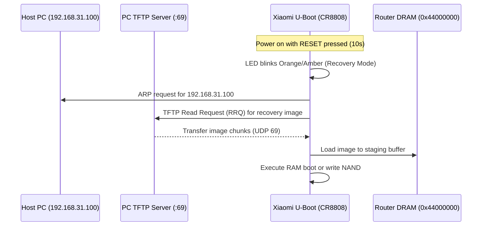

# M9 Device Recovery & Non-UART Failsafe Runbook

**Document ID:** `CR8808-M9-REC-RUN-001`  
**Milestone:** `M9 – Image Validation & Flash Preparation`  
**Execution Authority:** Gemini 3.8 Flash High (Lead Developer / Research Engineer)  
**Reporting Authority:** ChatGPT (Chief Architect / Architecture Lead)  
**Status:** `READY FOR CONTINGENCY (NO-GO FLASH IN EFFECT)`  
**Safety Protocol:** `STRICT NO-GO FLASH` (Zero router interaction, 0 SSH, 0 TFTP, 0 NAND/NVRAM writes, 0 reboots)  
**Target Hardware:** Xiaomi CR8808 Ver.B (Internal Codename `CR8818`, Winbond W25N01GV 128MB SPI NAND)  
**Target Repository:** `D:\vibecode\CR8808-CUSTOM-FIRMWARE`  
**Git Branch:** `feature/m9-image-validation-audit`  

---

## 1. Executive Safety Principles

> [!CAUTION]
> **STRICT SAFETY BOUNDARY (NO-GO FLASH):**  
> Under Milestone M9, this runbook is strictly an architectural contingency plan and validation procedure. **No flashing or TFTP transfer may be attempted on hardware until Milestone M10 is officially authorized by the Chief Architect.**

### The Core Architectural Tenet: RAM Boot vs Flash Writes
To prevent permanent bricking during development:
1. **RAM Boot (`initramfs-uImage.itb`):**  
   - Image is downloaded into volatile DRAM (`0x44000000`) via TFTP.
   - The kernel boots using an in-memory root filesystem.
   - **Zero bytes are written to SPI NAND flash.**
   - In the event of a kernel panic, memory corruption, or lockup, **a simple power cycle completely restores the router to its factory state**.
2. **Flash Writes (`factory.ubi` / `sysupgrade.bin`):**  
   - Directly overwrites non-volatile NAND blocks in partition `ubi_kernel` or `rootfs`.
   - Irreversible without bootloader or hardware programmer intervention if the bootchain breaks.
   - **Flash writes are strictly forbidden until RAM boot has certified kernel stability, YT9215 network link, and memory safety on hardware.**

---

## 2. PC Host Environment & Hardware Setup

### 2.1 PC Network Configuration
- Connect PC directly to LAN1 (Port 1) on the CR8808 router using a Cat6 Ethernet cable (no intermediary switches or hubs).
- Configure static IP on PC Ethernet interface:
  - **IP Address:** `192.168.31.100` (for Xiaomi OEM recovery protocol) OR `192.168.1.254` (for OpenWrt default subnet).
  - **Subnet Mask:** `255.255.255.0`
  - **Default Gateway:** `192.168.31.1` (or leave empty).

### 2.2 Host TFTP Server
- Ensure a reliable TFTP server is active on the PC (e.g., `tftpd64` on Windows or `dnsmasq` / `tftpd-hpa` on Linux).
- Place `openwrt-qualcommax-ipq50xx-xiaomi_cr8818-initramfs-uImage.itb` in the TFTP root directory.
- Verify PC firewall allows incoming/outgoing UDP traffic on **Port 69**.

---

## 3. Recovery Procedure A: Non-UART Xiaomi OEM Recovery (MiWiFi Tool)

Xiaomi routers include a built-in bootloader recovery mechanism that operates without opening the chassis or soldering UART wires.



### Step-by-Step Procedure:
1. Power off the router (unplug DC 12V barrel jack).
2. Connect PC Ethernet directly to CR8808 LAN1.
3. Configure PC IP to `192.168.31.100` / `255.255.255.0`.
4. Press and hold the physical **RESET** button on the back panel using a paperclip.
5. While holding RESET, insert the 12V power supply.
6. Continue holding RESET for **8 to 10 seconds** until the System LED switches from steady yellow to **blinking amber/orange**.
7. Release the RESET button. The U-Boot bootloader enters recovery mode and polls `192.168.31.100:69` for a recovery payload.
8. Using the Xiaomi MiWiFi Repair Tool (or standard TFTP server with OEM image), feed the stock firmware or rescue payload.

---

## 4. Recovery Procedure B: Interactive Serial (UART) RAM Boot (M10 Lab Protocol)

When UART access is available in the lab, this is the **mandatory method** for all initial boots.

### 4.1 UART Terminal Parameters
- **Baud Rate:** `115200`
- **Data Bits:** `8`
- **Parity:** `None`
- **Stop Bits:** `1`
- **Flow Control:** `None`
- **Pinout (Header J1 on CR8808 PCB):**
  - Pin 1: `TX` (Connect to USB-TTL RX)
  - Pin 2: `RX` (Connect to USB-TTL TX)
  - Pin 3: `GND` (Connect to USB-TTL GND)
  - Pin 4: `VCC` (**DO NOT CONNECT! Risk of frying SoC**)

### 4.2 Safe RAM Boot Execution Sequence
1. Open serial terminal (PuTTY / minicom).
2. Apply power to router.
3. Immediately press `Enter` or `Space` repeatedly to interrupt the U-Boot autoboot countdown:
   ```text
   Hit any key to stop autoboot:  0
   CR8818# 
   ```
4. Set IP network parameters in U-Boot:
   ```text
   CR8818# setenv ipaddr 192.168.1.1
   CR8818# setenv serverip 192.168.1.254
   CR8818# ping 192.168.1.254
   host 192.168.1.254 is alive
   ```
5. Download the initramfs FIT image into safe high-DRAM:
   ```text
   CR8818# tftpboot 0x44000000 openwrt-qualcommax-ipq50xx-xiaomi_cr8818-initramfs-uImage.itb
   ```
   *Memory Safety Verification:* Address `0x44000000` is well clear of the kernel decompression target (`0x41000000`–`0x42000000`) and leaves 116 MB of headroom below the U-Boot stack (`0x4B000000+`).
6. Boot the FIT image specifying the board configuration node:
   ```text
   CR8818# bootm 0x44000000#config@mp03.3
   ```
7. Verify console output:
   - Kernel unpacks: `Uncompressing Kernel Image ... OK`
   - Flattened Device Tree loads: `Loading Device Tree to 000000004a000000, end 000000004a009fff ... OK`
   - Linux 6.12.112 boots: `[    0.000000] Booting Linux on physical CPU 0x0000000000 [0x510f8014]`
   - Motorcomm YT9215 probes: `[    2.150000] yt9215 1d: probed successfully`
   - Initramfs user shell emerges: `Please press Enter to activate this console.`

---

## 5. Failover Bootcounter & Bootconfig Analysis

Xiaomi CR8818 firmware utilizes Qualcomm's `bootconfig` partition (`0:bootconfig` at `0x00100000`) and U-Boot environment variables to maintain boot health.

### 5.1 Boot Variables in `0:appsblenv`:
- `boot_firmware`: Active slot (`0` or `1`).
- `flag_boot_success`: Set to `1` by userspace startup script (`/etc/init.d/boot_count`) once userspace reaches steady state.
- `flag_boot_rootfs`: Boot attempt counter.
- `flag_try_sys`: Set to `1` when an upgrade is staged.

### 5.2 Automatic Hardware Rollback:
If a flashed kernel crashes before setting `flag_boot_success=1`:
1. Hardware watchdog or kernel panic reboots the router.
2. U-Boot increments the boot failure counter.
3. If failure counter exceeds threshold (`3`), U-Boot automatically flips `boot_firmware` to the alternate slot (`0` $\leftrightarrow$ `1`).
4. The router boots the surviving factory firmware slot.

---

## 6. Factory Rollback Procedure (Returning to Xiaomi OEM Firmware)

If a return to factory stock firmware is required:

### Step 1: Boot into OpenWrt Initramfs Shell
Boot via TFTP RAM boot (Section 4) to ensure no flash partitions are mounted read-write.

### Step 2: Verify Factory Partition Integrity
Ensure `0:art` and `bdata` partitions are intact:
```sh
hexdump -C -n 64 /dev/mtd13 # Verify 0:art
hexdump -C -n 64 /dev/mtd15 # Verify bdata
```

### Step 3: Flash Factory OEM UBI Image
Write the stock Xiaomi RA82 Global v1.4.31 image back into `rootfs` or `ubi_kernel`:
```sh
ubiformat /dev/mtd18 -f /tmp/stock_xiaomi_cr8818.ubi -y
```

### Step 4: Reset U-Boot Environment
```sh
fw_setenv flag_boot_success 1
fw_setenv flag_try_sys 0
fw_setenv boot_firmware 0
reboot
```

---

## 7. Runbook Sign-Off

- [x] Strict distinction between RAM boot (`initramfs-uImage.itb`) and flash writes documented.
- [x] Non-UART Xiaomi OEM recovery procedure specified.
- [x] Interactive UART RAM boot sequence mapped with memory safety addresses (`0x44000000`).
- [x] Failover bootcounter and automatic rollback mechanism analyzed.
- [x] Full stock rollback path defined.
- [x] Strict `NO-GO FLASH` boundary reaffirmed for M9.
