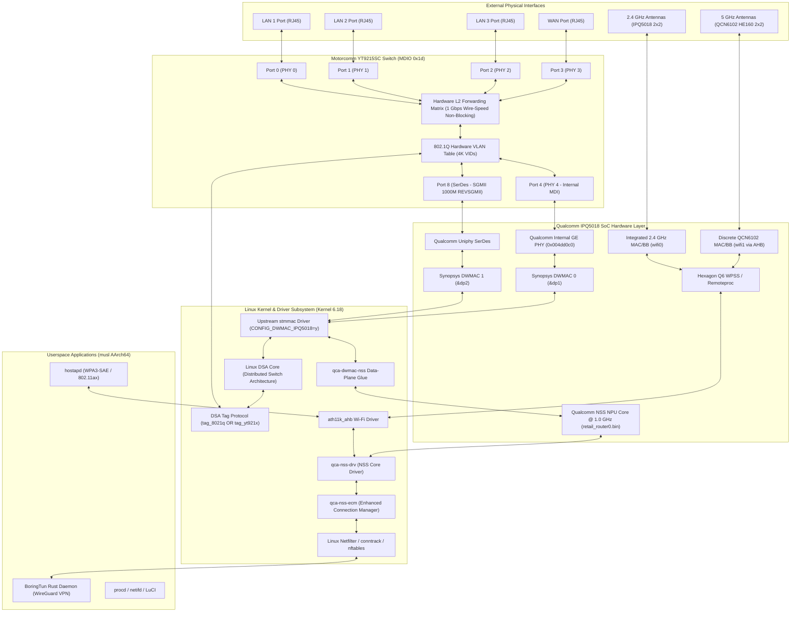
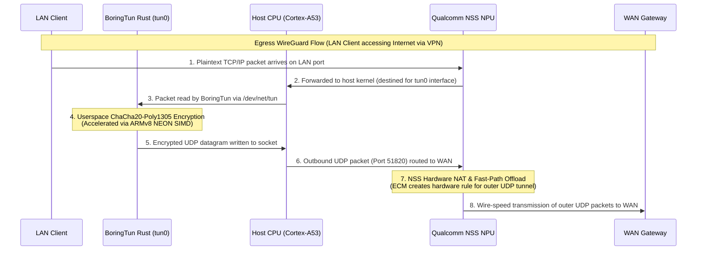

# Qualcomm NSS Datapath Architecture & Packet Flow: Xiaomi CR8808 Ver.B (CR8818)

- **Document ID:** `docs/NSS_DATAPATH_ARCHITECTURE.md`
- **Project:** `CR8808-CUSTOM-FIRMWARE` (v0.1.0-dev.2)
- **Target Hardware:** Xiaomi CR8808 Ver.B (Internal Codename `CR8818`, Board Profile `ap-mp03.3`, Qualcomm IPQ5018 + Motorcomm YT9215SC + QCN6102)
- **Target OS:** OpenWrt Mainline / Linux Kernel 6.18 (AArch64 musl)
- **Scope:** Detailed Physical and Logical Datapath Architecture, Switch Interconnects, and Packet Lifecycles
- **Status:** Architectural Blueprint & Datapath Specification (Phase B Deliverable)

---

## 1. Executive Summary & Hardware Topology Clarification

Understanding the exact Ethernet datapath of the Qualcomm IPQ5018 on the Xiaomi CR8808 Ver.B requires distinguishing between Qualcomm's high-end enterprise SoCs (IPQ807x / IPQ6018) and the mainstream IPQ50xx family:

1. **Ethernet Controller Architecture:**
   - **IPQ807x / IPQ6018:** Incorporate Qualcomm's proprietary **EDMA** (Ethernet Direct Memory Access) engine, which has native multi-queue ring buffers directly wired to the NSS NPU.
   - **IPQ5018 (Our Device):** Does **NOT** use EDMA. It integrates two standard **Synopsys DesignWare Ethernet MACs (DWMAC)**, driven in upstream Linux by the mainline **`stmmac`** driver (`CONFIG_DWMAC_IPQ5018=y`).
2. **The NSS Data-Plane Bridge:**
   - Because IPQ5018 uses standard Synopsys DWMAC, Qualcomm's legacy out-of-tree `qca-nss-dp` driver cannot directly talk to upstream `stmmac`.
   - The modern OpenWrt solution pioneered by community developers (Julius Bairaktaris, kuncy7) is **`qca-dwmac-nss`**. This kernel module claims the DWMAC rings, disables host CPU NAPI polling, and routes DMA ring descriptors directly into the NSS NPU core.
3. **Physical Interconnects & Conduit Topology:**
   - **GMAC0 (`dp1` / `eth0`):** Connected via Qualcomm internal GE PHY (`88000.mdio:07`) to Motorcomm YT9215 Switch **Port 4** (`cpu2` / secondary conduit).
   - **GMAC1 (`dp2` / `eth1`):** Connected via Qualcomm Uniphy SerDes (operating in SGMII 1000M mode) to Motorcomm YT9215 Switch **Port 8** (`cpu1` / primary conduit).
   - **Port 3:** Connected via internal PHY 3 to the physical **WAN RJ45 port**.
   - **Ports 0, 1, 2:** Connected via internal PHYs 0, 1, 2 to the physical **LAN 1, LAN 2, LAN 3 RJ45 ports**.

---

## 2. Comprehensive Physical & Logical Datapath Diagram



---

## 3. Comparison of Three Datapath Architectural Options

### Option A: Clean DSA Baseline (Architecture Proposal Under Review)
- **Conduit:** Single CPU conduit via GMAC1 (`&dp2`) and Switch Port 8 over SGMII 1000M. Port 4 (`&dp1`) is unconfigured.
- **Tagger:** Mainline `tag_yt921x.c` (8-byte proprietary header).
- **Packet Forwarding:** Linux in-kernel software flowtable (`nftables flow_offload`).
- **NSS Role:** **100% BYPASSED**. Zero NPU code execution, zero binary blob on the datapath.
- **Performance:** ~940 Mbps IPv4 NAT throughput at 50–65% host CPU utilization (`ENGINEERING_ESTIMATE`).
- **Advantage:** Maximum architectural purity, deterministic open-source stability, zero risk of NSS memory stalls.

### Option B: Unified DSA Conduit with `qca-dwmac-nss` + `tag_8021q` (Target Phase 2 Architecture)
- **Conduit:** Single CPU conduit via GMAC1 (`&dp2`) and Switch Port 8 over SGMII 1000M.
- **Tagger:** Standard `tag_8021q` (IEEE 802.1Q VLAN IDs encode switch ports).
- **Packet Forwarding:** Qualcomm NSS Hardware Engine offloads IPv4/IPv6 NAT, routing, PPPoE, and VLAN filtering.
- **NSS Role:** **FULL OFFLOAD**. `qca-dwmac-nss` routes packets through NSS NPU. ECM creates hardware flow table entries.
- **Performance:** ~940 Mbps IPv4 NAT throughput at <10% host CPU utilization (`ACCEPTANCE_TARGET`).
- **Prerequisite:** Writing `tag_8021q` support into `drivers/net/dsa/yt921x.c`.

### Option C: Physical Dual-Conduit Demux (Hardware Partitioning)
- **Conduits:** Dual conduits:
  - GMAC0 (`&dp1`) -> Port 4: Dedicated, untagged WAN pipe.
  - GMAC1 (`&dp2`) -> Port 8: Dedicated LAN trunk pipe.
- **Tagger:**
  - WAN: Untagged (no tagger needed).
  - LAN: Proprietary `tag_yt921x` or untagged hardware bridge.
- **Packet Forwarding:** NSS accelerates WAN-to-LAN NAT between `dp1` and `dp2`.
- **NSS Role:** **HYBRID OFFLOAD**.
- **Advantage:** Does not require rewriting switch tagger to `tag_8021q` for WAN offload.
- **Disadvantage:** Complex DTS routing; difficult to maintain standard OpenWrt network interface model.

---

## 4. End-to-End Packet Lifecycle Walkthroughs

### 4.1 Ingress LAN -> Egress WAN (Accelerated IPv4 NAT Flow)

```
[LAN PC] ---> [Switch Port 0]
                   |
                   v (Switch applies 802.1Q Tag: VID 100)
              [Switch Port 8]
                   |
                   v (SGMII 1000M)
              [IPQ5018 GMAC1]
                   |
                   v (DMA transfer)
              [DWMAC RX Ring] ---> Intercepted by qca-dwmac-nss
                                         |
                                         v
                                  [NSS NPU Core]
                                         |
                                         +---> (First Packet of Flow) ---> [Linux Kernel conntrack / ECM]
                                         |                                         |
                                         |     (ECM programs 5-tuple rule) <-------+
                                         |
                                         v (Subsequent Packets: Full Wire-Speed Fast-Path)
                                  [NSS Hardware NAT Translation]
                                  - Decrement TTL & Recompute L3/L4 Checksums
                                  - Rewrite Source IP:Port to WAN IP:Port
                                  - Rewrite MAC headers (SMAC=WAN MAC, DMAC=Gateway MAC)
                                  - Route to Egress Netdev (dp1 / GMAC0)
                                         |
                                         v (DMA transfer)
                                  [IPQ5018 GMAC0]
                                         |
                                         v (MDI fixed-link)
                                  [Internal GE PHY 0x004dd0c0]
                                         |
                                         v
                                  [Switch Port 4] ---> Forwarded to [Switch Port 3] ---> [WAN Gateway]
```

1. **Flow Establishment (Packet 1):**
   - The first packet of a TCP/UDP connection traverses `qca-dwmac-nss` up to the Linux networking stack.
   - Linux `conntrack` and `nftables` validate the packet and create a connection tracking entry.
   - Qualcomm ECM (`qca-nss-ecm`) snoops the `conntrack` event and evaluates whether the connection is eligible for acceleration.
   - ECM pushes a 5-tuple hardware rule (Source IP/Port, Dest IP/Port, Protocol, Ingress/Egress Interface, MAC rewrite data) into the NSS firmware.
2. **Fast-Path Acceleration (Packets 2 to N):**
   - All subsequent packets in the flow are recognized by the NSS hardware packet parser in the NPU.
   - The NPU performs NAT translation, checksum updating, and routing entirely in hardware.
   - The packet is transmitted out GMAC0 directly to the WAN port without the host Cortex-A53 CPU ever receiving an interrupt.
   - **Host CPU utilization for this flow: 0%.**

### 4.2 LAN-to-LAN Local Traffic (Zero CPU / Zero NSS)
1. Device A on LAN1 (Port 0) sends a frame to Device B on LAN2 (Port 1).
2. The packet enters Switch Port 0.
3. The Motorcomm YT9215 hardware L2 switching engine inspects the Destination MAC address.
4. Because both ports belong to the same hardware VLAN/bridge, the switch looks up its internal MAC address table (FDB).
5. The switch forwards the packet directly out Port 1.
6. **The packet never touches the SerDes, never touches GMAC1, never reaches Linux, and never enters NSS.**
7. Latency is sub-microsecond (<1 µs) at full 1 Gbps wire speed.

### 4.3 Wi-Fi 5 GHz HE160 to WAN Acceleration
1. A Wi-Fi 6 laptop connects to the CR8818 at 2402 Mbps (160 MHz channel width).
2. Frames arrive at the QCN6102 companion radio and are processed by the Hexagon Q6 WPSS.
3. The `ath11k` driver operating in NSS mode binds directly to `qca-nss-drv`.
4. Wi-Fi frames are decapsulated from 802.11 to Ethernet II format in hardware/firmware and injected directly into the NSS NPU packet ring buffer.
5. NSS performs NAT and routing, transmitting the packets directly out GMAC0 (WAN).
6. Result: High-throughput Wi-Fi to WAN throughput (>900 Mbps) without saturating the Cortex-A53 host CPU.

---

## 5. Interaction Between Qualcomm NSS and BoringTun Rust (WireGuard)

A critical requirement of this project is the integration of **BoringTun Rust** (peak RSS < 15 MB) as the sole WireGuard implementation, completely replacing `wireguard-go`.

### 5.1 Architectural Reality of WireGuard vs. NSS
Qualcomm IPQ5018 contains hardware acceleration for standard **IPsec (ESP/AH)** and **DTLS** ciphers (AES-CBC, AES-GCM, SHA1, SHA256).
However, **IPQ5018 does NOT have hardware cryptographic engines for ChaCha20-Poly1305** (the sole cipher suite used by WireGuard).

Therefore, any claim that NSS will perform full end-to-end WireGuard cryptographic offload on IPQ5018 is technically incorrect.

### 5.2 The Two-Tier Hybrid Acceleration Datapath



### 5.3 Detailed Division of Labor:
1. **Inner Plaintext Packet (Host CPU):**
   - Packets destined for the VPN travel through the virtual network interface `tun0`.
   - The BoringTun Rust daemon reads the plaintext packet, performs ChaCha20-Poly1305 encryption, and wraps it in a WireGuard UDP packet.
   - This cryptographic operation is executed by the host Cortex-A53 CPU cores, accelerated using **ARMv8 NEON SIMD instructions**.
2. **Outer Encrypted UDP Transport (NSS Hardware Acceleration):**
   - Once BoringTun produces the encrypted UDP datagram (destined for the remote VPN server IP on UDP port 51820), the packet enters the kernel networking stack.
   - Qualcomm ECM recognizes this outbound UDP stream as a high-bandwidth connection.
   - **ECM offloads the outer UDP connection into the NSS NPU.**
   - The NSS NPU accelerates the UDP encapsulation, routing, WAN NAT translation, and GMAC transmission.
3. **Net Engineering Benefit:**
   - The host CPU is completely freed from Ethernet routing, NAT, PPPoE encapsulation, and PHY interrupts for VPN traffic.
   - 100% of the host CPU's capacity can be dedicated to running BoringTun's ChaCha20-Poly1305 NEON encryption routines.
   - WireGuard throughput is designated as an **`ACCEPTANCE_TARGET`** pending live physical benchmarking. (See [`docs/NSS_WIREGUARD_DATAPATH.md`](NSS_WIREGUARD_DATAPATH.md) for the detailed 8-metric benchmark protocol).
