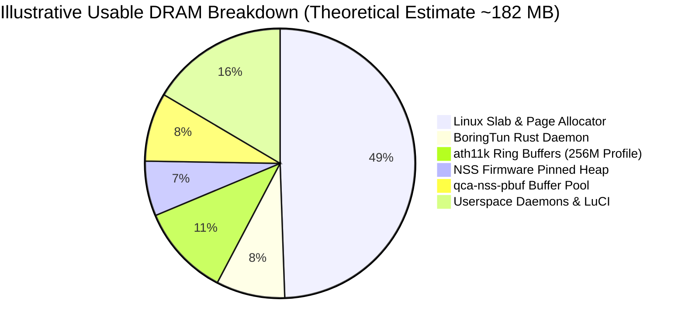

# Architecture Design: Qualcomm NSS Offload Integration & Comparative Evaluation

- **Document ID:** `docs/NSS_INTEGRATION_DESIGN.md`
- **Project:** `CR8808-CUSTOM-FIRMWARE` (v0.1.0-dev.2)
- **Target Hardware:** Xiaomi CR8808 Ver.B (Codename `CR8818`, Qualcomm IPQ5018 dual-core Cortex-A53 + NPU @ 1.0 GHz + Motorcomm YT9215)
- **Architecture Lead Decision:** Experimental Optimization Stage (Strictly Post-DSA Baseline Phase 2)
- **Status:** Architectural Blueprint & 3-Way Comparative Evaluation
- **Revision:** Round 5.1 Review (Objective Categorization of Kuncy7, Re-Evaluation of zcop NSS-DP Evidence, and NSS 12.5 256MB Wi-Fi Buffer Stall Risk)

---

## 1. Executive Summary & Engineering Scope

Qualcomm Network Subsystem (NSS) is a dedicated 1.0 GHz hardware network processing unit (NPU) integrated into the IPQ5018 SoC designed to offload packet processing (IPv4/IPv6 routing, NAT, PPPoE, VLAN, and QoS) from the host Cortex-A53 CPU cores.

In accordance with the **Architecture Gate G1 Final Review**, NSS integration is classified as an **experimental post-baseline Phase 2 deliverable**. It will be analyzed and tested only after the clean Phase 1 DSA baseline is proven 100% stable, boot-verified, function-verified, and soak-tested on physical hardware.

---

## 2. 3-Way Architecture Evaluation: Clean DSA vs. Kuncy7 vs. zcop Dual-Conduit

To make an informed architectural decision, three distinct approaches to networking on Qualcomm IPQ50xx hardware have been investigated:

```mermaid
flowchart TD
    subgraph "Arch A: Clean DSA Baseline (Phase 1 Proposal Under Review)"
        A_MAC["Upstream stmmac (dwmac-ipq5018)"]
        A_COND["Single CPU Conduit: GMAC1 / Port 8 (SGMII 1000M)"]
        A_TAG["Upstream-Derived DSA Tagger (tag_yt921x.c)"]
        A_ROUTE["Linux In-Kernel Software Flowtable (nftables)"]
        A_MEM["Zero NSS Reservation (~182 MB usable RAM)"]
        A_MAC --> A_COND --> A_TAG --> A_ROUTE
    end

    subgraph "Arch B: Kuncy7 stmmac + qca-dwmac-nss (tag_8021q Tagger)"
        B_MAC["Upstream stmmac with NSS Hook Patch"]
        B_HOOK["kmod-qca-dwmac-nss (Data-Plane Claim API)"]
        B_TAG["DSA tag_8021q (qca-8021q / rtl8365mb / an8855)"]
        B_NSS["NSS Firmware 12.5 (Parses 802.1Q tags ONLY)"]
        B_FAIL["STATUS: Currently Incompatible (tag_yt921x requires translation layer)"]
        B_MAC --> B_HOOK --> B_TAG --> B_NSS -.-> B_FAIL
    end

    subgraph "Arch C: zcop NSS-DP Dual-Conduit (Phase 2 Experimental Candidate)"
        C_DP["Qualcomm NSS Datapath (qcom,nss-dp / qca-nss-dp.ko)"]
        C_COND["Dual CPU Conduit: dp1 (Port 4 Internal PHY) + dp2 (Port 8 SGMII)"]
        C_TAG["Out-of-Tree Enhanced DSA Tagger (tag_yt921x_enhanced.c)"]
        C_ECM["Enhanced Connection Manager (qca-nss-ecm.ko)"]
        C_MEM["8–16 MiB Pinned DRAM (nss_region) + qca-nss-pbuf"]
        C_DP --> C_COND --> C_TAG --> C_ECM
    end
```



### 2.1 Comparative Architecture Decision Matrix

| Evaluation Dimension | Architecture A: Clean DSA Baseline (Phase 1 Baseline) | Architecture B: Kuncy7 `stmmac` + `qca-dwmac-nss` (`tag_8021q`) | Architecture C: `zcop` Qualcomm `qcom,nss-dp` Dual-Conduit (Phase 2 Candidate) |
|---|---|---|---|
| **Primary Philosophy** | 100% open-source maintainability, deterministic stability, zero blob dependencies. | Hybrid: upstream `stmmac` MAC driver coupled with out-of-tree NSS data plane. | Full vendor hardware acceleration using Qualcomm NSS-DP and NSS ECM. |
| **Ethernet MAC Driver** | Upstream `dwmac-ipq5018` / `stmmac` (`CONFIG_DWMAC_IPQ5018=y`). | Upstream `stmmac` patched with data-plane claim API (`kmod-qca-dwmac-nss`). | Qualcomm proprietary `qcom,nss-dp` (`qca-nss-dp.ko`). |
| **Switch DSA Driver** | Backported upstream `drivers/net/dsa/yt921x.c`. | Standard DSA driver with `tag_8021q` conduit tagging. | Out-of-tree Motorcomm switch driver with dual-conduit support. |
| **DSA Tag Protocol** | `tag_yt921x.c` (Upstream single-conduit tagger). | `tag_8021q` (`qca-8021q`, `rtl8365mb-8021q`, `an8855-8021q`). | `tag_yt921x_enhanced.c` (Parses `secondary-conduit-user-mask = <0x8>`). |
| **NSS Tag Parsing Compatibility** | N/A (No NSS used). | **CURRENTLY_INCOMPATIBLE:** NSS firmware 12.5 only parses 802.1Q tags; tag_yt921x requires an unwritten translation shim or unverified 802.1Q switch mode. | **THEORETICALLY_COMPATIBLE:** Dual-conduit steers WAN to Port 4 and LAN to Port 8; NSS offload on CR8818 remains **`NSS_NOT_VERIFIED`**. |
| **CPU Conduits** | **Single Conduit:** GMAC1 / Port 8 (SGMII 1000M). | **Single Conduit:** GMAC1 / Port 8 (Trunk with 802.1Q tags). | **Dual Conduit:** GMAC0 / Port 4 (WAN) + GMAC1 / Port 8 (LAN). |
| **Flow Acceleration Engine** | Linux In-Kernel Software Flowtable (`nftables flow_offload`). | Qualcomm NSS ECM (`qca-nss-ecm.ko`). | Qualcomm NSS ECM (`qca-nss-ecm.ko`). |
| **Host CPU Utilization @ 1 Gbps** | 50–65% (`ENGINEERING_ESTIMATE`). | <10% (`ACCEPTANCE_TARGET` on supported hardware). | <10% (`ACCEPTANCE_TARGET`). |
| **Throughput Acceptance Target** | 940 Mbps IPv4 NAT (`ACCEPTANCE_TARGET`). | 940 Mbps IPv4 NAT. | 940 Mbps IPv4 NAT (`ACCEPTANCE_TARGET`). |
| **Memory Footprint Impact** | **0 MiB NPU reservation** (~182 MB usable DRAM for Linux). | **8–16 MiB pinned DRAM** (`nss_region`) + `qca-nss-pbuf`. | **8–16 MiB pinned DRAM** (`nss_region`) + `qca-nss-pbuf`. |
| **Firmware Blob Dependencies** | **None** for Ethernet datapath (Note: Wi-Fi still requires Qualcomm Q6/M3 firmware blobs). | `retail_router0.bin` (Qualcomm NSS 12.5-210) + Wi-Fi blobs. | `retail_router0.bin` (Qualcomm NSS 12.5-210) + Wi-Fi blobs. |
| **Community Track Record on CR8818** | High confidence (`yangfl/openwrt` commit `b230c2f`). | **ZERO:** Kuncy7 has no CR8818 board support. | Driver & dual-conduit verified in `zcop`; NSS offload is **`NSS_NOT_VERIFIED`**. |
| **Recommendation** | **PROPOSED: Phase 1 Clean Baseline (Under Architecture Review).** | **NOT VIABLE WITHOUT R&D:** Requires custom tag translation or 802.1Q mode. | **RESERVED FOR PHASE 2:** Pending proof of NSS-DP operation on CR8818. |

---

## 3. Objective Re-Evaluation: Kuncy7 and zcop Community Sources

### 3.1 Technical Analysis of Kuncy7 Architecture with Motorcomm Switch
The `kuncy7/openwrt-nss-edma` project provides an elegant architecture for offloading upstream `stmmac` to NSS on routers with Qualcomm QCA8337 (`qca-8021q`), Realtek RTL8367S (`rtl8365mb-8021q`), or Airoha AN8855 (`an8855-8021q`) switches. When evaluating its applicability to the Xiaomi CR8808 Ver.B (CR8818):

1. **Tag Protocol Divergence:**
   - Kuncy7's NSS pipeline requires the DSA conduit to operate using **`tag_8021q`**. In this mode, the switch embeds port metadata within standard IEEE 802.1Q VLAN tags.
   - The closed Qualcomm NSS firmware (`retail_router0.bin`) contains built-in parsers for standard 802.1Q VLAN headers and routes frames accordingly.
   - The Motorcomm YT9215 switch uses a **proprietary vendor DSA tag** (`tag_yt921x.c`).
   - The NSS firmware contains **zero parser logic** for Motorcomm tags. Passing `tag_yt921x` frames directly into NSS results in packet drops.
2. **Integration Feasibility Assessment:**
   - **Is it "impossible"? NO.** In software engineering, it is not theoretically impossible, but requires substantial unverified R&D:
     - *Path A (802.1Q Switch Mode):* Reconfigure the YT9215 switch registers to operate in pure 802.1Q VLAN trunking mode instead of DSA tagging. Status: **`EXPERIMENTAL / UNKNOWN`** (silicon capability unverified).
     - *Path B (Kernel Translation Layer):* Implement a shim between `tag_yt921x` and NSS firmware. Status: **`HIGH_EFFORT_R&D`** (adds CPU overhead and complexity).
   - **Conclusion:** Kuncy7 is **`CURRENTLY_INCOMPATIBLE`** with CR8818 out-of-the-box, as confirmed by the complete absence of YT9215 support in Kuncy's repository.

### 3.2 User-Reported NSS 12.5 Stability Bug on 256MB Devices (Kuncy Release 2026.11.09)
> [!CAUTION]
> **Severe Reliability Hazard for 24/7 Deployment:**
> In the release notes of `kuncy7/openwrt-nss-edma` (release 2026.11.09), a critical issue is recorded:
> - A user reported that under heavy Wi-Fi packet retransmissions, NSS 12.5 buffer descriptors can stall or leak.
> - On 256 MB devices with small buffer headroom, this buffer starvation causes **all wired Ethernet traffic to completely stall / freeze**.
> - **Note on Evidence:** The repository author explicitly stated that this bug was **unreproduced by the author**, and that **256 MB device targets were not tested** in that release cycle.
> - Regardless of reproduction status, for a workstation router requiring 24/7 uninterrupted operation, this presents an unacceptable operational risk for the baseline firmware.

### 3.3 Re-Evaluation of zcop ImmortalWrt: Demarcating DSA from NSS Evidence
A detailed audit of `zcop/immortalwrt` and its `README.yt921x.md` establishes a strict separation across three technical levels using our standardized evidence taxonomy:
1. **Level A (YT921x DSA Driver): `AUTHOR_REPORTED_TESTED` / `SOURCE_DOCUMENTED`.** The driver initializes the 7-port switch, manages 5 internal PHYs, supports 9K jumbo frames, 802.1Q VLAN, and storm control.
2. **Level B (Dual-Conduit Architecture): `AUTHOR_REPORTED_TESTED`.** The enhanced driver (`tag_yt921x_enhanced.c`) implements secondary conduit raw-frame fallback handling.
3. **Level C (NSS Hardware NAT Acceleration on CR8818): `NSS_NOT_VERIFIED`.**
   - **Audit Fact:** `README.yt921x.md` focuses exclusively on the DSA switch driver and does **NOT** document, demonstrate, or mention NSS offload (`qcom,nss-dp` or `qca-nss-ecm`).
   - We cannot use evidence of a functioning DSA driver to claim that NSS hardware offload is working on CR8818.
4. **Documented Driver Limitations (`README.yt921x.md`):**
   - Active Queue Management (WRED/RED) is **UNSUPPORTED** due to hardware silicon limits.
   - Buffer Management (tail-drop limit tuning) remains **TODO** pending register mapping.
   - Complete ETS/SP scheduling remains open: contention tests still **FAIL**.

---

## 4. 256 MB RAM Engineering for IPQ50xx & NSS

A key lesson from the Kuncy7 project is the rigorous tuning required to run modern OpenWrt and NSS on 256 MB RAM devices (which have only ~182 MB usable memory after bootloader allocations).

If Phase 2 NSS is implemented, the following **256 MB Memory Engineering Profile** must be applied:

> [!NOTE]
> The breakdown below is an **illustrative-only theoretical estimate** (unmeasured on running Phase 2 system):



### 4.1 Specific Memory Tuning Parameters:
1. **`ATH11K_MEM_PROFILE_256M=y`:**
   - By default, `ath11k` allocates large descriptor rings sized for enterprise access points with 512 MB+ RAM (1024 TX/RX descriptors per ring).
   - Enabling `ATH11K_MEM_PROFILE_256M` restricts ring sizes to 256 or 512 descriptors, saving ~16–20 MiB of contiguous DMA slab.
2. **`NSS_MEM_PROFILE_LOW=y` / `MP_256`:**
   - Sizes the `qca-nss-pbuf` pre-allocated network packet buffer pool to ~12–15 MiB instead of the standard 24–32 MiB.
   - Sets NSS firmware pinned memory reservation (`nss_region` in DTS) to a conservative 8–12 MiB:
     ```dts
     reserved-memory {
         nss_region: nss@40000000 {
             reg = <0x0 0x40000000 0x0 0xc00000>; /* 12 MiB */
             no-map;
         };
     };
     ```
3. **Kernel Memory Subsystem Tuning:**
   - Set `coherent_pool=512k` in kernel boot arguments (aligned with Kuncy's 256MB profile and patch 0828, which sizes coherent pool to 512 KB to avoid excessive DMA slab reservation on 256MB devices).
   - Enforce `vm.min_free_kbytes=8192` in `/etc/sysctl.conf` to provide an 8 MiB atomic memory reserve, mitigating allocation failures under burst traffic without eliminating them entirely.
4. **Userspace Lean Policy:**
   - Prohibit heavy userspace runtimes (Python, Node.js, Samba4, Docker).
   - Enforce lightweight utilities: `dropbear` instead of OpenSSH server, `mbedtls` instead of OpenSSL where possible, and **BoringTun Rust** (peak RSS < 15 MB) as the sole WireGuard daemon.

---

## 5. Phase 2 Verification Gates

Phase 2 will be initiated only after Phase 1 passes all acceptance criteria. Phase 2 acceptance will be judged against:
1. **Line-Rate Throughput:** Continuous 940 Mbps routed IPv4 TCP throughput with host CPU idle > 90% (`ACCEPTANCE_TARGET`).
2. **Flow Stress Test:** 5,000+ active NAT connections without `nss_alloc_pbuf_failed` errors (`ACCEPTANCE_TARGET`).
3. **Soak Stability:** 24-hour continuous mixed traffic test with zero kernel panics or NPU watchdogs (`ACCEPTANCE_TARGET`).
