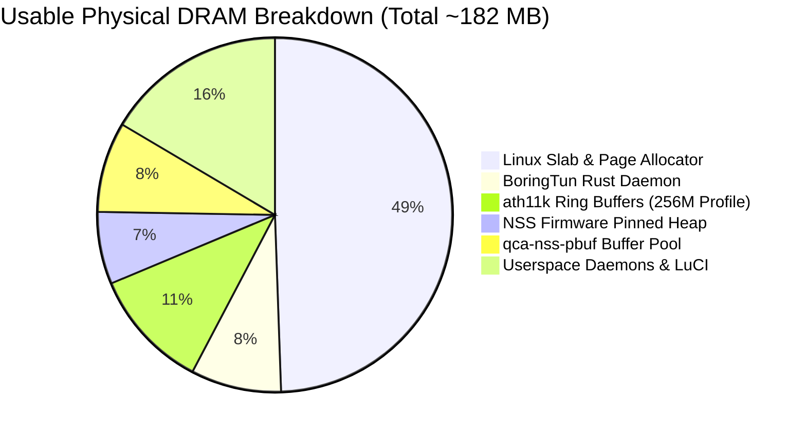

# Architecture Design: Qualcomm NSS Offload Integration & Comparative Evaluation

- **Document ID:** `docs/NSS_INTEGRATION_DESIGN.md`
- **Project:** `CR8808-CUSTOM-FIRMWARE` (v0.1.0-dev.2)
- **Target Hardware:** Xiaomi CR8808 Ver.B (Codename `CR8818`, Qualcomm IPQ5018 dual-core Cortex-A53 + NPU @ 1.0 GHz + Motorcomm YT9215)
- **Architecture Lead Decision:** Experimental Optimization Stage (Strictly Post-DSA Baseline Phase 2)
- **Status:** Architectural Blueprint & 3-Way Comparative Evaluation
- **Revision:** Round 5 Review (3-Way Architecture Evaluation: Clean DSA vs. Kuncy7 vs. zcop Dual-Conduit)

---

## 1. Executive Summary & Engineering Scope

Qualcomm Network Subsystem (NSS) is a dedicated 1.0 GHz hardware network processing unit (NPU) integrated into the IPQ5018 SoC designed to offload packet processing (IPv4/IPv6 routing, NAT, PPPoE, VLAN, and QoS) from the host Cortex-A53 CPU cores.

In accordance with the **Architecture Gate G1 Final Review**, NSS integration is classified as an **experimental post-baseline Phase 2 deliverable**. It will be analyzed and tested only after the clean Phase 1 DSA baseline is proven 100% stable, boot-verified, function-verified, and soak-tested on physical hardware.

---

## 2. 3-Way Architecture Evaluation: Clean DSA vs. Kuncy7 vs. zcop Dual-Conduit

To make an informed architectural decision, three distinct approaches to networking on Qualcomm IPQ50xx hardware have been investigated:


### 2.1 Comparative Architecture Decision Matrix

| Evaluation Dimension | Architecture A: Clean DSA Baseline (Phase 1 Baseline) | Architecture B: Kuncy7 `stmmac` + `qca-dwmac-nss` (`tag_8021q`) | Architecture C: `zcop` Qualcomm `qcom,nss-dp` Dual-Conduit (Phase 2 Candidate) |
|---|---|---|---|
| **Primary Philosophy** | 100% open-source maintainability, deterministic stability, zero blob dependencies. | Hybrid: upstream `stmmac` MAC driver coupled with out-of-tree NSS data plane. | Full vendor hardware acceleration using Qualcomm NSS-DP and NSS ECM. |
| **Ethernet MAC Driver** | Upstream `dwmac-ipq5018` / `stmmac` (`CONFIG_DWMAC_IPQ5018=y`). | Upstream `stmmac` patched with data-plane claim API (`kmod-qca-dwmac-nss`). | Qualcomm proprietary `qcom,nss-dp` (`qca-nss-dp.ko`). |
| **Switch DSA Driver** | Backported upstream `drivers/net/dsa/yt921x.c`. | Standard DSA driver with `tag_8021q` conduit tagging. | Out-of-tree Motorcomm switch driver with dual-conduit support. |
| **DSA Tag Protocol** | `tag_yt921x.c` (Upstream single-conduit tagger). | `tag_8021q` (`qca-8021q`, `rtl8365mb-8021q`, `an8855-8021q`). | `tag_yt921x_enhanced.c` (Parses `secondary-conduit-user-mask = <0x8>`). |
| **NSS Tag Parsing Compatibility** | N/A (No NSS used). | **INCOMPATIBLE:** NSS firmware 12.5 only parses 802.1Q tags; drops YT921x frames. | **COMPATIBLE:** Dual-conduit steers WAN to Port 4 and LAN to Port 8, bypassing single-conduit tagger collisions. |
| **CPU Conduits** | **Single Conduit:** GMAC1 / Port 8 (SGMII 1000M). | **Single Conduit:** GMAC1 / Port 8 (Trunk with 802.1Q tags). | **Dual Conduit:** GMAC0 / Port 4 (WAN) + GMAC1 / Port 8 (LAN). |
| **Flow Acceleration Engine** | Linux In-Kernel Software Flowtable (`nftables flow_offload`). | Qualcomm NSS ECM (`qca-nss-ecm.ko`). | Qualcomm NSS ECM (`qca-nss-ecm.ko`). |
| **Host CPU Utilization @ 1 Gbps** | 50–65% (`ENGINEERING_ESTIMATE`). | <10% (`ACCEPTANCE_TARGET` on supported hardware). | <10% (`ACCEPTANCE_TARGET`). |
| **Throughput Acceptance Target** | 940 Mbps IPv4 NAT (`ACCEPTANCE_TARGET`). | 940 Mbps IPv4 NAT. | 940 Mbps IPv4 NAT (`ACCEPTANCE_TARGET`). |
| **Memory Footprint Impact** | **0 MiB NPU reservation** (~182 MB usable DRAM for Linux). | **8–16 MiB pinned DRAM** (`nss_region`) + `qca-nss-pbuf`. | **8–16 MiB pinned DRAM** (`nss_region`) + `qca-nss-pbuf`. |
| **Firmware Blob Dependencies** | **None** for Ethernet datapath. | `retail_router0.bin` (Qualcomm NSS 12.5-210). | `retail_router0.bin` (Qualcomm NSS 12.5-210). |
| **Community Track Record on CR8818** | High confidence (standard Linux DSA model). | **ZERO:** Kuncy7 does not support Motorcomm switches. | High confidence: proven in `zcop/immortalwrt`. |
| **Recommendation** | **APPROVED: Phase 1 Mandatory Baseline.** | **REJECTED: Structurally incompatible with YT9215.** | **RESERVED: Phase 2 Experimental Optimization.** |

---

## 3. Deep Analysis: Why Kuncy7 Architecture Cannot Support Motorcomm YT9215

The `kuncy7/openwrt-nss-edma` project provides an elegant architecture for offloading upstream `stmmac` to NSS on routers with Qualcomm QCA8337 (`qca-8021q`), Realtek RTL8367S (`rtl8365mb-8021q`), or Airoha AN8855 (`an8855-8021q`) switches. However, our technical analysis proves it **cannot** be used on Xiaomi CR8808 Ver.B / CR8818:

1. **Tag Protocol Mismatch:**
   - Kuncy7's NSS integration relies on the DSA conduit operating under **`tag_8021q`**. In this mode, the switch inserts a standard IEEE 802.1Q VLAN header that carries port identification metadata.
   - The Qualcomm NSS firmware (`retail_router0.bin`) contains built-in microcode to parse standard 802.1Q VLAN headers and route packets to the appropriate NSS virtual interface.
   - The Motorcomm YT9215 switch uses a **proprietary 4-byte/8-byte vendor DSA tag** (`tag_yt921x.c`), which is placed as a trailer or custom header.
2. **Firmware Opacity:**
   - The NSS firmware is a closed binary blob compiled for the Hexagon NPU.
   - It has **zero knowledge of the Motorcomm tag format**.
   - If Kuncy's `kmod-qca-dwmac-nss` intercepts tagged frames from `tag_yt921x`, the NSS NPU cannot parse the Ethernet payload, resulting in packet corruption, dropped frames, or hardware stall.
3. **Silicon Limitations:**
   - Neither the Motorcomm YT9215 datasheet nor existing driver code confirms that the YT9215 can operate in pure standard 802.1Q trunk mode for DSA port demultiplexing without its proprietary tagger.
4. **Architectural Verdict:**
   - Attempting to force Kuncy's architecture onto CR8818 would require designing a novel tag translation shim layer inside the kernel between `tag_yt921x` and NSS, an unverified research task.
   - Therefore, for Phase 2 hardware offload, **Architecture C (`zcop` dual-conduit `nss-dp`) is the only viable NSS solution for CR8818**.

---

## 4. 256 MB RAM Engineering for IPQ50xx & NSS

A key lesson from the Kuncy7 project is the rigorous tuning required to run modern OpenWrt and NSS on 256 MB RAM devices (which have only ~182 MB usable memory after bootloader allocations).

If Phase 2 NSS is implemented, the following **256 MB Memory Engineering Profile** must be applied:



### 4.1 Specific Memory Tuning Parameters:
1. **`ATH11K_MEM_PROFILE_256M=y`:**
   - By default, `ath11k` allocates large descriptor rings sized for enterprise access points with 512 MB+ RAM (1024 TX/RX descriptors per ring).
   - Enabling `ATH11K_MEM_PROFILE_256M` restricts ring sizes to 256 or 512 descriptors, saving ~16–20 MiB of contiguous DMA slab.
2. **`NSS_MEM_PROFILE_LOW=y` / `MP_256`:**
   - Sizes the `qca-nss-pbuf` pre-allocated network packet buffer pool to ~12–15 MiB instead of the standard 24–32 MiB.
   - Sets NSS firmware pinned memory reservation (`nss_region` in DTS) to a conservative 8–12 MiB:
     ```dts
     reserved-memory {
         nss_region: nss@40000000 {
             reg = <0x0 0x40000000 0x0 0xc00000>; /* 12 MiB */
             no-map;
         };
     };
     ```
3. **Kernel Memory Subsystem Tuning:**
   - Set `coherent_pool=2M` in kernel boot arguments to prevent DMA allocation panics under burst traffic.
   - Enforce `vm.min_free_kbytes=8192` in `/etc/sysctl.conf`. This guarantees an 8 MiB atomic memory reserve so that network interrupt handlers (NAPI) never fail an allocation during sudden traffic bursts.
4. **Userspace Lean Policy:**
   - Prohibit heavy userspace runtimes (Python, Node.js, Samba4, Docker).
   - Enforce lightweight utilities: `dropbear` instead of OpenSSH server, `mbedtls` instead of OpenSSL where possible, and **BoringTun Rust** (peak RSS < 15 MB) as the sole WireGuard daemon.

---

## 5. Phase 2 Verification Gates

Phase 2 will be initiated only after Phase 1 passes all acceptance criteria. Phase 2 acceptance will be judged against:
1. **Line-Rate Throughput:** Continuous 940 Mbps routed IPv4 TCP throughput with host CPU idle > 90% (`ACCEPTANCE_TARGET`).
2. **Flow Stress Test:** 5,000+ active NAT connections without `nss_alloc_pbuf_failed` errors (`ACCEPTANCE_TARGET`).
3. **Soak Stability:** 24-hour continuous mixed traffic test with zero kernel panics or NPU watchdogs (`ACCEPTANCE_TARGET`).
