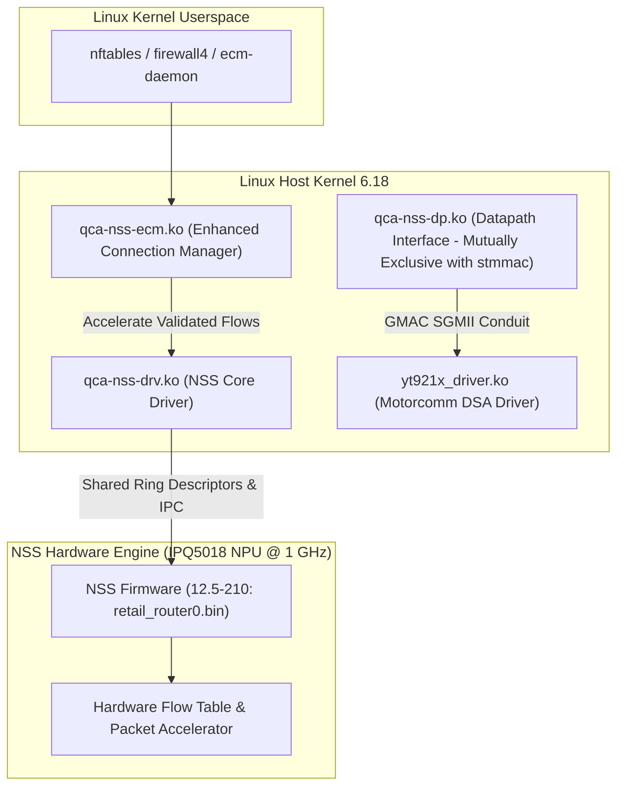

# Architecture Design: Qualcomm NSS Offload Integration (Experimental Phase)

- **Document ID:** `docs/NSS_INTEGRATION_DESIGN.md`
- **Project:** `CR8808-CUSTOM-FIRMWARE` (v0.1.0-dev.2)
- **Target Hardware:** Xiaomi CR8808 Ver.B (Qualcomm IPQ5018 dual-core Cortex-A53 + NPU @ 1.0 GHz)
- **Architecture Lead Decision:** Experimental Optimization Stage (Strictly Post-DSA Baseline)
- **Status:** Architectural Blueprint & Feasibility Study
- **Revision:** Round 2 Review (Driver Ownership & Phased Gate Enforcement)

---

## 1. Overview and Engineering Scope

Qualcomm Network Subsystem (NSS) is a dedicated 1.0 GHz hardware network processing unit (NPU) integrated into the IPQ5018 SoC designed to offload packet processing (IPv4/IPv6 routing, NAT, PPPoE, VLAN, and QoS) from the host Cortex-A53 CPU cores.

In accordance with the **Architecture Gate G1 Final Review**, NSS integration is classified as an **experimental post-baseline Phase 2 deliverable**. It will be analyzed and tested only after the clean Phase 1 DSA baseline is proven 100% stable, boot-verified, function-verified, and soak-tested on physical hardware.

---

## 2. Driver Ownership: Clean DSA Baseline vs. NSS Datapath

A critical architectural distinction between Phase 1 and Phase 2 lies in **hardware GMAC controller ownership**:

| Architectural Phase | Ethernet MAC Driver | Conduit Netdev | Switch Driver | Flow Offload Engine | Memory Overhead |
|---|---|---|---|---|---|
| **Phase 1: Clean DSA Baseline** | Upstream `dwmac-ipq5018` (`stmmac`) | `eth0` / `eth1` (Linux netdev) | Upstream / backported `motorcomm,yt9215` DSA | In-kernel `nftables flowtable` (Software offload on CPU) | **Zero NSS reservation** (Full ~182 MB usable RAM for Linux) |
| **Phase 2: NSS Acceleration** | Qualcomm `qcom,nss-dp` (`qca-nss-dp.ko`) | NSS virtual datapath interface | `motorcomm,yt9215-enhanced` DSA slave cluster | `qca-nss-ecm.ko` + NPU hardware flow tables | **8–16 MiB DRAM pinned** for NSS firmware + pbuf pool |

> **Driver Conflict & Mutually Exclusive Binding:**
> The Synopsys DesignWare MAC driver (`stmmac` / `dwmac-ipq5018`) and Qualcomm's proprietary datapath driver (`qca-nss-dp`) cannot both bind to GMAC0/GMAC1 simultaneously. Phase 1 relies strictly on standard upstream `stmmac`. Phase 2 requires switching device tree bindings and kernel module configurations to `qcom,nss-dp`. Mixing these layers during initial board bringup is strictly prohibited.

---

## 3. Core Subsystems and Driver Dependencies (Phase 2 Target)

### 3.1 Firmware Line Selection
- **Firmware Recipe:** `nss-firmware` (v2025.05.01) from `kuncy7/nss-packages` or `qosmio/qca-sdk-nss-fw`.
- **Target Firmware Version:** **NSS 12.5 Release 210** (`QCA_Networking_2024.SPF_12.5/ED1`).
- **Binary Image:** `/lib/firmware/qca-nss0-retail.bin` (extracted from `retail_router0.bin` for IPQ5018 `MP` profile).
- **Secondary Option:** NSS 12.2 Release 156 (retained for regression fallback).

### 3.2 Datapath & Driver Architecture (`zcop` Model)
Unlike `kuncy7`'s approach (which unbinds DSA to load a private 802.1Q switch fabric driver `kmod-qca8337-nss`), `zcop/immortalwrt`'s architecture **maintains Linux DSA intact**:
- **Device Tree:** `target/linux/qualcommax/dts/ipq5018-cr881x-nss.dts`.
- **GMAC Datapath:** Both GMAC0 and GMAC1 bind to `compatible = "qcom,nss-dp"`.
- **Switch Connection:** The Motorcomm YT9215S/SC switch remains connected to GMAC1 as a DSA slave netdev cluster via `tag_yt921x_enhanced.c`.
- **Connection Acceleration:** `qca-nss-ecm.ko` listens to Linux Netfilter connection tracking events (`conntrack`). When a routed IPv4 TCP/UDP flow is established and packets pass symmetric NAT inspection, ECM pushes acceleration rules into `qca-nss-drv.ko`. Subsequent packets in the flow are handled directly by the NSS NPU without waking host CPU cores.

---

## 4. Strict 256 MB RAM Budgeting for NSS

On 256 MB devices (which have only ~182 MB usable after U-Boot), NSS memory allocation must be strictly bounded:

| Memory Region | Default 512 MB Allocation | Strict 256 MB Budget | Impact / Mitigation |
|---|---|---|---|
| **NSS Firmware Heap (`nss_region`)** | 16–32 MiB | **8–16 MiB** | Pinned in DTS at `0x40000000`. Limits firmware ring buffer sizing. |
| **`qca-nss-pbuf` Buffer Pool** | Full buffer pool (~24 MiB) | **MP_256 Profile (~12 MiB)** | Sized via `qca-nss-pbuf.init` to prevent buffer starvation. |
| **`ath11k` Buffer Allocation** | Full 512 MB descriptors | **`ATH11K_MEM_PROFILE_256M=y`** | Limits Wi-Fi RX/TX descriptor rings. |
| **Userspace Headroom** | ~350 MB | **~110–130 MB** | Heavy packages (Samba, Python, Docker) must be excluded. |

---

## 5. Known Upstream NSS Limitations to Resolve

Empirical review of `zcop` development logs (`docs/cr881x/NSS Offload status.md`) identifies the following open technical hurdles:

1. **Wi-Fi NSS Offload Disabled:**
   - In `zcop`'s current CR881x configuration, Wi-Fi NSS offload is disabled (`status = "disabled"`). Wi-Fi traffic is bridged via host CPU `ath11k`.
   - *Investigation Goal:* Determine whether enabling `ath11k` wifili NSS offload causes memory exhaustion on 256 MB RAM before considering enabling it.
2. **Resource Exhaustion Under Topology Stress:**
   - Rapid topology changes (e.g., WAN disconnect/reconnect, VLAN addition/removal) can leave stale flow descriptors in NSS firmware tables, causing rule allocation rejections.
   - *Mitigation Plan:* Validate ECM flow teardown timers and exception re-sync logic before long-term deployment.
3. **Encrypted Tunnel Non-Offload:**
   - Qualcomm NSS on IPQ5018 lacks cryptographic acceleration engines for modern ChaCha20-Poly1305.
   - WireGuard traffic bypasses NSS flow acceleration and is processed by BoringTun on the dual-core Cortex-A53 CPU.
4. **Cold-Boot vs. Warm-Boot SerDes Stability:**
   - SGMII SerDes timing between IPQ5018 UNIPHY and Motorcomm Port 8 must synchronize reliably on cold power-on.

---

## 6. Phase 2 Verification & Benchmarking Suite

When Phase 2 begins, NSS will be judged against strict quantitative gates:
1. **Throughput & CPU Idle:** Demonstrate continuous 930+ Mbps routed IPv4 TCP throughput with host CPU idle > 90% (vs. ~35–50% idle on standard Linux flowtable).
2. **Concurrent Flow Capacity:** Support 5,000+ concurrent active NAT connections without triggering NSS ring buffer allocation panics (`nss_alloc_pbuf_failed`).
3. **Soak & Stability:** 24-hour continuous mixed traffic test (HTTP/HTTPS, BitTorrent, UDP streaming) without kernel warning dumps or interface resets.
