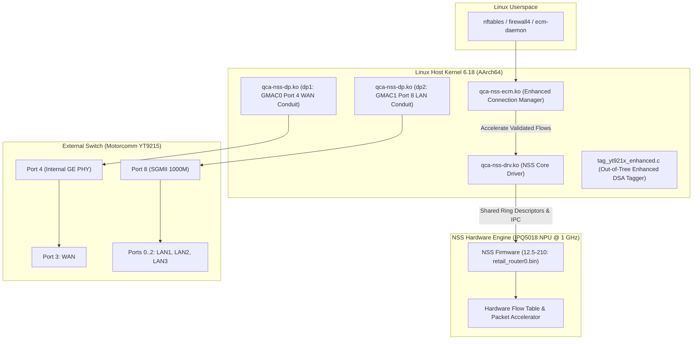

# Architecture Design: Qualcomm NSS Offload Integration (Experimental Phase 2)

- **Document ID:** `docs/NSS_INTEGRATION_DESIGN.md`
- **Project:** `CR8808-CUSTOM-FIRMWARE` (v0.1.0-dev.2)
- **Target Hardware:** Xiaomi CR8808 Ver.B (Qualcomm IPQ5018 dual-core Cortex-A53 + NPU @ 1.0 GHz)
- **Architecture Lead Decision:** Experimental Optimization Stage (Strictly Post-DSA Baseline Phase 2)
- **Status:** Architectural Blueprint & Comparative Feasibility Study
- **Revision:** Round 4 Review (Side-by-Side Architectural Decision Table & Dual-Conduit Demarcation)

---

## 1. Overview and Engineering Scope

Qualcomm Network Subsystem (NSS) is a dedicated 1.0 GHz hardware network processing unit (NPU) integrated into the IPQ5018 SoC designed to offload packet processing (IPv4/IPv6 routing, NAT, PPPoE, VLAN, and QoS) from the host Cortex-A53 CPU cores.

In accordance with the **Architecture Gate G1 Final Review**, NSS integration is classified as an **experimental post-baseline Phase 2 deliverable**. It will be analyzed and tested only after the clean Phase 1 DSA baseline is proven 100% stable, boot-verified, function-verified, and soak-tested on physical hardware.

---

## 2. Architecture Decision Table: Phase 1 Clean DSA vs. Phase 2 NSS Datapath

| Architectural Dimension | Phase 1: Clean DSA Baseline (CURRENT GOAL) | Phase 2: Experimental NSS Datapath (POST-BASELINE) |
|---|---|---|
| **Primary Architectural Goal** | Deterministic stability, minimal memory footprint, zero blob dependencies. | Maximum hardware offload, near-zero CPU load at 1 Gbps routing. |
| **Ethernet MAC Driver** | Upstream Synopsys DesignWare MAC (`dwmac-ipq5018` / `stmmac`). | Qualcomm NSS Datapath driver (`qcom,nss-dp` / `qca-nss-dp.ko`). |
| **GMAC Hardware Ownership** | `stmmac` claims GMAC1 (`eth1`); GMAC0 unbound in single-conduit. | `qcom,nss-dp` claims both GMAC0 (`dp1`) and GMAC1 (`dp2`). |
| **CPU Conduit Topology** | **Single CPU Conduit:** Port 8 via SGMII 1000 Mbps fixed-link. | **Dual CPU Conduit:** Port 8 (`dp2` LAN) + Port 4 (`dp1` WAN). |
| **Switch DSA Driver Stack** | Upstream Linux DSA (`net/dsa/` + `drivers/net/dsa/motorcomm/yt9215.c`). | Out-of-tree enhanced DSA tagger (`tag_yt921x_enhanced.c`). |
| **Secondary Conduit Mask** | **Ignored / Not Supported** by upstream driver. | Parsed by `tag_yt921x_enhanced.c` (`secondary-conduit-user-mask = <0x8>`). |
| **WAN/LAN Demultiplexing** | Pure software demux via standard DSA tags over SGMII Port 8. | Hardware demux: WAN routed to Port 4 (`dp1`), LAN to Port 8 (`dp2`). |
| **Flow Acceleration Engine** | In-kernel Linux software flowtable (`nftables flow_offload`). | Hardware NPU flow tables (`qca-nss-ecm.ko` + `qca-nss-drv.ko`). |
| **Target Throughput** | 940 Mbps IPv4 NAT (`ACCEPTANCE_TARGET`). | 930+ Mbps IPv4 NAT (`ACCEPTANCE_TARGET`). |
| **Expected Host CPU Load** | 50–65% at 1 Gbps (`ENGINEERING_ESTIMATE`). | <10% at 1 Gbps (`ACCEPTANCE_TARGET`). |
| **Memory Reservation** | **Zero NPU reservation** (~182 MB usable DRAM for Linux slab/buffers). | **8–16 MiB pinned DRAM** (`nss_region` `SOURCE_DERIVED`) + `qca-nss-pbuf`. |
| **Firmware Blobs Required** | **None** for Ethernet datapath. | `retail_router0.bin` (NSS 12.5 Release 210 / SPF 12.5). |
| **Prerequisite Gate** | Gate G1 Architecture Approval. | Phase 1 Clean DSA certified 100% stable & soak-tested. |

---

## 3. Phase 2 Datapath Architecture & Hardware Wiring

### 3.1 Strict Driver Ownership Demarcation
- The Synopsys DesignWare MAC driver (`stmmac`) and Qualcomm's proprietary datapath driver (`qca-nss-dp`) cannot both bind to GMAC0/GMAC1 simultaneously.
- Phase 1 relies strictly on standard upstream `stmmac`.
- Phase 2 requires switching device tree bindings and kernel module configurations to `qcom,nss-dp`. Mixing these layers during initial board bringup is strictly prohibited.

---

## 4. Strict 256 MB RAM Budgeting for Phase 2 NSS

On 256 MB devices (which have only ~182 MB usable after U-Boot), NSS memory allocation must be strictly bounded:

| Memory Region | Default 512 MB Allocation | Strict 256 MB Budget | Basis / Mitigation |
|---|---|---|---|
| **NSS Firmware Heap (`nss_region`)** | 16–32 MiB | **8–16 MiB** | `SOURCE_DERIVED`: Pinned in DTS at `0x40000000`. Limits firmware ring buffer sizing. |
| **`qca-nss-pbuf` Buffer Pool** | Full buffer pool (~24 MiB) | **MP_256 Profile (~12 MiB)** | Sized via `qca-nss-pbuf.init` to prevent buffer starvation. |
| **`ath11k` Buffer Allocation** | Full 512 MB descriptors | **`ATH11K_MEM_PROFILE_256M=y`** | Limits Wi-Fi RX/TX descriptor rings. |
| **Userspace Headroom** | ~350 MB | **~110–130 MB** | Heavy packages (Samba, Python, Docker) must be excluded. |

---

## 5. Phase 2 Verification & Acceptance Gates

When Phase 2 begins, NSS will be judged against strict quantitative gates:
1. **Throughput & CPU Idle:** Demonstrate continuous 930+ Mbps routed IPv4 TCP throughput with host CPU idle > 90% (`ACCEPTANCE_TARGET`).
2. **Concurrent Flow Capacity:** Support 5,000+ concurrent active NAT connections without triggering NSS ring buffer allocation panics (`nss_alloc_pbuf_failed`) (`ACCEPTANCE_TARGET`).
3. **Soak & Stability:** 24-hour continuous mixed traffic test without kernel warning dumps or interface resets (`ACCEPTANCE_TARGET`).
