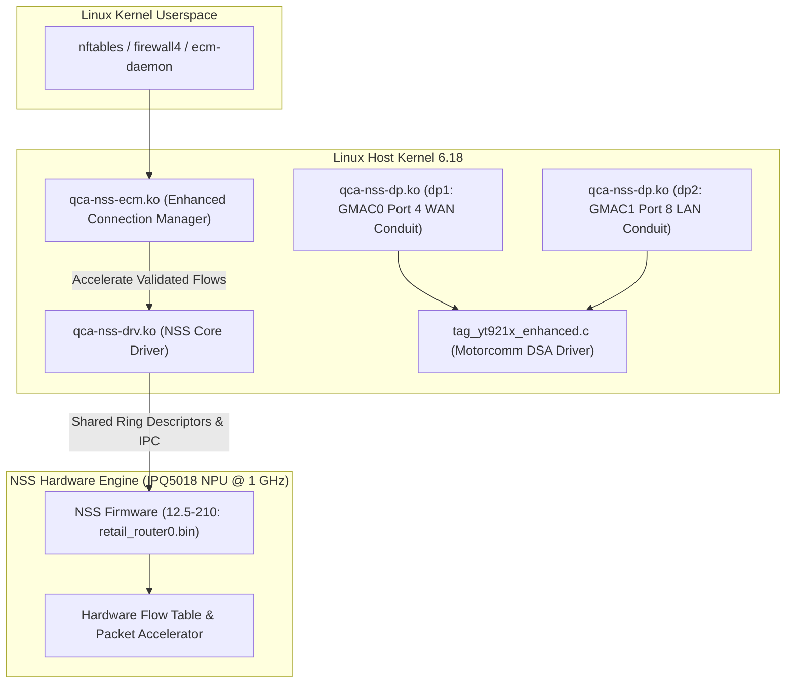

# Architecture Design: Qualcomm NSS Offload Integration & Architecture Demarcation

- **Document ID:** `docs/NSS_INTEGRATION_DESIGN.md`
- **Project:** `CR8808-CUSTOM-FIRMWARE` (v0.1.0-dev.2)
- **Target Hardware:** Xiaomi CR8808 Ver.B (Qualcomm IPQ5018 dual-core Cortex-A53 + NPU @ 1.0 GHz)
- **Architecture Lead Decision:** Experimental Stage (Strictly Post-DSA Baseline Phase 2)
- **Status:** Architectural Blueprint & Comparative Feasibility Study
- **Revision:** Round 3 Review (Side-by-Side Architectural Comparison & Dual-Conduit Demarcation)

---

## 1. Overview and Engineering Scope

Qualcomm Network Subsystem (NSS) is a dedicated 1.0 GHz hardware network processing unit (NPU) integrated into the IPQ5018 SoC designed to offload packet processing (IPv4/IPv6 routing, NAT, PPPoE, VLAN, and QoS) from the host Cortex-A53 CPU cores.

In accordance with the **Architecture Gate G1 Final Review**, NSS integration is classified as an **experimental post-baseline Phase 2 deliverable**. It will be analyzed and tested only after the clean Phase 1 DSA baseline is proven 100% stable, boot-verified, function-verified, and soak-tested on physical hardware.

---

## 2. In-Depth Architectural Comparison: Upstream OpenWrt vs. zcop ImmortalWrt

To resolve prior ambiguities, the table below establishes the fundamental differences in GMAC driver ownership, switch conduits, and packet datapath between the two reference architectures:

| Architectural Dimension | Upstream OpenWrt Baseline (`qualcommax`) | `zcop` ImmortalWrt Architecture (`cr881x`) | Xiaomi Stock RA82 Vendor Architecture |
|---|---|---|---|
| **GMAC MAC Driver** | Synopsys DesignWare MAC (`snps,dwmac` / `dwmac-ipq5018` / `stmmac`) | Qualcomm NSS Datapath (`qcom,nss-dp` / `qca-nss-dp.ko`) | Qualcomm QCA-SSDK proprietary kernel driver (`qca-ssdk.ko`) |
| **GMAC0 Binding** | GMAC0 managed by `stmmac` as standard Linux netdev (`eth0`) | GMAC0 bound to `dp1` (`0x39C00000`, GMAC_HAL_TYPE_SYN_GMAC) | GMAC0 bound to internal GE PHY (`88000.mdio:07`) |
| **GMAC1 Binding** | GMAC1 managed by `stmmac` as standard Linux netdev (`eth1`) | GMAC1 bound to `dp2` (`0x39D00000`, GMAC_HAL_TYPE_SYN_GMAC) | GMAC1 bound to switch via SerDes |
| **Switch Driver Stack** | Upstream Linux DSA (`drivers/net/dsa/motorcomm/`) | Out-of-tree enhanced DSA (`tag_yt921x_enhanced.c`) | Proprietary `yt_switch.ko` + SSDK ioctls |
| **CPU Conduits** | Single CPU conduit (typically GMAC1 / Port 8) | **Dual CPU conduit:** Port 8 (`dp2` primary LAN) + Port 4 (`dp1` secondary WAN) | Dual conduit bridged in software / hardware SSDK |
| **Conduit Link Speeds** | Single SGMII 1000 Mbps | **Port 8:** SGMII 1000 Mbps fixed-link **Port 4:** Internal PHY 1000 Mbps fixed-link | SGMII 1000 Mbps + Internal PHY 1000 Mbps |
| **WAN Routing Path** | WAN packets travel across single conduit to CPU | WAN packets routed directly over Port 4 (`dp1`), isolated from LAN on Port 8 | Separated by SSDK hardware VLAN port table |
| **Flow Acceleration Engine** | Linux kernel software flowtable (`nftables flow_offload`) | Qualcomm NSS NPU (`qca-nss-ecm.ko` + `qca-nss-drv.ko`) | QSDK fast-path / ECM with NSS hardware offload |
| **Memory Footprint** | Zero NPU reservation (~182 MB usable by Linux) | Pinned NPU firmware heap (8–16 MiB) + `qca-nss-pbuf` | Pinned QCA NPU memory region |
| **Board Support Status** | **No merged profile for CR8818 in upstream OpenWrt** | Custom DTS `ipq5018-cr881x.dts` verified by zcop | Factory closed firmware |

---

## 3. The Dual-Conduit vs. Single-Conduit Warning

> [!WARNING]
> **We cannot assume an upstream single-conduit driver can trivially replace zcop's dual-conduit architecture without hardware verification.**
>
> On the CR8808 Ver.B board, physical copper traces route:
> 1. Switch Port 4 to IPQ5018 Internal GE PHY (GMAC0).
> 2. Switch Port 8 to IPQ5018 UNIPHY SerDes (GMAC1).
>
> In `zcop`'s DTS, Port 4 is specifically constrained to WAN traffic via `motorcomm,secondary-conduit-user-mask = <0x8>`, preventing WAN broadcast packets from entering the LAN conduit. If an upstream single-conduit DSA driver (which only binds Port 8) is used, all WAN and LAN traffic must share the single 1000 Mbps SGMII bus. More critically, the switch's internal forwarding and VLAN ingress filtering rules must be reconfigured to prevent WAN packet leakage. This requires live device testing before any single-conduit assumption can be accepted.

---

## 4. Phase 2 NSS Core Subsystems and Driver Dependencies

When Phase 2 begins (strictly post-DSA baseline), NSS integration will follow the `zcop` model:

### 4.1 Strict 256 MB RAM Budgeting for NSS
On 256 MB devices (which have only ~182 MB usable after U-Boot), NSS memory allocation must be strictly bounded:

| Memory Region | Default 512 MB Allocation | Strict 256 MB Budget | Impact / Mitigation |
|---|---|---|---|
| **NSS Firmware Heap (`nss_region`)** | 16–32 MiB | **8–16 MiB** | Pinned in DTS at `0x40000000`. Limits firmware ring buffer sizing. |
| **`qca-nss-pbuf` Buffer Pool** | Full buffer pool (~24 MiB) | **MP_256 Profile (~12 MiB)** | Sized via `qca-nss-pbuf.init` to prevent buffer starvation. |
| **`ath11k` Buffer Allocation** | Full 512 MB descriptors | **`ATH11K_MEM_PROFILE_256M=y`** | Limits Wi-Fi RX/TX descriptor rings. |
| **Userspace Headroom** | ~350 MB | **~110–130 MB** | Heavy packages (Samba, Python, Docker) must be excluded. |

---

## 5. Phase 2 Verification & Acceptance Gates

Phase 2 will be judged against strict quantitative gates:
1. **Throughput & CPU Idle:** Demonstrate continuous 930+ Mbps routed IPv4 TCP throughput with host CPU idle > 90% (vs. ~35–50% idle on standard Linux flowtable).
2. **Concurrent Flow Capacity:** Support 5,000+ concurrent active NAT connections without triggering NSS ring buffer allocation panics (`nss_alloc_pbuf_failed`).
3. **Soak & Stability:** 24-hour continuous mixed traffic test (HTTP/HTTPS, BitTorrent, UDP streaming) without kernel warning dumps or interface resets.
