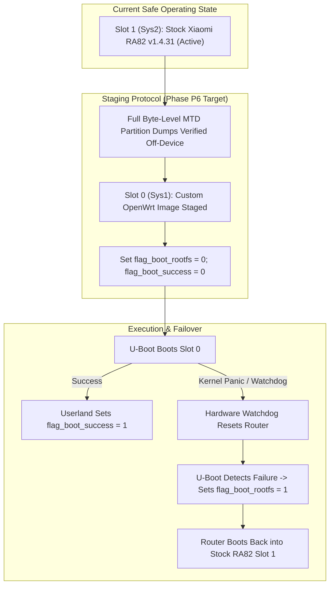

# Recovery, Fallback, and Rollback Architecture (Non-UART Strategy)

- **Document ID:** `docs/RECOVERY_AND_ROLLBACK_DESIGN.md`
- **Project:** `CR8808-CUSTOM-FIRMWARE` (v0.1.0-dev.2)
- **Target Hardware:** Xiaomi CR8808 Ver.B (Codename `CR8818`, Winbond W25N01GWZEIG 128 MB SPI NAND)
- **Primary Operational Constraint:** **Operator has NO UART serial console and NO external hardware programmer.**
- **Architecture Lead Decision:** **`NO-GO on flashing pending independent recovery validation`**
- **Status:** Authoritative Pre-P2 Reference Specification
- **Revision:** Round 2 Review (U-Boot TFTP Reality & Real Xiaomi Boot Flags)

---

## 1. Problem Statement and Safety Mandate

The project owner depends on this physical router for daily workstation Internet access and does not possess a UART USB-TTL adapter soldered to the board, nor a dedicated SOP-8/WSON-8 flash programmer.

> [!CAUTION]
> In firmware engineering, **dual-boot A/B layout is NOT an automatic anti-brick guarantee**. If an untested firmware image initializes the bootloader environment incorrectly, fails to deassert switch reset (GPIO 39), encounters an early kernel panic before the watchdog timer starts, or corrupts boot flags, the device becomes inaccessible over Ethernet/Wi-Fi and is bricked.
>
> Furthermore, **stock Xiaomi U-Boot's TFTP recovery mode flashes received images directly into physical NAND**; it does not provide an interactive RAM-only netboot without a soldered UART console.
>
> Therefore, **an absolute `NO-GO` on firmware flashing is in effect until a verifiable, non-UART recovery path is independently validated.**

---

## 2. Flash Memory Partitioning & Real Xiaomi Bootloader Environment

The physical storage is a **Winbond W25N01GWZEIG 128 MB (1024 Mbit) SPI NAND**:


### 2.1 Critical Factory Partitions
- **`0:boot` (U-Boot):** Contains the primary Qualcomm IPQ bootloader. Must NEVER be overwritten.
- **`0:ART`:** Acoustic / RF Tuning table containing calibration for IPQ5018 2.4 GHz and QCN6102 5 GHz radios. Irreplaceable without lab RF equipment.
- **`0:bdata`:** Contains board serial number, country code, and factory MAC addresses.
- **`0:rootfs` (Sys1 / Slot 0):** Primary firmware image partition.
- **`0:rootfs_1` (Sys2 / Slot 1):** Secondary firmware image partition. Currently active with stock Xiaomi RA82 v1.4.31.

### 2.2 Real Xiaomi Bootloader NVRAM Flags
Stock Xiaomi U-Boot does **NOT** use generic upstream U-Boot variables like `bootcounter` or `boot_success`. Instead, Xiaomi's boot logic is governed by specific NVRAM variables:

| NVRAM Variable | Valid Values | Operational Role |
|---|---|---|
| **`flag_boot_rootfs`** | `0` or `1` | Selects active boot slot. `0` boots Sys1 (`rootfs`), `1` boots Sys2 (`rootfs_1`). |
| **`flag_boot_success`** | `0` or `1` | Set to `0` by bootloader during boot attempt; must be set to `1` by userland script upon successful boot completion. |
| **`flag_try_sys1_failed`** | `0`, `1`, `2` | Counter/flag incremented by U-Boot when Sys1 fails to complete boot. |
| **`flag_try_sys2_failed`** | `0`, `1`, `2` | Counter/flag incremented by U-Boot when Sys2 fails to complete boot. |
| **`flag_last_success`** | `0` or `1` | Indicates which system partition last successfully reached userland. |

**Xiaomi Failover Boot Mechanism:**
When U-Boot starts, it reads `flag_boot_rootfs`. If the target system fails to boot multiple times (triggering hardware watchdog reset before `flag_boot_success` is written to `1`), U-Boot increments the corresponding `flag_try_sysX_failed` variable. Once the failure threshold is reached, U-Boot flips `flag_boot_rootfs` to the opposite slot and attempts to boot the fallback image.

---

## 3. Stock Xiaomi U-Boot TFTP Reality vs. Non-UART Limitations

### 3.1 The Stock TFTP Recovery Behavior
Stock Xiaomi routers include a TFTP client in U-Boot triggered by holding the reset button during power-on:
1. U-Boot assigns the router a static IP (typically `192.168.31.1`).
2. U-Boot sends TFTP requests to a host at `192.168.31.100` (or `192.168.31.2`) requesting a specific recovery filename (e.g. `test.bin` or `firmware.bin`).
3. **CRITICAL REALITY:** Once the file is fetched into RAM, **stock U-Boot automatically writes the image into physical NAND flash**.
4. Stock U-Boot does **NOT** execute a non-persistent RAM-only boot from this recovery mechanism.

### 3.2 Non-UART Risk Analysis
Without a soldered UART console:
- The operator cannot send break sequences (`ctrl-c`, `space`) to access the interactive U-Boot prompt (`IPQ5018#`).
- The operator cannot execute arbitrary memory commands: `tftpboot 0x44000000 initramfs.itb` followed by `bootm 0x44000000`.
- **Consequence:** True RAM-only execution (booting a kernel entirely in memory without touching NAND) is only possible if initiated from the currently running Linux system via `kexec` (if supported by kernel) or via a pre-staged bootloader environment.
- Therefore, TFTP recovery is a **NAND-flashing last resort**, not a non-destructive testing playground.

---

## 4. Defense-in-Depth Rollback Hierarchy



### 4.1 Tier 1: Inactive Slot 0 Staging (Slot 1 Stock Untouched)
1. **Never Touch Active Slot:** The stock Xiaomi RA82 firmware remains running on Slot 1 (`0:rootfs_1`).
2. **Flash Inactive Slot Only:** The custom OpenWrt image is flashed strictly to Slot 0 (`0:rootfs`).
3. **One-Shot Boot Attempt:** The NVRAM flags are set:
   ```sh
   nvram set flag_boot_rootfs=0
   nvram set flag_boot_success=0
   nvram commit
   ```
4. **Automated Rollback:** If Slot 0 fails to reach the userland confirmation service within the watchdog timeout window, U-Boot automatically fails over back to `flag_boot_rootfs=1` (Stock RA82).

### 4.2 Tier 2: OpenWrt Failsafe Mode
If Slot 0 boots successfully to userland but network configuration (DSA, firewall, or SSH) is corrupted:
- Holding the physical reset button during the 2-second failsafe LED flash window triggers OpenWrt `failsafe` mode.
- Failsafe mounts rootfs read-only without overlay, exposing static IP `192.168.1.1` for terminal recovery.

### 4.3 Tier 3: Stock TFTP Factory Unbrick
If both slots become unbootable:
- The operator sets PC IP to `192.168.31.100` with Xiaomi Mi WiFi Repair Tool / TFTP server serving stock `miwifi_cr8808_all_*.bin`.
- Holding reset on power-on triggers U-Boot TFTP flash write to restore stock factory state.

---

## 5. Mandatory Pre-Flight Verification Checklist

Before any request to flash physical NAND can even be submitted:
- [ ] Complete byte-level backup of all physical MTD partitions (`0:boot`, `0:ART`, `0:bdata`, `0:rootfs`, `0:rootfs_1`, `0:boot_env`) downloaded and SHA-256 verified off-device.
- [ ] Stock U-Boot TFTP recovery behavior verified via packet capture (Wireshark) to confirm exact TFTP client IP, port, and filename requests.
- [ ] Verification of Xiaomi boot flag failover behavior documented from verified IPQ5018 community teardowns.
- [ ] Product Owner explicit authorization.

> **Status Confirmation:**
> The current status remains strictly **`NO-GO on flashing pending independent recovery validation`**.
