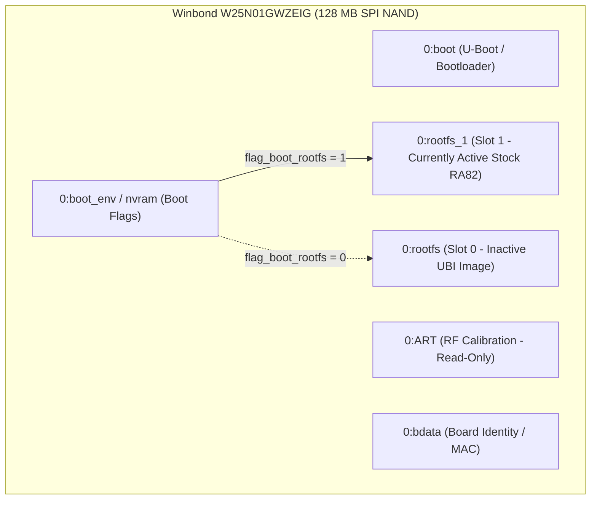
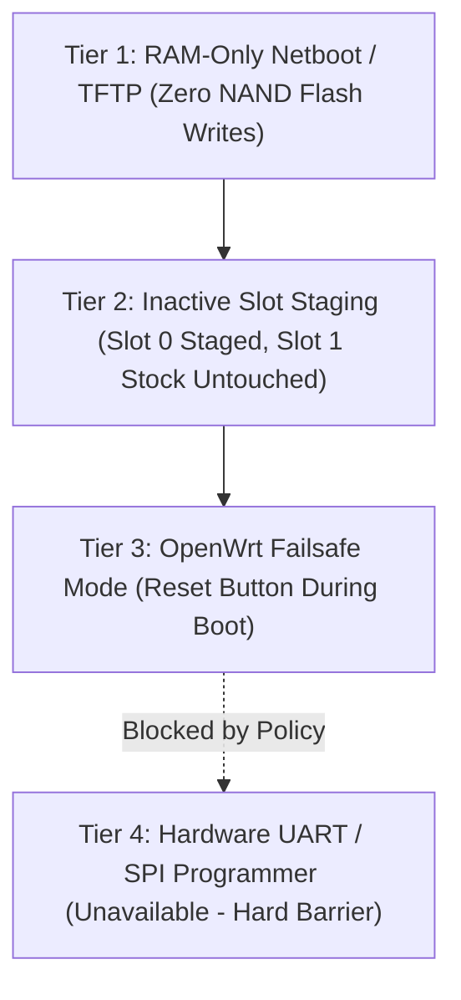

# Recovery, Fallback, and Rollback Architecture (Non-UART Strategy)

- **Document ID:** `docs/RECOVERY_AND_ROLLBACK_DESIGN.md`
- **Project:** `CR8808-CUSTOM-FIRMWARE` (v0.1.0-dev.2)
- **Target Hardware:** Xiaomi CR8808 Ver.B (Codename `CR8818`, Winbond W25N01GWZEIG 128 MB SPI NAND)
- **Primary Operational Constraint:** **User has NO UART serial console and NO external hardware programmer.**
- **Flash Authorization:** **`NO-GO pending independent recovery validation`**

---

## 1. Problem Statement and Safety Mandate

The project owner depends on this physical router for daily workstation Internet access and does not possess a UART USB-TTL adapter soldered to the board, nor a dedicated SOP-8/WSON-8 flash programmer.

> [!CAUTION]
> In firmware engineering, **dual-boot A/B layout is NOT a magical anti-brick guarantee**. If an untested firmware image initializes the bootloader environment incorrectly, fails to deassert switch reset (GPIO 39), encounters an early kernel panic before watchdog initialization, or corrupts the U-Boot environment variables, the device becomes inaccessible over Ethernet/Wi-Fi and is effectively bricked.
>
> Therefore, **no persistent NAND writes or firmware flashing are permitted until a verifiable, non-UART recovery path is empirically proven.**

---

## 2. Flash Memory Partitioning & Dual-Boot Architecture

The physical flash is a **Winbond W25N01GWZEIG 128 MB (1024 Mbit) SPI NAND**:

### Key Partition Layout:
- **`0:boot` (U-Boot):** Contains the primary Qualcomm APQ/IPQ bootloader. Must NEVER be overwritten.
- **`0:ART`:** Acoustic / RF Tuning table containing calibration for IPQ5018 2.4 GHz and QCN6102 5 GHz radios. Irreplaceable without lab RF equipment.
- **`0:bdata`:** Contains board serial number, country code, and factory MAC addresses.
- **`0:rootfs` (Slot 0):** Primary firmware image partition.
- **`0:rootfs_1` (Slot 1):** Secondary firmware image partition. Currently active with stock Xiaomi RA82 v1.4.31 (`flag_boot_rootfs=1`).

---

## 3. Defense-in-Depth Recovery Strategy (Non-UART)

To ensure zero risk of bricking, the project establishes a 4-tier recovery hierarchy:

### 3.1 Tier 1: Non-Persistent RAM-Only Netboot (Pre-requisite for Any Flash)
Before any firmware image is ever written to physical NAND:
- The custom firmware will be built as an **initramfs image** (`openwrt-qualcommax-ipq50xx-xiaomi_cr881x-initramfs-uImage.itb`).
- The image will be loaded directly into volatile RAM via TFTP or network bootloader hook.
- The router executes the custom kernel and userspace entirely from RAM without altering a single byte on the physical NAND.
- **If the build fails or hangs, a simple power cycle instantly restores the stock RA82 firmware from NAND Slot 1.**

### 3.2 Tier 2: Inactive Slot Staging with Automatic Fallback Watchdog
Once Tier 1 passes and if persistent installation is approved in Phase P6:
1. **Target Inactive Slot Only:** The new firmware is written strictly to `0:rootfs` (Slot 0), leaving `0:rootfs_1` (Stock RA82) 100% bit-for-bit intact.
2. **One-Shot Boot Attempt:** The U-Boot environment variable `flag_boot_rootfs` is set to `0` with a hardware watchdog countdown (`bootcounter=1`).
3. **Automatic Fallback:** If the custom firmware on Slot 0 fails to reach userspace and confirm success (`boot_success=1`), the hardware watchdog triggers a reboot and U-Boot automatically reverts `flag_boot_rootfs` back to `1` (Stock RA82).

### 3.3 Tier 3: OpenWrt Failsafe Mode
If the custom firmware boots successfully but network configuration is locked out:
- Holding the physical reset button during the 2-second failsafe LED flash window forces OpenWrt to boot without mounting the overlay filesystem.
- The router exposes a static IP (`192.168.1.1`) with telnet/SSH access, allowing full configuration recovery.

---

## 4. Mandatory Pre-Flight Verification Checklist

No flashing authorization can be requested until all of the following requirements are satisfied:
- [ ] Complete byte-level backup of all physical MTD partitions (`0:boot`, `0:ART`, `0:bdata`, `0:rootfs`, `0:rootfs_1`) downloaded and verified off-device.
- [ ] Stock U-Boot TFTP recovery protocol (holding reset on power-on) tested and verified to send TFTP read requests for recovery images.
- [ ] Initramfs non-persistent RAM boot demonstrated to bring up Ethernet network interfaces cleanly.
- [ ] Rollback script and documentation tested on a second workstation.
- [ ] Written confirmation from Product Owner.
