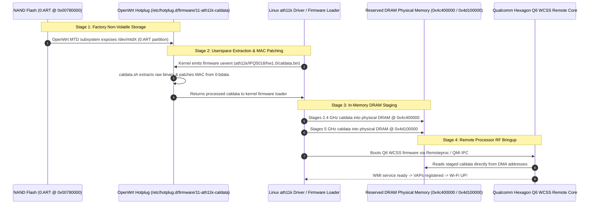

# Wi-Fi Subsystem & Calibration Architecture Specification

- **Document ID:** `docs/WIFI_CALIBRATION_DESIGN.md`
- **Project:** `CR8808-CUSTOM-FIRMWARE` (v0.1.0-dev.2)
- **Target Hardware:** Xiaomi CR8808 Ver.B (Codename `CR8818`, Qualcomm IPQ5018 + QCN6102)
- **Target Platform:** OpenWrt Clean DSA Baseline (`qualcommax/ipq50xx`, Linux 6.18, AArch64 musl)
- **Status:** Authoritative RF & Calibration Engineering Blueprint
- **Revision:** Round 5 Review (Complete 4-Stage Calibration Pipeline & HE160 Mandate)

---

## 1. Executive Summary & RF System Overview

The Xiaomi CR8808 Ver.B utilizes a dual-radio Qualcomm 802.11ax (Wi-Fi 6) architecture:
1. **2.4 GHz Radio (`wifi0`):** Qualcomm IPQ5018 SoC-integrated 2x2 802.11b/g/n/ax radio connected via internal AHB bus, supporting channel widths up to 40 MHz (max theoretical PHY rate: 574 Mbps).
2. **5 GHz Radio (`wifi1`):** Discrete Qualcomm **QCN6102** 2x2 802.11a/n/ac/ax radio connected via PCIe Gen2 x1 bus, supporting **160 MHz channel bandwidth (HE160)** and 1024-QAM (max theoretical PHY rate: **2402 Mbps**).

> [!IMPORTANT]
> **Mandatory HE160 Retention:**
> Operating at 160 MHz channel width (2402 Mbps PHY rate) on the 5 GHz band is a non-negotiable project requirement. Down-negotiating or limiting the radio to 80 MHz (1201 Mbps) represents a 50% throughput penalty and constitutes an architectural regression.

---

## 2. End-to-End 4-Stage Wi-Fi Calibration Pipeline

RF calibration data (power amplifier bias, I/Q imbalance, channel power limits, and low-noise amplifier gain tables) is device-specific, measured during factory testing, and permanently etched into the SPI NAND flash. If calibration data is lost, corrupted, or incorrectly staged, the wireless subsystem will fail to initialize or emit severely attenuated RF signals.

In modern OpenWrt with `ath11k`, calibration data flows through a deterministic 4-stage pipeline:



---

### Detailed Stage Breakdown:

### Stage 1: Physical NAND Storage (`0:ART`)
- **Physical Partition:** Partition `0:ART` on the Winbond W25N01GWZEIG 128 MB SPI NAND.
- **Flash Offset:** `0x00780000` (length `0x00100000` = 1 MiB).
- **Security & Protection:** DTS marks this partition with `read-only;`. It must never be written to or erased during sysupgrade.

### Stage 2: OpenWrt Hotplug Extraction (`11-ath11k-caldata`)
- When the `ath11k_ahb` (for IPQ5018) or `ath11k_pci` (for QCN6102) module probes during boot, it requests calibration data from userspace via the Linux kernel firmware loader (`request_firmware`).
- OpenWrt's firmware hotplug script `/etc/hotplug.d/firmware/11-ath11k-caldata` intercepts this request:
  ```sh
  case "$FIRMWARE" in
  "ath11k/IPQ5018/hw1.0/caldata.bin")
      caldata_extract "0:ART" 0x1000 0x10000
      ;;
  "ath11k/qcn6122/hw1.0/caldata.bin" | "ath11k/QCN6102/hw1.0/caldata.bin")
      caldata_extract "0:ART" 0x20000 0x10000
      ;;
  esac
  ```
- The helper script `/lib/upgrade/caldata.sh` extracts the raw byte slice from the `/dev/mtd+ART` character device and patches the base MAC address read from partition `0:bdata`.

### Stage 3: Kernel DRAM Staging (`bdf_region`)
- The Linux `ath11k` driver receives the calibration data from userspace and stages the binaries into designated physical DRAM reserved memory regions:
  - **2.4 GHz (IPQ5018 Integrated):** Physical DRAM base address **`0x4c400000`** (size `0x200000` = 2 MiB).
  - **5 GHz (QCN6102 PCIe):** Physical DRAM base address **`0x4d100000`** (size `0x200000` = 2 MiB).
- These regions are defined in the Device Tree under `reserved-memory`:
  ```dts
  reserved-memory {
      wifi_bdf: bdf@4c400000 {
          reg = <0x0 0x4c400000 0x0 0x200000>;
          no-map;
      };

      qcn6122_bdf: bdf@4d100000 {
          reg = <0x0 0x4d100000 0x0 0x200000>;
          no-map;
      };
  };
  ```

### Stage 4: Remote Processor Bringup (Qualcomm Q6 WCSS)
- The IPQ5018 contains an integrated Qualcomm Hexagon DSP / Q6 WCSS (Wireless Connectivity Subsystem) remote core.
- The host Linux kernel uses `qcom_q6v5_wcss` and `remoteproc` to load the wireless processor firmware (`q6_fw.mdt`).
- Once booted, the Q6 core uses QMI (Qualcomm Messaging Interface) to negotiate parameters, queries the DRAM staging addresses directly via DMA/shared memory, and programs the analog RF front-ends.

---

## 3. Demarcation: QCN6102 vs. QCN6122 Silicon Family

A frequent point of confusion in Qualcomm documentation is the relationship between QCN6102 and QCN6122:

| Hardware Dimension | Qualcomm QCN6102 (CR8808 Ver.B / CR8818) | Qualcomm QCN6122 (Reference SoM / Enterprise APs) |
|---|---|---|
| **Silicon Implementation** | Commercial router client/AP 5 GHz PCIe chip | Commercial router / carrier gateway 5 GHz PCIe chip |
| **RF Stream Configuration** | 2x2 MU-MIMO (Dual stream) | 2x2 MU-MIMO (Dual stream) / 4x4 options |
| **Max Channel Width** | **160 MHz (HE160)** | **160 MHz (HE160)** |
| **Max Theoretical PHY Rate** | **2402 Mbps** (at 1024-QAM, 160 MHz) | **2402 Mbps** (at 1024-QAM, 160 MHz) |
| **PCIe Device ID** | `17cb:1104` (Subsystem: Qualcomm QCN6102) | `17cb:1104` (Subsystem: Qualcomm QCN6122) |
| **OpenWrt DTS Include** | `ipq5018-qcn6122.dtsi` | `ipq5018-qcn6122.dtsi` |
| **ath11k Firmware Family** | `ath11k/qcn6122/hw1.0/` | `ath11k/qcn6122/hw1.0/` |

### Key Engineering Conclusion:
In the upstream Linux and OpenWrt `qualcommax` source tree, `ipq5018-qcn6122.dtsi` is the shared family include file. Because the QCN6102 and QCN6122 share identical PCIe register maps, baseband architecture, and WMI firmware ABI, referencing `ipq5018-qcn6122.dtsi` in board DTS is standard, expected upstream practice. It does **NOT** indicate a hardware mismatch.

---

## 4. Acceptance Criteria & Wi-Fi Validation Gates (Phase P5)

When custom firmware reaches hardware validation (Phase P5), the wireless subsystem must satisfy the following strict criteria:
1. **2.4 GHz Carrier Bringup:** `wifi0` associates 802.11ax clients at 40 MHz width, generating stable beacons with zero driver panics.
2. **5 GHz HE160 Operation:** `wifi1` operates on 160 MHz channels (Channels 36–64 or 100–128) with `iw dev wlan0 info` confirming:
   ```
   channel 36 (5180 MHz), width: 160 MHz, center1: 5250 MHz
   ```
3. **Throughput Acceptance Target:** Single-client TCP throughput exceeding **900 Mbps** on 5 GHz HE160 (`ACCEPTANCE_TARGET`) with zero caldata CRC errors in `dmesg`.
