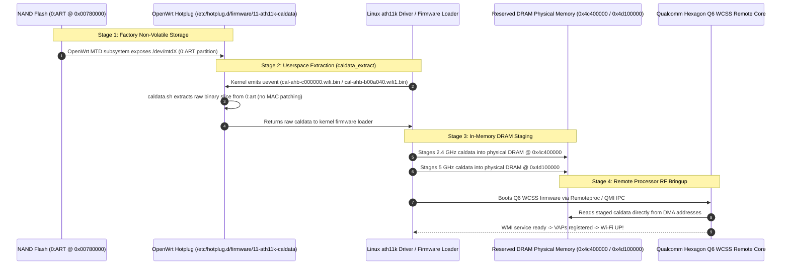

# Wi-Fi Subsystem & Calibration Architecture Specification

- **Document ID:** `docs/WIFI_CALIBRATION_DESIGN.md`
- **Project:** `CR8808-CUSTOM-FIRMWARE` (v0.1.0-dev.2)
- **Target Hardware:** Xiaomi CR8808 Ver.B (Codename `CR8818`, Qualcomm IPQ5018 + QCN6102)
- **Target Platform:** OpenWrt Clean DSA Baseline (`qualcommax/ipq50xx`, Linux 6.18, AArch64 musl)
- **Status:** Authoritative RF & Calibration Engineering Blueprint
- **Revision:** Round 5.2 Review (Precise AHB Calibration Request Paths cal-ahb-*, AHB Driver Attachment, Removal of Erroneous PCI ID, and Firmware Blob Clarification)

---

## 1. Executive Summary & RF System Overview

The Xiaomi CR8808 Ver.B utilizes a dual-radio Qualcomm 802.11ax (Wi-Fi 6) architecture:
1. **2.4 GHz Radio (`wifi0`):** Qualcomm IPQ5018 SoC-integrated 2x2 802.11b/g/n/ax radio connected via internal AHB bus, supporting channel widths up to 40 MHz (max theoretical PHY rate: 574 Mbps). Probed as an AHB platform device (`c000000.wifi`).
2. **5 GHz Radio (`wifi1`):** Discrete Qualcomm **QCN6102** 2x2 802.11a/n/ac/ax radio physically attached via PCIe bus, but **managed and registered by the Hexagon Q6 WPSS (Wireless Processor Subsystem) / Remoteproc as an AHB platform device (`b00a040.wifi1` / `b00a040.wifi`)**, supporting **160 MHz channel bandwidth (HE160)** and 1024-QAM (max theoretical PHY rate: **2402 Mbps**). Probed by `ath11k_ahb`, NOT `ath11k_pci`.

> [!IMPORTANT]
> **Mandatory HE160 Retention:**
> Operating at 160 MHz channel width (2402 Mbps PHY rate) on the 5 GHz band is a non-negotiable project requirement. Down-negotiating or limiting the radio to 80 MHz (1201 Mbps) represents a 50% throughput penalty and constitutes an architectural regression.

> [!NOTE]
> **Binary Firmware Blob Clarification:**
> While the Clean DSA Ethernet datapath operates with **zero NSS binary blobs**, the Wi-Fi subsystem strictly requires proprietary Qualcomm Hexagon Q6 WCSS and M3 firmware blobs (`q6_fw.mdt`, `m3_fw.mdt` provided by `ath11k-firmware-ipq5018` and `ath11k-firmware-qcn6122`). Clean DSA refers strictly to the Ethernet datapath, not a 100% blob-free system.

---

## 2. End-to-End 4-Stage Wi-Fi Calibration Pipeline

RF calibration data (power amplifier bias, I/Q imbalance, channel power limits, and low-noise amplifier gain tables) is device-specific, measured during factory testing, and permanently etched into the SPI NAND flash. If calibration data is lost, corrupted, or incorrectly staged, the wireless subsystem will fail to initialize or emit severely attenuated RF signals.

In modern OpenWrt with `ath11k`, calibration data flows through a deterministic 4-stage pipeline:



---

### Detailed Stage Breakdown:

### Stage 1: Physical NAND Storage (`0:ART`)
- **Physical Partition:** Partition `0:ART` on the Winbond W25N01GWZEIG 128 MB SPI NAND.
- **Flash Offset:** `0x00780000` (length `0x00100000` = 1 MiB).
- **Security & Protection:** DTS marks this partition with `read-only;`. It must never be written to or erased during sysupgrade.

### Stage 2: OpenWrt Hotplug Extraction (`11-ath11k-caldata`)
- Both the integrated 2.4 GHz radio (`wifi0`) and the companion 5 GHz radio (`wifi1`) are probed as **AHB platform devices** (`ath11k_ahb`), because the companion radio is attached via PCIe but managed by Qualcomm's Hexagon Q6 WPSS (Wireless Processor Subsystem) / Remoteproc and exposed to Linux APSS as an AHB platform device (`b00a040.wifi1` / `b00a040.wifi`).
- During driver probe, the kernel firmware loader requests calibration files via uevents. In OpenWrt (authoritatively implemented in `yangfl` commit `b230c2f`), the firmware request names are:
  ```sh
  case "$FIRMWARE" in
  "ath11k/IPQ5018/hw1.0/cal-ahb-c000000.wifi.bin")
      case "$(board_name)" in
      xiaomi,ax6000|\
      xiaomi,cr8818)
          caldata_extract "0:art" 0x1000 0x20000
          ;;
      esac
      ;;
  "ath11k/QCN6122/hw1.0/cal-ahb-b00a040.wifi1.bin" | \
  "ath11k/QCN6122/hw1.0/cal-ahb-b00a040.wifi.bin")
      case "$(board_name)" in
      xiaomi,cr8818)
          caldata_extract "0:art" 0x26800 0x20000
          ;;
      esac
      ;;
  esac
  ```
- **Key Technical Findings on Firmware Request Names:**
  1. **2.4 GHz Exact Request Name:** `ath11k/IPQ5018/hw1.0/cal-ahb-c000000.wifi.bin` (identifying the AHB base address `c000000.wifi`).
  2. **5 GHz Exact Request Name:** `ath11k/QCN6122/hw1.0/cal-ahb-b00a040.wifi1.bin` in OpenWrt 6.12 (`yangfl`). In newer upstream OpenWrt mainline revisions, this request was evolved/renamed to `ath11k/QCN6122/hw1.0/cal-ahb-b00a040.wifi.bin`. Both string variants must be handled in hotplug scripts to maintain kernel cross-version compatibility.
  3. **No Userspace MAC Patching:** `caldata_extract` is called directly without running `ath11k_patch_mac`. The MAC address configuration is handled natively via device tree NVMEM cells (`mac_addr_dp1`, `mac_addr_dp2`).
  4. **Partition Label:** Partition is referenced as `"0:art"` (lowercase).
  5. **Geometry:** 2.4 GHz offset `0x1000` (length `0x20000` = 128 KiB); 5 GHz offset `0x26800` (length `0x20000` = 128 KiB).

### Stage 3: Kernel DRAM Staging (`bdf_region`)
- The Linux `ath11k` driver receives the calibration data from userspace and stages the binaries into designated physical DRAM reserved memory regions:
  - **2.4 GHz (IPQ5018 Integrated):** Physical DRAM base address **`0x4c400000`** (size `0x200000` = 2 MiB).
  - **5 GHz (QCN6102 PCIe):** Physical DRAM base address **`0x4d100000`** (size `0x200000` = 2 MiB).
- These regions are defined in the Device Tree under `reserved-memory`:
  ```dts
  reserved-memory {
      wifi_bdf: bdf@4c400000 {
          reg = <0x0 0x4c400000 0x0 0x200000>;
          no-map;
      };

      qcn6122_bdf: bdf@4d100000 {
          reg = <0x0 0x4d100000 0x0 0x200000>;
          no-map;
      };
  };
  ```

### Stage 4: Remote Processor Bringup (Qualcomm Q6 WCSS)
- The IPQ5018 contains an integrated Qualcomm Hexagon DSP / Q6 WCSS (Wireless Connectivity Subsystem) remote core.
- The host Linux kernel uses `qcom_q6v5_wcss` and `remoteproc` to load the wireless processor firmware (`q6_fw.mdt`).
- Once booted, the Q6 core uses QMI (Qualcomm Messaging Interface) to negotiate parameters, queries the DRAM staging addresses directly via DMA/shared memory, and programs the analog RF front-ends.

---

## 3. Demarcation: QCN6102 vs. QCN6122 Silicon Family

A frequent point of confusion in Qualcomm documentation is the relationship between QCN6102 and QCN6122:

| Hardware Dimension | Qualcomm QCN6102 (CR8808 Ver.B / CR8818) | Qualcomm QCN6122 (Reference SoM / Enterprise APs) |
|---|---|---|
| **Silicon Implementation** | Commercial router client/AP 5 GHz PCIe chip | Commercial router / carrier gateway 5 GHz PCIe chip |
| **RF Stream Configuration** | 2x2 MU-MIMO (Dual stream) | 2x2 MU-MIMO (Dual stream) / 4x4 options |
| **Max Channel Width** | **160 MHz (HE160)** | **160 MHz (HE160)** |
| **Max Theoretical PHY Rate** | **2402 Mbps** (at 1024-QAM, 160 MHz) | **2402 Mbps** (at 1024-QAM, 160 MHz) |
| **Device Attachment & Driver** | AHB platform device via Q6 WPSS (`ath11k_ahb`) | AHB platform device via Q6 WPSS (`ath11k_ahb`) |
| **PCIe Device ID Status** | **`UNKNOWN / INCONCLUSIVE`** (Not exposed as standard PCI netdev) | **`UNKNOWN / INCONCLUSIVE`** |
| **OpenWrt DTS Include** | `ipq5018-qcn6122.dtsi` | `ipq5018-qcn6122.dtsi` |
| **ath11k Firmware Family** | `ath11k/QCN6122/hw1.0/` | `ath11k/QCN6122/hw1.0/` |

### Key Engineering Analysis & Evidence Status:
1. **Physical Silicon vs. Firmware Path & Driver Attachment:**
   - On-device audit certifies the physical 5 GHz silicon as **Qualcomm QCN6102** (`DEVICE_READBACK`).
   - The authoritative `yangfl` DTS (`ipq5018-cr8818.dts`) and hotplug script specify the firmware path as **`ath11k/QCN6122/hw1.0/cal-ahb-b00a040.wifi1.bin`** (or `.wifi.bin` in newer mainline) and target package **`ath11k-firmware-qcn6122`**.
   - **Correction on PCIe ID:** Prior documentation erroneously associated PCIe ID `17cb:1104` with QCN6102. LKDDb and Linux mainline sources attribute `17cb:1104` to QCN6024/9024/9074. On IPQ5018, the companion 5 GHz chip is managed directly by the Hexagon Q6 WPSS remote core and registers with APSS as an **AHB platform device** (`b00a040.wifi1` / `b00a040.wifi`), probed by `ath11k_ahb`, NOT `ath11k_pci`. The PCI ID is therefore marked **`UNKNOWN / INCONCLUSIVE`**.
   - While Qualcomm's driver architecture uses `ipq5018-qcn6122.dtsi` as a shared family include (due to identical baseband core), the exact behavior of the QCN6122 firmware binary on physical QCN6102 silicon under high transmit power is classified as **`UNKNOWN / PENDING_ON_DEVICE_VERIFICATION`**.
2. **Pre-Build Gate:**
   - Under no circumstances will calibration extraction or radio firmware parameters be frozen for production installation until this equivalence is empirically confirmed on physical hardware in Phase P5.

---

## 4. Acceptance Criteria & Wi-Fi Validation Gates (Phase P5)

When custom firmware reaches hardware validation (Phase P5), the wireless subsystem must satisfy the following strict criteria:
1. **2.4 GHz Carrier Bringup:** `wifi0` associates 802.11ax clients at 40 MHz width, generating stable beacons with zero driver panics.
2. **5 GHz HE160 Operation:** `wifi1` operates on 160 MHz channels (Channels 36–64 or 100–128) with `iw dev wlan0 info` confirming:
   ```
   channel 36 (5180 MHz), width: 160 MHz, center1: 5250 MHz
   ```
3. **Throughput Acceptance Target:** Single-client TCP throughput exceeding **900 Mbps** on 5 GHz HE160 (`ACCEPTANCE_TARGET`) with zero caldata CRC errors in `dmesg`.
