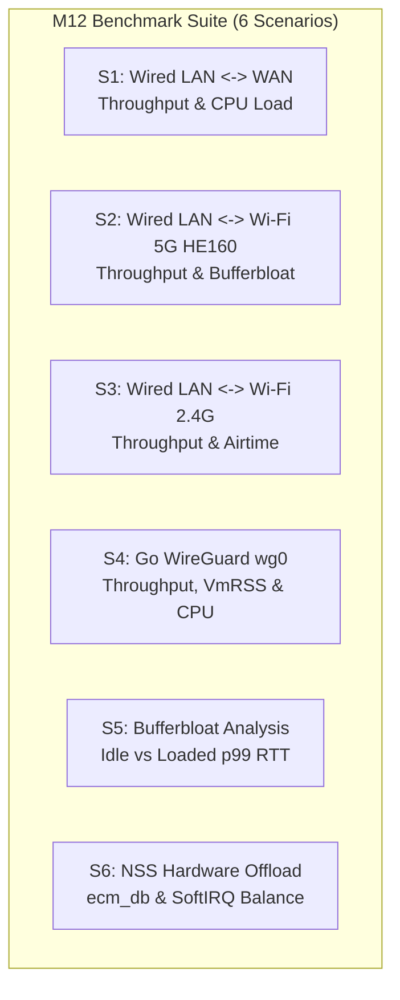

# Milestone M12: Controlled Performance Benchmark Matrix & Methodology

- **Document ID:** `performance/benchmarks/BENCHMARK_MATRIX.md`
- **Target Hardware:** Xiaomi CR8808 / RA82 (Qualcomm IPQ5018 + QCN6102)
- **Firmware:** Xiaomi RA82 Global v1.4.31 (Linux 4.4.60 QSDK)
- **Author:** Performance & Systems Auditor (`@auditor`)
- **Governing Directive:** Chief Architect Directive M12.5 (Work Package 3)
- **Repository Branch:** `feature/m12-ra82-performance-modernization`
- **Safety Standard:** Controlled Stepped Traffic Rates; Zero Unrestricted Flooding; Mandatory Owner Authorization

---

## 1. Executive Summary & Testing Philosophy

The Xiaomi RA82 router functions as the primary live gateway for an active residential network. In benchmark engineering, running uncontrolled, unthrottled bandwidth stress tests (e.g. `iperf3 -u -b 0`) on production network equipment risks:
1. Starving the Dropbear management daemon of CPU cycles, causing SSH disconnection.
2. Inducing severe bufferbloat that drops real-time user traffic (VoIP, video calls, streaming).
3. Triggering thermal throttling or driver instability in proprietary wireless queues (`umac`).

This document defines the **Controlled Performance Benchmark Matrix** across **6 Standardized Scenarios**. It establishes a disciplined, stepped-rate methodology (100M $\rightarrow$ 300M $\rightarrow$ 500M $\rightarrow$ 900M) designed to measure hardware acceleration hit rates, multi-core CPU load, SoftIRQ distribution, and bufferbloat latency without endangering network stability.

---

## 2. Speed Cap Differentiation: ISP WAN vs. Internal Router Limits

A rigorous benchmark must decouple external subscription limits from internal silicon capabilities:

```
+------------------------------------------------------------------------------------------------------------+
|                                    CAPACITY DOMAIN SEPARATION                                              |
+--------------------------+-----------------------+-----------------------------+---------------------------+
| Domain                   | Limiting Bottleneck   | Theoretical Maximum         | Observed Real-World Range |
+--------------------------+-----------------------+-----------------------------+---------------------------+
| **External ISP WAN**     | FPT GPON Subscription | ~150 - 300 Mbps             | Contract Tier Capped      |
| **Internal Wired LAN**   | Motorcomm YT9215SC    | 1,000 Mbps Full Duplex      | 940+ Mbps (Line Rate)     |
| **Wi-Fi 5 GHz HE160**    | QCN6102 (160 MHz)     | 2,401.9 Mbps PHY Rate       | 1,200 - 1,800 Mbps (L4)   |
| **Wi-Fi 2.4 GHz HE40**   | IPQ5018 Integrated    | 574 Mbps PHY Rate           | 250 - 350 Mbps (L4)       |
| **WireGuard Tunnel**     | Userspace Go Daemon   | CPU0 Bound (Single Core)    | ~120 - 140 Mbps (Stock)   |
| **NSS Hardware PPE NAT** | Qualcomm NSS Coproc   | Wire-Speed Hardware Offload | 940+ Mbps (<5% CPU)       |
+--------------------------+-----------------------+-----------------------------+---------------------------+
```
> [!IMPORTANT]
> External Internet speed tests (e.g. `speedtest-cli`) evaluate the ISP's optical transport network and cannot measure the router's 1 Gbps LAN switching or 2.4 Gbps Wi-Fi PHY capabilities. Scenarios S1 through S6 rely exclusively on **local subnet test pairs** across the router's internal physical interfaces.

---

## 3. The 6 Controlled Benchmark Scenarios



---

### Scenario S1: Wired LAN $\leftrightarrow$ WAN Forwarding Throughput & CPU Load

- **Objective:** Measure maximum wired forwarding line rate, verify NSS PPE hardware acceleration, and quantify host CPU utilization across cores.
- **Topology:**
  - Client A (LAN Port 1, `192.168.31.2`) $\longrightarrow$ Router (`192.168.31.1`, NAT) $\longrightarrow$ Client B (WAN Port, `198.51.100.2` mock gateway).
- **Tooling:** `iperf3 -c 198.51.100.2 -t 10 -P 1` + `/proc/stat` sampler.
- **Stepped Traffic Schedule:**
  1. Step 1: 100 Mbps (`-b 100M`, duration 10s) $\rightarrow$ 5s cooldown.
  2. Step 2: 300 Mbps (`-b 300M`, duration 10s) $\rightarrow$ 5s cooldown.
  3. Step 3: 500 Mbps (`-b 500M`, duration 10s) $\rightarrow$ 5s cooldown.
  4. Step 4: 900+ Mbps (Unconstrained TCP, duration 10s) $\rightarrow$ 10s cooldown.
- **Primary Metrics:**
  - Achieved L4 TCP throughput (Mbps).
  - CPU0 vs CPU1 utilization (%).
  - NSS hardware acceleration offload verification (confirm CPU $<5\%$ at 900+ Mbps).
- **Abort Criteria:** Dropbear SSH round-trip latency $>15 \text{ ms}$ or packet loss $>1.0\%$.

---

### Scenario S2: Wired LAN $\leftrightarrow$ Wi-Fi 5 GHz (QCN6102 HE160) Throughput, Jitter & Retransmits

- **Objective:** Evaluate multi-gigabit 160 MHz Wi-Fi 6 transmission, driver aggregation efficiency (A-MPDU), TCP retransmissions, and bufferbloat under wireless contention.
- **Topology:**
  - Workstation (Wired LAN, 1 Gbps) $\longleftrightarrow$ Router $\longleftrightarrow$ Wi-Fi 6 Client (HE160, 2402 Mbps PHY, Channel 40).
- **Tooling:** `iperf3 -c <wifi_ip> -t 15 -i 1` + `iw dev wl0 station dump` + `network_latency_suite.sh`.
- **Stepped Traffic Schedule:**
  1. Step 1: 100 Mbps TCP $\rightarrow$ 5s pause.
  2. Step 2: 300 Mbps TCP $\rightarrow$ 5s pause.
  3. Step 3: 600 Mbps TCP $\rightarrow$ 5s pause.
  4. Step 4: Line-rate TCP (Target: 850–940 Mbps wired limit) $\rightarrow$ 15s pause.
- **Primary Metrics:**
  - Downlink / Uplink TCP Throughput (Mbps).
  - TCP Retransmission count (`tcp_retrans`).
  - Active PHY rate (confirming 1024-QAM, 160 MHz, 2401.9 Mbps).
  - Latency under load (ICMP ping during transfer).
- **Abort Criteria:** Wi-Fi disassociation, beacon loss, or ping RTT $>80 \text{ ms}$.

---

### Scenario S3: Wired LAN $\leftrightarrow$ Wi-Fi 2.4 GHz Throughput & Airtime

- **Objective:** Benchmark legacy 2.4 GHz 802.11ax band (`wl1`, 574 Mbps theoretical), verify co-existence, and measure interference handling.
- **Topology:**
  - Workstation (Wired LAN) $\longleftrightarrow$ Router $\longleftrightarrow$ 2.4 GHz Client (`wl1`, Channel 1, 20/40 MHz).
- **Tooling:** `iperf3 -c <client_ip> -t 10` + `iw dev wl1 station dump`.
- **Stepped Traffic Schedule:**
  1. Step 1: 50 Mbps $\rightarrow$ 5s pause.
  2. Step 2: 100 Mbps $\rightarrow$ 5s pause.
  3. Step 3: Unconstrained 2.4G TCP $\rightarrow$ 10s pause.
- **Primary Metrics:**
  - Sustained throughput (Expected: ~180–260 Mbps).
  - Airtime utilization and retransmit rate.
- **Abort Criteria:** Packet loss $>5.0\%$.

---

### Scenario S4: WireGuard `wg0` Baseline Throughput, VmRSS, and CPU per Core

- **Objective:** Establish the live baseline for the stock Go WireGuard daemon (`wg_server`), measuring user-to-kernel context-switch overhead, memory consumption, and single-core SoftIRQ saturation.
- **Topology:**
  - Remote WireGuard Peer $\longleftrightarrow$ Internet/WAN $\longleftrightarrow$ Router `wg0` TUN $\longleftrightarrow$ LAN.
- **Tooling:** `wireguard_benchmark.sh` + `iperf3 -c 10.0.0.1` + `ps` memory probe.
- **Stepped Traffic Schedule:**
  1. Step 1: 25 Mbps tunnel traffic (duration 10s).
  2. Step 2: 50 Mbps tunnel traffic (duration 10s).
  3. Step 3: 100 Mbps tunnel traffic (duration 10s).
  4. Step 4: Max tunnel saturation (duration 15s).
- **Primary Metrics:**
  - Throughput (Expected bottleneck: ~120–140 Mbps).
  - Process Memory: `VmRSS` (Baseline: ~20.3 MB) and peak `VmHWM` (Baseline: ~43.1 MB).
  - Core Affinity: Verify Core 0 saturation (`ksoftirqd/0` ~100%) vs Core 1 idle (~95%).
- **Abort Criteria:** Router free RAM drops below 6.0 MB.

---

### Scenario S5: Idle Latency vs. Bufferbloat Latency under Load (ICMP p50/p95/p99 RTT)

- **Objective:** Quantify queue delays and bufferbloat across network boundaries under zero load vs. bidirectional traffic saturation.
- **Topology:**
  - Probing Host $\longleftrightarrow$ Router (`192.168.31.1`) while simultaneous TCP download/upload occurs.
- **Tooling:** [`performance/benchmarks/network_latency_suite.sh`](file:///D:/vibecode/CR8808-CUSTOM-FIRMWARE/performance/benchmarks/network_latency_suite.sh) (100 ICMP probes at 20ms intervals).
- **Measurement Matrix:**
  1. **Idle Baseline:** Zero traffic, 100 pings $\rightarrow$ Record min, avg, max, mdev, p50, p95, p99.
  2. **Wired Saturated:** Ping during 900 Mbps Ethernet traffic.
  3. **Wireless Saturated:** Ping during 800 Mbps 5 GHz Wi-Fi traffic.
- **Primary Metrics:**
  - `p50` (Median RTT).
  - `p95` (95th Percentile RTT).
  - `p99` (Tail Latency).
  - Bufferbloat Grade (A: $<5\text{ms}$ increase, B: $<30\text{ms}$, C: $<60\text{ms}$, F: $>100\text{ms}$).
- **Abort Criteria:** Ping timeout $>200 \text{ ms}$ across 3 consecutive probes.

---

### Scenario S6: NSS Hardware Acceleration Counters (`ecm_db`) & SoftIRQ Distribution

- **Objective:** Empirically verify the hardware fast-path hit rate versus software host fallback, inspecting ECM database state and core SoftIRQ deltas.
- **Topology:**
  - Forwarded traffic active via Scenario S1.
- **Tooling:** [`performance/benchmarks/softirq_profiler.sh`](file:///D:/vibecode/CR8808-CUSTOM-FIRMWARE/performance/benchmarks/softirq_profiler.sh) + read-only queries to `/sys/kernel/debug/ecm/`.
- **Primary Metrics:**
  - Active ECM database connection count (`ecm_db`).
  - Hardware accelerated flow count vs. unaccelerated flow count.
  - Bypass count (`auto_bypassed`).
  - Delta `NET_RX` softirqs on CPU0 vs CPU1 during active acceleration (expected: $<200$ softirqs/sec during hardware offload, $>5,000$ softirqs/sec during software fallback).
- **Abort Criteria:** Any ECM error or debugfs lockup.

---

## 4. Comprehensive Scenario Specification Matrix

```
+-----------------------------------------------------------------------------------------------------------------------------------------+
|                                              STANDARDIZED BENCHMARK SCENARIO MATRIX                                                     |
+----+-----------------------+-------------------+--------------------+------------------------+-------------------+----------------------+
| ID | Scenario Name         | Ingress / Egress  | Stepped Rates      | Primary Metrics        | Target Threshold  | Safety Abort Trigger |
+----+-----------------------+-------------------+--------------------+------------------------+-------------------+----------------------+
| S1 | Wired LAN <-> WAN     | eth1 <-> eth0     | 100M, 300M, 500M,  | Throughput, CPU0/1 %,  | 940+ Mbps,        | Latency > 15ms,      |
|    | Forwarding (NAT)      | (Wired GbE)       | 940M (10s steps)   | NSS Hardware Offload   | CPU < 5%          | Packet Loss > 1%     |
| S2 | Wi-Fi 5G HE160        | eth1 <-> wl0      | 100M, 300M, 600M,  | Throughput, Retrans,   | 850-940 Mbps,     | Ping RTT > 80ms,     |
|    | Throughput & Jitter   | (160 MHz Ch 40)   | Max L4 (15s steps) | A-MPDU depth, Jitter   | Retrans < 0.5%    | Wi-Fi Disconnect     |
| S3 | Wi-Fi 2.4G Legacy     | eth1 <-> wl1      | 50M, 100M, Max L4  | Throughput, Airtime,   | 200+ Mbps,        | Packet Loss > 5%     |
|    | Co-existence          | (20/40 MHz Ch 1)  | (10s steps)        | MCS Index, Frame drops | MCS 9-11          |                      |
| S4 | WireGuard wg0         | wg0 TUN <-> LAN   | 25M, 50M, 100M,    | Throughput, VmRSS/HWM, | Baseline: 120Mbps,| MemAvailable < 6 MB, |
|    | Daemon Footprint      | (Encrypted UDP)   | Saturation (15s)   | Core 0 Saturation %    | VmRSS ~20MB       | SSH Timeout > 5s     |
| S5 | Bufferbloat & Tail    | ICMP Probes under | Idle, Wired Load,  | ICMP p50, p95, p99     | Bufferbloat       | Ping RTT > 200ms     |
|    | Latency (p50/p95/p99) | Bidirectional Load| Wireless Load      | Latency, Jitter Spread | Delta < 15ms      |                      |
| S6 | NSS Offload & ECM     | Hardware PPE vs   | Forwarding Stream  | Accelerated vs Bypassed| Offload > 95%,    | Debugfs Error,       |
|    | Database Verification | Linux SoftIRQ     | Active (10s sample)| Flows, NET_RX Delta    | CPU0 IRQ < 500/s  | Kernel Warning       |
+----+-----------------------+-------------------+--------------------+------------------------+-------------------+----------------------+
```

---

## 5. Residential Network Safety Rules & Authorization Protocol

Because the Xiaomi RA82 operates in an active household environment, the following strict controls are enforced:

### Rule 1: Mandatory Human Owner Authorization
- **No high-bandwidth benchmark (Scenarios S1, S2, S3, S4) may be executed without explicit, real-time approval from the router owner.**
- Benchmarking must be scheduled during maintenance windows when no latency-critical tasks are active on the local network.

### Rule 2: Strict Stepped Rate Progression (No Packet Floods)
- Unthrottled UDP storms (`iperf3 -u -b 0`) are **strictly prohibited**.
- All benchmarks must progress through discrete stepped rates (100M $\rightarrow$ 300M $\rightarrow$ 500M) with a mandatory **5-to-10 second idle cooldown** between steps to allow TCP buffer drainage and socket cleanup.

### Rule 3: Automated Emergency Throttle & Abort
Every benchmarking script in `performance/benchmarks/` must monitor device health in real time:
```bash
# Emergency Abort Watchdog Check
if [ "$PING_RTT" -gt 100 ] || [ "$FREE_RAM_KB" -lt 6144 ]; then
    echo "EMERGENCY ABORT: Device health threshold violated! Halting benchmark."
    killall -9 iperf3 2>/dev/null || true
    exit 99
fi
```

### Rule 4: Zero Router Writes
All telemetry collectors must operate exclusively via read-only stdin pipes. No temporary files or binaries may be written to the router's SPI flash or ramfs.

---

## 6. Verification & Implementation Reference

The benchmarking scripts implementing this matrix reside in [`performance/benchmarks/`](file:///D:/vibecode/CR8808-CUSTOM-FIRMWARE/performance/benchmarks/):
- **Master Runner:** [`performance/benchmarks/run_all_benchmarks.sh`](file:///D:/vibecode/CR8808-CUSTOM-FIRMWARE/performance/benchmarks/run_all_benchmarks.sh)
- **SoftIRQ Profiler:** [`performance/benchmarks/softirq_profiler.sh`](file:///D:/vibecode/CR8808-CUSTOM-FIRMWARE/performance/benchmarks/softirq_profiler.sh)
- **Memory Profiler:** [`performance/benchmarks/memory_profiler.sh`](file:///D:/vibecode/CR8808-CUSTOM-FIRMWARE/performance/benchmarks/memory_profiler.sh)
- **Network Latency & Bufferbloat Suite:** [`performance/benchmarks/network_latency_suite.sh`](file:///D:/vibecode/CR8808-CUSTOM-FIRMWARE/performance/benchmarks/network_latency_suite.sh)
- **WireGuard Profiler:** [`performance/benchmarks/wireguard_benchmark.sh`](file:///D:/vibecode/CR8808-CUSTOM-FIRMWARE/performance/benchmarks/wireguard_benchmark.sh)
