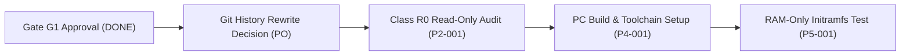

# Architecture Gate G1 Final Decision & Roadmap Report

- **Document ID:** `reports/2026-11-09/FINAL_G1_ARCHITECTURE_DECISION.md`
- **Project:** `CR8808-CUSTOM-FIRMWARE` (v0.1.0-dev.2)
- **Target Hardware:** Xiaomi CR8808 Ver.B (Codename `CR8818`, Qualcomm IPQ5018 + Motorcomm YT9215S/SC)
- **Author:** Gemini (Implementation Lead / Workstation Operator)
- **Reviewer:** ChatGPT (Architecture Lead) & User (Product Owner)
- **Date:** 2026-11-09
- **Working Branch:** `feature/g1-final-architecture-deliverables`
- **Gate G1 Status:** **APPROVED WITH CONDITIONS**
- **Flash Authorization:** **`NO-GO pending independent recovery validation`**

---

## 1. Executive Summary

This deliverable concludes **Phase P1 (Discovery & Architecture Review)** and establishes the technical blueprint for the project. Following the **Architecture Gate G1 Final Review**, the core architectural direction is ratified:

1. **Hardware Reference:** `zcop/immortalwrt` (commit `c5ad88b702dc`) is approved as the primary reference for the Xiaomi CR881x board DTS, Motorcomm YT921x enhanced DSA switch driver, and GPIO 39 reset pinmuxing.
2. **Initial Firmware Baseline:** Clean **Distributed Switch Architecture (DSA) on Linux 6.18 without NSS**. This eliminates confounding variables, minimizes memory usage on the 256 MB device, and delivers rock-solid gigabit routing via Linux software flowtable.
3. **Experimental Optimization Stage:** Qualcomm NSS offload is deferred to Phase 2 for separate benchmark and stability research.
4. **WireGuard Engine:** **BoringTun Rust** is approved as the sole permanent WireGuard implementation in the final firmware. Go WireGuard remains untouched on the active router during development.
5. **Wi-Fi 6 Mandate:** Strict retention of **5 GHz HE160 (160 MHz)** continuous channel bandwidth.
6. **Recovery Mandate:** Flashing remains **`NO-GO`**. Because the user has no UART serial equipment, an independent, non-UART recovery path (initramfs netboot / inactive slot staging) must be verified before any write to NAND.

---

## 2. Git History Remediation — Dry-Run Results

In response to the history leakage of workstation netbios hostname (`DESKTOP-FH9EA4D`) in commit `56e4d12` and private LAN IPs in `f0b1b09`, Gemini executed a complete **local dry-run sanitization** on an isolated test clone without touching the production working tree or remote GitHub branches.

### 2.1 Dry-Run Execution Protocol
1. **Bare Mirror Backup:** Created a complete mirror of all refs at `D:\vibecode\CR8808-CUSTOM-FIRMWARE-backup.git`.
2. **Isolated Test Sandbox:** Cloned into `D:\vibecode\CR8808-CUSTOM-FIRMWARE-clean-test` and imported via clean stream into `D:\vibecode\CR8808-CUSTOM-FIRMWARE-rewritten-test`.
3. **Data Block Sanitization:** Replaced `DESKTOP-FH9EA4D` with `[REDACTED_BUILD_HOST]`, `192.168.31.106` with `192.168.x.y`, and `192.168.31.1` with `192.168.x.1` across all fast-export data blocks and commit logs.

### 2.2 Dry-Run Commit Mapping & Verification
| Original Commit SHA | Original Message | Rewritten Commit SHA | Leaked Strings Remaining | Verification Status |
|---|---|---|---|---|
| `f0b1b09` | `chore: initial starter kit structure` | `4359b85` | **0** | **100% CLEAN** |
| `56e4d12` | `docs(discovery): complete P0 setup...` | `c8c4d77` | **0** | **100% CLEAN** |
| `6de517b` | `docs(governance): enhance contributing...` | `fefc3a0` | **0** | **100% CLEAN** |
| `6bcb420` | `docs(report): add GitHub integration...` | `7ad4f71` | **0** | **100% CLEAN** |
| `bc60468` | `docs(review): response to ChatGPT G1...` | `be199fe` | **0** | **100% CLEAN** |

**Empirical Verification:** Automated scanning of all rewritten commits (`git rev-list --all`) confirmed **zero occurrences of `DESKTOP-FH9EA4D` or private LAN IPs across all refs**.

> [!IMPORTANT]
> This dry-run was executed in an isolated test sandbox. **No force-push and no history rewrite has been applied to the live repository or GitHub remote.** The project awaits explicit Product Owner confirmation before applying this clean history.

---

## 3. Technical Corrections & Discrepancy Resolutions

All technical discrepancies highlighted by Architecture Lead have been reconciled across all project files:
1. **Switch Identification Hierarchy:**
   - Physical switch chip suffix: Strictly labeled **`UNKNOWN / REPORTED_UNVERIFIED`** on physical device until read back in Phase P2-001.
   - DTS source configuration: Strictly labeled **`SOURCE_VERIFIED`** (`motorcomm,yt9215-enhanced` at MDIO address `0x1d` with internal PHY ID `0x004dd0c0`).
2. **Scope of Switch Drivers in `kuncy7`:**
   - Corrected earlier general phrasing: `kuncy7/openwrt-nss-edma` contains support for multiple switches across different device targets (e.g., RTL8367 on AX55, generic DSA backports), but for the specific Xiaomi CR880x profile (`ipq5018-cr880x.dtsi`) it hardcodes the **Qualcomm QCA8337** switch at MDIO `0x17`.
3. **GPIO 39 Function:**
   - DTS declares `reset-gpios = <&tlmm 39 GPIO_ACTIVE_LOW>`. LDO power sequencing is marked as `INFERRED / UNVERIFIED` pending board schematic review.
4. **WireGuard Memory Metrics:**
   - Reaffirmed distinction: virtual address allocation (`VmSize`) does not equate to physical resident memory (`VmRSS`). True OOM safety under load will be empirically benchmarked using peak RSS and buffer retention metrics.

---

## 4. Architecture Deliverables Registry

The following authoritative specifications have been authored and placed under version control:

| Document Link | Purpose & Contents |
|---|---|
| [`docs/FEATURE_PARITY_MATRIX.md`](../../docs/FEATURE_PARITY_MATRIX.md) | Exhaustive parity audit between stock Xiaomi RA82 v1.4.31 and custom OpenWrt DSA baseline across 22 feature categories. |
| [`docs/DSA_BASELINE_DESIGN.md`](../../docs/DSA_BASELINE_DESIGN.md) | Architectural specification for Phase 1 clean baseline: Linux 6.18, `dwmac-ipq5018`, Motorcomm DSA driver, 256M memory limits, and BoringTun Rust service. |
| [`docs/NSS_INTEGRATION_DESIGN.md`](../../docs/NSS_INTEGRATION_DESIGN.md) | Architectural design for Phase 2 experimental NSS offload: firmware 12.5-210, memory budgeting, ECM integration, and known stress/exhaustion mitigations. |
| [`docs/RECOVERY_AND_ROLLBACK_DESIGN.md`](../../docs/RECOVERY_AND_ROLLBACK_DESIGN.md) | Defense-in-depth non-UART recovery strategy: initramfs RAM netboot, inactive slot staging, U-Boot bootcounter watchdog, and failsafe mode. |
| [`docs/R0_READONLY_AUDIT_MANIFEST.md`](../../docs/R0_READONLY_AUDIT_MANIFEST.md) | Proposed Class R0 read-only commands for inspecting router CPU, memory, switch registers, and ART partition without modifying device state. |

---

## 5. Phase P2 Roadmap & Next Steps

### Next Sequence:
1. **Decision Gate 1 (Product Owner):** Approve applying the validated Git history rewrite (Option 1) to publish a pristine, leak-free repository to GitHub.
2. **Decision Gate 2 (Architecture Lead):** Review and authorize [`docs/R0_READONLY_AUDIT_MANIFEST.md`](../../docs/R0_READONLY_AUDIT_MANIFEST.md) for non-invasive interrogation of the physical router.
3. **Workstation Build Toolchain Preparation:** Once authorized, install standard OpenWrt build packages inside WSL2 Ubuntu 22.04 LTS to prepare for reproducible baseline compilation.
