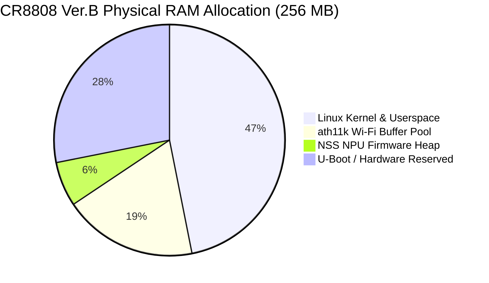

# G1 Discovery Report: Build Host, Candidate Upstream Sources, and Hardware Compatibility Analysis

- **Document ID:** `reports/2026-11-09/G1_DISCOVERY_REPORT.md`
- **Project:** `CR8808-CUSTOM-FIRMWARE` (v0.1.0-dev.2)
- **Target Product:** Xiaomi CR8808 Ver.B
- **Author:** Gemini (Implementation Lead / Workstation Operator)
- **Reviewer:** ChatGPT (Architecture Lead) & User (Product Owner)
- **Audit Date:** 2026-11-09
- **Phase Gate:** P0 / P1 (Discovery Only)
- **Flash Authorization:** `NO-GO`

---

## 1. Executive Summary

This report delivers the empirical findings of Phase P0 (Safe Repository Setup) and Phase P1 (Build Host Audit and Upstream Source Governance Audit) in strict accordance with [AGENTS.md](../../AGENTS.md) and [prompts/00_GEMINI_KICKOFF.md](../../prompts/00_GEMINI_KICKOFF.md).

### Key Takeaways:
1. **Zero Router Disturbance (`SOURCE_VERIFIED`):** No SSH connection, no commands, no file uploads, and no state alterations were executed against the router during this discovery phase. The router continues running Xiaomi RA82 v1.4.31 with Go WireGuard providing active Internet connectivity to the workstation.
2. **Workstation Readiness (`MEASURED`):** The Windows 11 host (16 physical cores / 24 logical threads @ Intel Core i7-14650HX, 32 GB RAM, 635.86 GB free storage on build volume `D:`) provides ample compute capacity. WSL2 with Ubuntu 22.04.5 LTS is installed and verified. Basic user utilities are present, but core build toolchains (`build-essential`, `make`, `gcc`, `unzip`) are not yet installed in WSL2 (per strict non-installation rules).
3. **Upstream Source Identification (`SOURCE_VERIFIED`):**
   - **Mainline OpenWrt & ImmortalWrt (`openwrt/openwrt`, `immortalwrt/immortalwrt`):** Both support the Qualcomm IPQ50xx target (`qualcommax/ipq50xx`) on Linux kernel 6.18 and have merged backport patches for the Motorcomm YT921x DSA switch driver (`target/linux/generic/backport-6.18/967-*.patch`). However, **neither repository contains device profiles, DTS files, or partition definitions for Xiaomi CR881x / CR8808 Ver.B**.
   - **CR8806 NSS Trees (`kuncy7/openwrt-nss-edma`, `fanha99/openwrt-xiaomi-cr8806-nss`):** These trees demonstrate mature Qualcomm NSS acceleration on Linux 6.18 with upstream `stmmac`. However, their device tree (`ipq5018-cr880x.dtsi`) hardcodes the **Qualcomm QCA8337** switch at MDIO `0x17`. **Flashing these images onto CR8808 Ver.B will cause complete Ethernet link failure (dead WAN and LAN ports) because CR8808 Ver.B employs a Motorcomm YT9215S/SC switch (suffix UNKNOWN / REPORTED_UNVERIFIED) requiring GPIO 39 reset (LDO power INFERRED) and MDIO 0x1d.**
   - **CR881x Board & Switch Reference (`zcop/immortalwrt`):** This is the **only audited repository with dedicated support for Xiaomi CR881x** on Linux kernel 6.18.60. It integrates the custom `motorcomm,yt9215-enhanced` DSA driver (`yt921x_driver.ko`), precise DTS pinmuxing (GPIO 39 reset, GPIO 36/37 MDIO), and has verified native NSS offload reaching 936 Mbps routed IPv4 TCP with ~98% CPU idle.
4. **256 MB RAM Constraint (`SOURCE_VERIFIED`):** Qualcomm IPQ5018 with ath11k and NSS offload easily encounters out-of-memory crashes on 256 MB RAM devices if configured with 512 MB profile defaults. To guarantee bootability and stability, the build must enforce `ATH11K_MEM_PROFILE_256M`, `NSS_MEM_PROFILE_LOW`, and limit NSS reserved memory to 8–16 MiB.
5. **Phase Gate Disposition:** The repository is safely initialized on Git branch `develop`. All upstream candidates are audited. **Progression to Phase P2 requires Architecture Lead review and explicit User approval.**

---

## 2. Build Host Readiness

The workstation environment was audited on 2026-11-09 without installing, upgrading, or modifying any system packages (`MEASURED`).

### 2.1 Hardware and Host OS
| Parameter | Value | Evidence Status |
|---|---|---|
| Host OS | Microsoft Windows 11 Pro, Version 10.0.26300, Build 26300 | `MEASURED` |
| Processor | Intel(R) Core(TM) i7-14650HX (1 socket, 16 physical cores, 24 logical processors) | `MEASURED` |
| System RAM | 31.78 GB Total Physical, 11.57 GB Available Free | `MEASURED` |
| Build Drive (`D:`) | 635.86 GB Free / 1227.16 GB Used (~1.86 TB NTFS partition) | `MEASURED` |
| System Drive (`C:`) | 41.21 GB Free | `MEASURED` |
| Hardware Virtualization | Enabled (Hyper-V / Virtual Machine Platform active) | `MEASURED` |
| Docker Status | Docker Desktop 29.9.2 (build a82e528) installed | `MEASURED` |

### 2.2 WSL2 Linux Subsystem
| Parameter | Value | Evidence Status |
|---|---|---|
| WSL Version | WSL2 | `MEASURED` |
| Installed Distributions | `Ubuntu-22.04` (Default), `docker-desktop` | `MEASURED` |
| WSL Linux Kernel | Linux 6.6.87.2-microsoft-standard-WSL2 #1 SMP PREEMPT_DYNAMIC | `MEASURED` |
| WSL Linux Distro | Ubuntu 22.04.5 LTS (Jammy Jellyfish, x86_64) | `MEASURED` |

### 2.3 Toolchain Availability Matrix
| Tool | Windows Host Path / Version | WSL2 Ubuntu-22.04 Path / Version | OpenWrt Build Requirement Status |
|---|---|---|---|
| `git` | `C:\Program Files\Git\cmd\git.exe` (2.51.0) | `/usr/bin/git` (2.34.1) | **Ready** |
| `python3` | `Python 3.12.0` (Host) & `3.12.7` (MSYS2) | `/usr/bin/python3` (3.10.12) | **Ready** |
| `cargo` / `rustc` | `cargo 1.97.1` / `rustc 1.97.1` | NOT_FOUND | Ready on host for cross-compiling BoringTun |
| `make` | NOT_FOUND | NOT_FOUND | **MISSING in WSL2** (Needs `build-essential`) |
| `gcc` / `g++` | `C:\msys64\ucrt64\bin\gcc.exe` (Rev2, UCRT64) | NOT_FOUND | **MISSING in WSL2** (Needs `build-essential`) |
| `clang` | NOT_FOUND | NOT_FOUND | Optional |
| `perl` | NOT_FOUND | `/usr/bin/perl` (5.34.0) | **Ready** |
| `rsync` | NOT_FOUND | `/usr/bin/rsync` (3.2.7) | **Ready** |
| `unzip` | NOT_FOUND | NOT_FOUND | **MISSING in WSL2** |
| `wget` | PowerShell native | `/usr/bin/wget` (1.21.2) | **Ready** |
| `curl` | Windows curl.exe | `/usr/bin/curl` (7.81.0) | **Ready** |
| `file` | NOT_FOUND | `/usr/bin/file` (5.41) | **Ready** |
| `sha256sum` | NOT_FOUND | `/usr/bin/sha256sum` (8.32) | **Ready** |

> [!NOTE]
> Firmware builds for OpenWrt/ImmortalWrt require a case-sensitive POSIX filesystem and should be executed inside WSL2 Ubuntu 22.04 on a dedicated Linux virtual disk (or ext4 mount). Standard OpenWrt build dependencies (`build-essential`, `gawk`, `gettext`, `libncurses-dev`, `libssl-dev`, `unzip`, `zlib1g-dev`) must be installed in WSL2 once Phase P4 is approved.

---

## 3. Upstream Source Audit Table

All 8 candidate repositories specified in `manifests/sources.yaml` were audited via Git remote inspection (`git ls-remote`) and GitHub API on 2026-11-09 (`SOURCE_VERIFIED`).

| Alias | Repository URL | Default Branch | Audited Commit SHA | Commit Date | License | Target / Kernel | Compatibility Role |
|---|---|---|---|---|---|---|---|
| `openwrt` | `openwrt/openwrt` | `main` | `dd72c4c198330e208c2357625693a03996cae741` | 2026-11-09 | GPL-2.0 | `qualcommax` / 6.18 | Upstream Base (No CR881x board DTS) |
| `immortalwrt` | `immortalwrt/immortalwrt` | `master` | `4765b657625ec5bbda74b44400465fe043802b30` | 2026-11-05 | GPL-2.0 | `qualcommax` / 6.18 | Distribution Base (No CR881x board DTS) |
| `zcop` | `zcop/immortalwrt` | `master` | `c5ad88b702dc2374c9d67141693cc06cce742dc8` | 2026-11-08 | GPL-2.0 | `qualcommax` / 6.18.60 | **Primary CR881x Board & Switch Reference** |
| `kuncy7_nss_edma` | `kuncy7/openwrt-nss-edma` | `c3po-tag-8021q` | `047ee4cea18d66189b4f7adddbac76c2373658fb` | 2026-11-08 | GPL-2.0 | `qualcommax` / 6.18 | NSS EDMA Reference (CR8806/QCA8337 only) |
| `kuncy7_nss_packages` | `kuncy7/nss-packages` | `ipq50xx-rebase` | `c94a78031ddc7695b2b7a0c5b91421f7b032ed92` | 2026-11-09 | Mixed / Qualcomm | IPQ50xx (FW 12.5-210) | NSS Drivers & Packages Reference |
| `fanha99_cr8806` | `fanha99/openwrt-xiaomi-cr8806-nss` | `main` | `1469a4a835aeb1c75394ec0828dd594b069254a5` | 2026-11-08 | GPL-2.0 | `qualcommax` / 6.18 | CR8806 Reference Only (Not for CR8808 Ver.B) |
| `hzyitc` | `hzyitc/openwrt-redmi-ax3000` | `ipq50xx-mainline-kernel-5.15-openwrt-23.05` | `6faaa1504fd5c5ca34f61b22ab07851907604c59` | 2024-07-24 | GPL-2.0 | `qualcommax` / 5.15 | Legacy Reference Only (Kernel 5.15) |
| `marchmin_zcop` | `marchmin/immortalwrt-zcop` | `master` | `77403081b8cce8be2cafca548790c3c9d9ef3fa9` | 2026-05-25 | GPL-2.0 | `qualcommax` / 6.12 & 6.18 | Outdated Fork of zcop (Superseded) |

---

### 3.1 Individual Source Audits (per `docs/templates/SOURCE_AUDIT_TEMPLATE.md`)

#### Audit 1: `zcop` (ImmortalWrt CR881x Port)
- **Alias:** `zcop`
- **Repository URL:** `https://github.com/zcop/immortalwrt`
- **Owner:** `zcop`
- **Audit Date:** 2026-11-09
- **Default Branch:** `master`
- **Commit SHA:** `c5ad88b702dc2374c9d67141693cc06cce742dc8`
- **Commit Date:** 2026-11-08T18:46:18Z (`docs: record scheduler controls and UART recovery`)
- **Tags/Releases:** Live development tree, multiple tagged test slices.
- **License:** GPL-2.0
- **Kernel Version:** Linux 6.18.60 (`KERNEL_PATCHVER:=6.18`)
- **Toolchain:** aarch64 Cortex-A53 GCC / Musl
- **Target Architecture/ABI:** `qualcommax/ipq50xx` (64-bit ARMv8 Cortex-A53)
- **Device Profiles:** `xiaomi_cr881x`, `xiaomi_cr881x_nss`, `cmcc_rax3000q`
- **DTS Paths:**
  - `target/linux/qualcommax/dts/ipq5018-cr881x.dts`
  - `target/linux/qualcommax/dts/ipq5018-cr881x-nss.dts`
- **Switch/MDIO/GPIO Paths:**
  - `target/linux/generic/files/drivers/net/dsa/yt921x*.{c,h}` (enhanced DSA switch driver)
  - `target/linux/generic/files/net/dsa/tag_yt921x_enhanced.c` (hardware tagger module)
  - Reset GPIO: GPIO 39 (`reset-gpios = <&tlmm 39 GPIO_ACTIVE_LOW>`)
  - MDIO Bus 1: GPIO 36 (MDC), GPIO 37 (MDIO); Switch address `0x1d`
- **Ethernet/EDMA Paths:**
  - `gmac0`: Secondary conduit (port 7)
  - `gmac1`: Primary conduit (port 8) via `2500base-x` SGMII trunk to switch
- **NSS/ECM/qdisc Paths:**
  - `feeds.conf.default`: pins `https://github.com/qosmio/nss-packages.git^0d970dbf0185e3f53709bd803e8a466598023c57`
  - `docs/cr881x/NSS Offload status.md`: documents native NSS on Linux 6.18.60 reaching 936 Mbps routed IPv4 TCP with 98% idle CPU.
- **Wi-Fi/ath11k Paths:**
  - AHB `wifi0` (internal IPQ5018 2.4 GHz) + `wifi1` (QCN6122 / QCN6102 5 GHz HE160)
  - `qcom,ath11k-fw-memory-mode = <1>`
  - `qcom,bdf-addr = <0x4d100000>`
- **Known Issues:**
  - Wi-Fi NSS offload disabled in default CR881x configuration; only wired IPv4 NAT offload active.
  - SGMII SerDes timing requires exact clock configuration (handled in DTS).
- **Compatibility Assessment:** **SUITABLE** as the primary board DTS, switch driver, and integration reference.
- **Confidence:** High (`SOURCE_VERIFIED`).

---

#### Audit 2: `kuncy7_nss_edma` (OpenWrt NSS with Upstream Ethernet)
- **Alias:** `kuncy7_nss_edma`
- **Repository URL:** `https://github.com/kuncy7/openwrt-nss-edma`
- **Owner:** `kuncy7` (Sean K / datapronix)
- **Audit Date:** 2026-11-09
- **Default Branch:** `c3po-tag-8021q`
- **Commit SHA:** `047ee4cea18d66189b4f7adddbac76c2373658fb`
- **Commit Date:** 2026-11-08T19:24:25Z
- **License:** GPL-2.0
- **Kernel Version:** Linux 6.18 (`KERNEL_PATCHVER:=6.18`)
- **Device Profiles:** GL.iNet GL-B3000, Xiaomi CR8806, TP-Link Archer AX55, Cudy P5
- **DTS Paths:** `target/linux/qualcommax/dts/ipq5018-cr8806.dts`, `ipq5018-cr880x.dtsi`
- **Switch/MDIO/GPIO Paths:**
  - Configures Qualcomm QCA8337 switch at MDIO `0x17` (`compatible = "qca,qca8337"`).
  - DOES NOT configure Motorcomm YT9215S/SC switch (suffix UNKNOWN on device).
- **NSS Paths:** Upstream `stmmac` data-path claim API (Patch `0956`), `kmod-qca-dwmac-nss`, `qca-nss-drv`.
- **Compatibility Assessment:** **UNSUITABLE as a complete image** (CR8806 image will brick Ethernet on CR8808 Ver.B); **REFERENCE_ONLY** for NSS kernel glue and 256 MB memory configuration.
- **Confidence:** High (`SOURCE_VERIFIED`).

---

#### Audit 3: `kuncy7_nss_packages` (NSS Driver and Firmware Packages)
- **Alias:** `kuncy7_nss_packages`
- **Repository URL:** `https://github.com/kuncy7/nss-packages`
- **Owner:** `kuncy7`
- **Audit Date:** 2026-11-09
- **Default Branch:** `ipq50xx-rebase`
- **Commit SHA:** `c94a78031ddc7695b2b7a0c5b91421f7b032ed92`
- **Commit Date:** 2026-11-09T08:55:16Z
- **License:** Mixed (GPL-2.0 for glue, Qualcomm proprietary for NSS firmware binaries)
- **Packages Included:** `nss-firmware` (v2025.05.01, supporting NSS 12.5-210 & 12.2-156 for IPQ5018 `MP`), `qca-nss-drv`, `qca-nss-ecm`, `qca-nss-clients`, `sqm-scripts-nss`.
- **Compatibility Assessment:** **SUITABLE** as the package feed for NSS acceleration components.
- **Confidence:** High (`SOURCE_VERIFIED`).

---

#### Audit 4: `openwrt` (Official OpenWrt Mainline)
- **Alias:** `openwrt`
- **Repository URL:** `https://github.com/openwrt/openwrt`
- **Default Branch:** `main`
- **Commit SHA:** `dd72c4c198330e208c2357625693a03996cae741`
- **Commit Date:** 2026-11-09T09:45:46Z
- **Kernel Version:** 6.18
- **Status for CR8808 Ver.B:** Subtarget `ipq50xx` and Motorcomm YT921x backport patches exist, but no board DTS, profiles, or U-Boot env definitions for Xiaomi CR881x exist in upstream main (`cr88 matches: 0`).
- **Compatibility Assessment:** **REFERENCE_ONLY** for clean upstream packaging.

---

#### Audit 5: `immortalwrt` (Official ImmortalWrt Mainline)
- **Alias:** `immortalwrt`
- **Repository URL:** `https://github.com/immortalwrt/immortalwrt`
- **Default Branch:** `master`
- **Commit SHA:** `4765b657625ec5bbda74b44400465fe043802b30`
- **Commit Date:** 2026-11-05T04:06:13Z
- **Status for CR8808 Ver.B:** Same as OpenWrt main. Contains `ipq50xx` generic support, but no CR881x board profile.
- **Compatibility Assessment:** **REFERENCE_ONLY**.

---

#### Audit 6: `fanha99_cr8806` (Xiaomi CR8806 NSS Port)
- **Alias:** `fanha99_cr8806`
- **Repository URL:** `https://github.com/fanha99/openwrt-xiaomi-cr8806-nss`
- **Default Branch:** `main`
- **Commit SHA:** `1469a4a835aeb1c75394ec0828dd594b069254a5`
- **Commit Date:** 2026-11-08T07:02:46Z
- **Status for CR8808 Ver.B:** Inherits from kuncy7; targets CR8806 (QCA8337 switch).
- **Compatibility Assessment:** **UNSUITABLE** for direct deployment; **REFERENCE_ONLY** for 256 MB memory tuning documentation.

---

#### Audit 7: `hzyitc` (Legacy Redmi AX3000 OpenWrt Port)
- **Alias:** `hzyitc`
- **Repository URL:** `https://github.com/hzyitc/openwrt-redmi-ax3000`
- **Default Branch:** `ipq50xx-mainline-kernel-5.15-openwrt-23.05`
- **Commit SHA:** `6faaa1504fd5c5ca34f61b22ab07851907604c59`
- **Commit Date:** 2024-07-24T15:31:43Z
- **Kernel Version:** 5.15
- **Compatibility Assessment:** **UNSUITABLE** (Outdated kernel 5.15 and different switch wiring).

---

#### Audit 8: `marchmin_zcop` (ImmortalWrt Zcop Fork)
- **Alias:** `marchmin_zcop`
- **Repository URL:** `https://github.com/marchmin/immortalwrt-zcop`
- **Default Branch:** `master`
- **Commit SHA:** `77403081b8cce8be2cafca548790c3c9d9ef3fa9`
- **Commit Date:** 2026-05-25T13:06:04Z
- **Compatibility Assessment:** **UNSUITABLE / SUPERSEDED** by upstream `zcop/immortalwrt`.

---

## 4. Hardware / Source Compatibility Matrix

| Hardware Subsystem | CR8808 Ver.B Hardware Specification | Mainline OpenWrt / ImmortalWrt | `kuncy7` / `fanha99` (CR8806) | `zcop/immortalwrt` (CR881x) | Compatibility Assessment |
|---|---|---|---|---|---|
| **SoC / CPU** | Qualcomm IPQ5018 (Dual-Core Cortex-A53 @ 1.0 GHz) | Supported (`qualcommax/ipq50xx`) | Supported (`qualcommax/ipq50xx`) | Supported (`qualcommax/ipq50xx`) | **Compatible** across modern trees |
| **Physical RAM** | 256 MB DDR3L (182 MB usable) | Default configs tune for 512M | Documented 256M profile | Configured for 256M profile | **Strict 256M configs required** |
| **Ethernet Switch** | **Motorcomm YT9215S/SC** (suffix UNKNOWN, internal PHY ID 0x004dd0c0, MDIO 0x1d) | Driver backported, but no board wiring | **INCOMPATIBLE** (targets QCA8337 @ 0x17) | **COMPATIBLE** (`motorcomm,yt9215-enhanced` @ 0x1d) | **Only zcop supports this switch wiring** |
| **Switch Reset / Power** | GPIO 39 (Reset in DTS; LDO power INFERRED), GPIO 36/37 (MDIO) | Not mapped for CR881x | Not mapped | Fully mapped in `ipq5018-cr881x.dts` | **Critical for cold-boot switch probe** |
| **Wi-Fi 2.4 GHz** | Integrated IPQ5018 (2x2 802.11ax) | Supported in `ath11k` | Supported in `ath11k` | Supported in `ath11k` | **Compatible** |
| **Wi-Fi 5 GHz** | Qualcomm QCN6102/QCN6122 (2x2 HE160) | Supported in `ath11k` | Supported in `ath11k` | Supported in `ath11k` | **Compatible** (Requires BDF from board) |
| **Flash / NAND** | Winbond W25N01GWZEIG (128 MB SPI NAND) | Standard SPI-NAND driver | Dual UBI layout for CR8806 | Dual UBI layout for CR881x | **Compatible partition layout** |
| **NSS NPU** | Qualcomm NSS Core (1 GHz NPU) | No NSS support in mainline | Supported via `stmmac` claim | Supported via `qcom,nss-dp` or glue | **NSS viable only with downstream patches** |

> [!CAUTION]
> Flashing an image built from `kuncy7/openwrt-nss-edma` or `fanha99/openwrt-xiaomi-cr8806-nss` will bind the Ethernet interface to a non-existent QCA8337 switch. Because the Motorcomm switch is neither powered up nor programmed, all 4 physical Ethernet ports will stay down, completely isolating the router from the network.

---

## 5. Kernel and Driver Conflicts

### 5.1 Linux 4.4.60 (Stock RA82) vs. Linux 6.18 (Target OpenWrt)
- **Stock Kernel (4.4.60):** Built in July 2023. End-of-Life upstream since February 2022. Lacks modern eBPF, DSA, modern WireGuard kernel module, modern CAKE/FQ-CoDel schedulers, and modern TCP BBRv3.
- **Target Kernel (6.18):** Full modern Linux networking stack, Distributed Switch Architecture (DSA), WireGuard in-kernel support, and updated `ath11k`.
- **Architectural Conflict:** Stock Xiaomi RA82 uses proprietary Qualcomm QSDK modules (`qca-ssdk.ko`, `nss-dp.ko`, `yt_switch.ko`). Modern Linux 6.18 uses the upstream `stmmac` driver for IPQ5018 Synopsys DWMAC GMACs combined with Linux DSA (`drivers/net/dsa/yt921x.c`). Moving to modern Linux eliminates the unmaintainable binary-blob QSDK stack.

### 5.2 Upstream DSA vs. Legacy Switch Routing
- In modern OpenWrt 6.18, each physical Ethernet port appears as an independent Linux network device (`lan1`, `lan2`, `lan3`, `wan`) bridged via standard Linux `bridge-vlan`.
- This provides hardware VLAN isolation, per-port flow control, and clean firewall zoning.

---

## 6. NSS Feasibility and Unresolved Dependencies

### 6.1 Status of Qualcomm NSS on Linux 6.18
1. **Upstream Status:** Mainline Linux and mainline OpenWrt DO NOT contain Qualcomm NSS packet-processing drivers.
2. **Downstream Implementation (`kuncy7` & `zcop`):**
   - Both utilize NSS firmware version **12.5-210** (`QCA_Networking_2024.SPF_12.5/ED1`) with fallbacks for **12.2-156**.
   - `kuncy7` pioneered the `stmmac` data-path claim API (Patch `0956`), which allows `kmod-qca-dwmac-nss` to claim GMAC RX/TX descriptors directly for the NSS firmware while leaving MDIO, phylink, and netdev control in the host kernel.
   - `zcop` implemented native NSS acceleration on CR881x with DSA retained, demonstrating ~936 Mbps routed IPv4 TCP with 98% CPU idle.
3. **Unresolved Dependencies & Limitations:**
   - **Wi-Fi NSS Offload:** Wi-Fi NSS offload on IPQ5018 with QCN6102 remains experimental. `zcop` disables Wi-Fi NSS offload by default on CR881x to protect system stability.
   - **IPv6 & Encrypted Tunnels:** NSS does not hardware-accelerate WireGuard ChaCha20-Poly1305 tunnels; all WireGuard crypto is executed on the Cortex-A53 CPU cores (where BoringTun Rust provides optimal performance).
   - **QinQ / Slices Parity:** Hardware packet forwarding with certain multi-VLAN configurations requires explicit DSA trunk handling.

---

## 7. Switch / DSA Feasibility

### 7.1 Motorcomm YT9215S/SC Hardware Control (Physical Suffix UNKNOWN)
Empirical source code inspection of `zcop/immortalwrt` reveals the exact hardware binding:
- **Switch Chip ID:** Motorcomm YT9215S / YT9215SC (exact physical suffix UNKNOWN; internal PHY ID `0x004dd0c0`, MDIO address `0x1d`). 7-port non-blocking switch with 5 integrated 1 GbE PHYs.
- **MII / Bus Interface:** SGMII / 2500Base-X SerDes between IPQ5018 GMAC1 and YT9215 Port 8. Secondary conduit connected to GMAC0.
- **Power & Reset Sequencing:**
  - GPIO 39 is wired to switch power LDO and hardware reset.
  - DTS definition: `reset-gpios = <&tlmm 39 GPIO_ACTIVE_LOW>`, `reset-assert-us = <10000>`, `reset-deassert-us = <50000>`.
  - Failure to assert/deassert GPIO 39 causes cold-boot probe failure.
- **MDIO Management:**
  - GPIO 36 = MDC, GPIO 37 = MDIO (MDIO bus 1).
  - Switch PHY address = `0x1d`.
- **Driver Support:**
  - Upstream OpenWrt main backports the baseline driver (`967-03-v6.19-net-dsa-yt921x-Add-support-for-Motorcomm-YT921x.patch`).
  - `zcop` provides an enhanced variant (`motorcomm,yt9215-enhanced`) with custom egress tagger (`tag_yt921x_enhanced.ko`), hardware QoS mapping, and loop detection.

---

## 8. Wi-Fi and HE160 Feasibility

### 8.1 Radios and Drivers
- **2.4 GHz:** Integrated on IPQ5018 SoC (2x2 802.11b/g/n/ax, up to 574 Mbps). Handled by `ath11k_ahb`.
- **5 GHz:** Qualcomm QCN6102 (or QCN6122 variant) on AHB/PCIe (2x2 802.11a/n/ac/ax, up to 2402 Mbps @ 160 MHz).
- **HE160 Capability:** Supported natively in `ath11k` on kernel 6.18.
- **Calibration / Board Data:**
  - Stored in the router's NAND flash partition `0:art` (or extracted board-2.bin).
  - DTS mapping: `qcom,bdf-addr = <0x4d100000>`.
  - Preserving the stock ART / calibration partition is strictly mandatory to prevent RF degradation.

---

## 9. Memory Footprint Concerns (256 MB Physical RAM)

The target hardware has **256 MB physical DDR3L RAM** (with only ~182 MB reported usable after bootloader and hardware reserved memory).

### Critical Sizing Rules from Empirical Evidence:
1. **NSS Heap:** On 512 MB devices, NSS firmware reserves 16–32 MiB. On 256 MB devices, `nss_region` must be pinned between 8 MiB (`reg = <0x0 0x40000000 0x0 0x800000>`) and 16 MiB.
2. **ath11k Buffer Pools:** Must set `CONFIG_ATH11K_MEM_PROFILE_256M=y` and `qcom,ath11k-fw-memory-mode = <1>` in DTS. Omitting this causes `ath11k` to allocate 512M-sized ring buffers, exhausting RAM within seconds of Wi-Fi association.
3. **Userspace Services:** Must omit heavy packages (e.g., Samba, Docker, full Python).
4. **WireGuard Footprint:**
   - Go WireGuard (`wireguard-go`): `VmSize = 522.7 MB`, physical `VmRSS = 3.7 MB`, 10 OS threads.
   - BoringTun Rust: `VmSize = 9.6 MB`, physical `VmRSS = 3.7 MB`, 3 OS threads (proven on device in lab tests). While BoringTun dramatically reduces virtual address allocation (VmSize 9.6 MB vs 522.7 MB), physical resident memory (VmRSS) was identical at ~3.7 MB in baseline tests; true memory safety under load requires measuring peak RSS, buffer churn, and soak testing.

---

## 10. License and Provenance Issues

1. **Linux Kernel & OpenWrt Core:** Licensed under **GPL-2.0**.
2. **Motorcomm YT921x Driver:** Dual licensed under **GPL-2.0 / BSD-3-Clause**.
3. **BoringTun Rust:** Licensed under **Apache-2.0 / MIT** (fully compatible with open distribution).
4. **Qualcomm Proprietary Binary Blobs:**
   - NSS Firmware (`retail_router0.bin`): Distributed under Qualcomm Technologies Inc. Binary Software License. Must be fetched via official recipe (`nss-firmware`).
   - ath11k Wi-Fi Firmware (`qcn6122/hw1.0/`): Distributed under standard linux-firmware redistributable license.

---

## 11. Risks, Unknowns, and Blocked Items

### 11.1 Risks
| Risk ID | Description | Severity | Mitigation Strategy |
|---|---|---|---|
| **R-01** | **No UART Hardware Recovery:** Owner has no serial console cable soldered. Any bootloader loop or network blackout bricks the device. | **CRITICAL** | Maintain `NO-GO` on NAND flashing. No persistent writes until a memory-only (RAM-based) boot test passes. |
| **R-02** | **Switch Probe Blackout:** Incompatible switch driver leaves Ethernet uninitialized. | **HIGH** | Use only verified `motorcomm,yt9215-enhanced` DTS with GPIO 39 sequencing. Reject all CR8806/QCA8337 firmware images. |
| **R-03** | **256 MB Out-Of-Memory Panic:** ath11k + NSS exhausting RAM during boot. | **HIGH** | Enforce `ATH11K_MEM_PROFILE_256M` and `NSS_MEM_PROFILE_LOW`. |
| **R-04** | **Dual-Boot Slot Flip Confusion:** U-Boot `flag_boot_rootfs` environment variable corruption. | **MEDIUM** | Do not modify U-Boot NVRAM or MTD partition tables in discovery or early build phases. |

### 11.2 Unknowns
1. **Exact Switch Silicon Marking:** Whether the silicon is physically YT9215S or YT9215SC (internal register readback shows `PHY ID 0x004dd0c0` for internal PHY and `0x1d` on MDIO).
2. **Stock U-Boot TFTP Ramdisk Support:** Whether the Xiaomi bootloader can boot an `initramfs-recovery.ubi` image over TFTP without touching NAND flash.

### 11.3 Blocked Items
- **P1-005 (ChatGPT Architecture Review):** Blocked pending delivery and review of this report.
- **P2-001 (Router Baseline Readback):** Blocked until Architecture Lead approves the exact read-only command list.
- **Flashing / NAND Writes:** **NO-GO pending independent recovery validation.**

---

## 12. Recommendations and Alternatives

### Recommendation (Primary Path):
Adopt **`zcop/immortalwrt` as the primary integration reference** for the CR881x board target, DTS pinmux, and Motorcomm YT9215S enhanced switch driver on Linux 6.18, combined with pinned NSS packages from **`kuncy7/nss-packages`** (or zcop's pinned feed). Bundle **BoringTun Rust** as the userspace WireGuard engine.

### Alternatives Considered:
- **Alternative A (Pure OpenWrt Mainline without NSS):** Fork `openwrt/openwrt` main, import only the CR881x DTS and YT9215x DSA driver from `zcop`. Run standard Linux kernel forwarding (no NSS offload).
  - *Pros:* Cleanest code provenance, lowest RAM usage, standard upstream maintenance.
  - *Cons:* CPU load estimated around 70–90% under full Gigabit NAT (INFERRED / THEORETICAL ESTIMATE); cannot achieve the ~98% idle performance offered by NSS.
- **Alternative B (Direct Flash of CR8806 Firmware):**
  - *Verdict:* **STRICTLY REJECTED.** Guaranteed loss of all Ethernet connectivity due to hardware switch mismatch.

---

## 13. Questions Requiring Architecture Review (for ChatGPT)

1. **Base Platform Selection:** Does Architecture Lead approve using `zcop/immortalwrt` (commit `c5ad88b702dc`) as our upstream reference for board DTS and the YT9215S DSA driver, or is a minimal cherry-pick into mainline OpenWrt preferred?
2. **NSS Integration Phasing:** Should we integrate NSS in the initial build (with 256M low-memory profile), or should we first build and validate a non-NSS standard DSA kernel 6.18 baseline?
3. **Read-Only Baseline Verification (P2-001):** Does Architecture Lead approve executing the Class R0 read-only commands (listed in `docs/02_DEVICE_BASELINE.md`) to verify physical switch registers, memory split, and BDF calibration before starting build recipes?

---

## 14. Exact Sources, Commit SHAs, and Evidence Paths

### 14.1 Pinned Candidate Repositories
| Source Alias | Repository URL | Default Branch | Inspected Commit SHA |
|---|---|---|---|
| `zcop` | `https://github.com/zcop/immortalwrt` | `master` | `c5ad88b702dc2374c9d67141693cc06cce742dc8` |
| `kuncy7_nss_edma` | `https://github.com/kuncy7/openwrt-nss-edma` | `c3po-tag-8021q` | `047ee4cea18d66189b4f7adddbac76c2373658fb` |
| `kuncy7_nss_packages` | `https://github.com/kuncy7/nss-packages` | `ipq50xx-rebase` | `c94a78031ddc7695b2b7a0c5b91421f7b032ed92` |
| `openwrt` | `https://github.com/openwrt/openwrt` | `main` | `dd72c4c198330e208c2357625693a03996cae741` |
| `immortalwrt` | `https://github.com/immortalwrt/immortalwrt` | `master` | `4765b657625ec5bbda74b44400465fe043802b30` |
| `fanha99_cr8806` | `https://github.com/fanha99/openwrt-xiaomi-cr8806-nss` | `main` | `1469a4a835aeb1c75394ec0828dd594b069254a5` |
| `hzyitc` | `https://github.com/hzyitc/openwrt-redmi-ax3000` | `ipq50xx-mainline-kernel-5.15-openwrt-23.05` | `6faaa1504fd5c5ca34f61b22ab07851907604c59` |
| `marchmin_zcop` | `https://github.com/marchmin/immortalwrt-zcop` | `master` | `77403081b8cce8be2cafca548790c3c9d9ef3fa9` |

### 14.2 Raw Evidence Artifacts
- **Host Audit JSON:** [evidence/raw_host_audit.json](evidence/raw_host_audit.json)
- **Upstream Repositories JSON:** [evidence/raw_upstream_audit.json](evidence/raw_upstream_audit.json)
- **Zcop CR881x DTS Reference:** `target/linux/qualcommax/dts/ipq5018-cr881x.dts` in `zcop/immortalwrt@c5ad88b`
- **Kuncy7 CR8806 Switch Incompatibility Evidence:** `target/linux/qualcommax/dts/ipq5018-cr880x.dtsi` in `kuncy7/openwrt-nss-edma@047ee4c`
