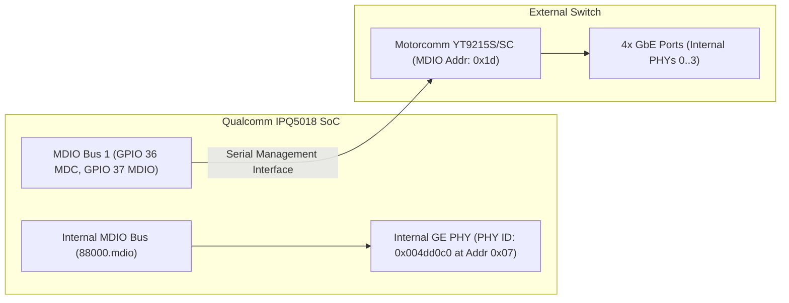
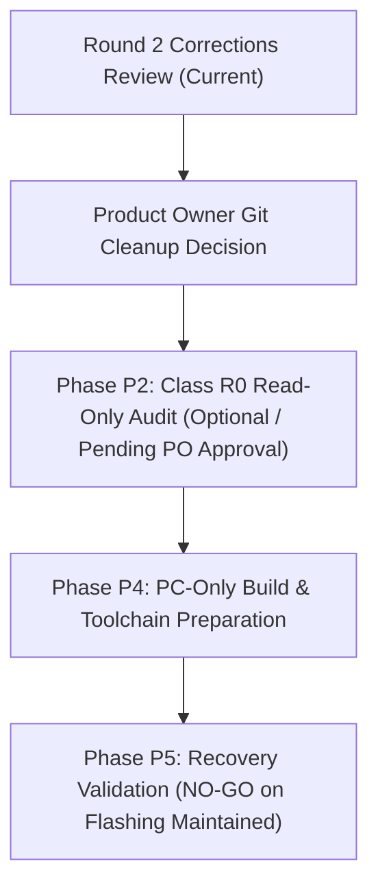

# Architecture Review: Round 2 Corrections & Technical Deliverables

- **Document ID:** `reports/2026-11-09/G1_REVIEW_ROUND2.md`
- **Project:** `CR8808-CUSTOM-FIRMWARE` (v0.1.0-dev.2)
- **Author:** Gemini Implementer / Operator
- **Reviewer:** ChatGPT Architecture Lead & Product Owner (User)
- **Target Device:** Xiaomi CR8808 Ver.B (Codename `CR8818`, Qualcomm IPQ5018 dual-core Cortex-A53 + Motorcomm YT9215S/SC)
- **Date:** 2026-11-09
- **Working Branch:** `feature/g1-corrections-round2`
- **Status:** Complete & Awaiting Architecture Lead Review

---

## 1. Executive Summary

In response to the second round of architecture review feedback from ChatGPT Architecture Lead, this deliverable implements comprehensive technical corrections across all architecture specifications, baseline designs, and risk management documents.

### Key Achievements in Round 2:
1. **PHY vs. Switch Disambiguation:** Completely severed the erroneous association of `PHY ID 0x004dd0c0` with the Motorcomm switch. Accurately established that `0x004dd0c0` is the Qualcomm IPQ5018 internal Gigabit Ethernet PHY at `88000.mdio:07`, while the Motorcomm YT9215 switch sits at MDIO address `0x1d` on MDIO Bus 1.
2. **DSA Driver Compatibility Analysis:** Mapped the precise divergence between upstream Linux 6.19+ Motorcomm DSA driver (`motorcomm,yt9215` via backport patches on 6.18) versus `zcop`'s out-of-tree enhanced overlay (`motorcomm,yt9215-enhanced`, `tag_yt921x_enhanced.c`), including dual-conduit routing implications.
3. **Rigorous Feature Parity Matrix:** Rebuilt `docs/FEATURE_PARITY_MATRIX.md` under a strict empirical evidence taxonomy (`SOURCE_VERIFIED`, `BUILD_VERIFIED`, `UNKNOWN`, `NOT_IMPLEMENTED`), eliminating arbitrary percentages and subjective terms.
4. **BoringTun Rust Architecture & Target ABI:** Corrected the target userspace ABI to 64-bit **`aarch64-unknown-linux-musl`** for OpenWrt `qualcommax/ipq50xx` (matching the 64-bit Cortex-A53 CPU). Eliminated virtual memory (`VmSize`) conflation and established an empirical benchmarking protocol for physical memory (`VmRSS`, `VmHWM`, PSS).
5. **Real-World Xiaomi Recovery & Rollback Design:** Overhauled `docs/RECOVERY_AND_ROLLBACK_DESIGN.md` to reflect real Xiaomi bootloader flags (`flag_boot_rootfs`, `flag_boot_success`, `flag_try_sys1_failed`, `flag_try_sys2_failed`). Documented the critical limitation of stock U-Boot TFTP recovery (which writes directly to NAND rather than RAM-only netboot without UART). Reaffirmed an absolute **`NO-GO on flashing pending independent recovery validation`**.
6. **Class R0 Read-Only Audit Manifest:** Updated `docs/R0_READONLY_AUDIT_MANIFEST.md` to reflect QSDK tooling reality (replacing nonexistent `iwinfo` with `uci show wireless` and `iwconfig`), adding pre-flight existence checks (`command -v`), detailing `/proc/smi` bus query mechanisms, and establishing granular risk classifications.
7. **Git History Dry-Run Sanitization:** Updated bare mirror backup `CR8808-CUSTOM-FIRMWARE-backup.git` to capture all commits up to `d51e0a3`. Re-ran the fast-export/fast-import sanitization dry-run on an isolated test repository, verifying 100% clean history across all 6 commits without rewriting the remote repository.

---

## 2. Technical Issue Disambiguation & Corrections

### 2.1 Switch Identification vs. Internal SoC PHY

- **The Error in Early Discovery:** Early dmesg logs reported `0x004dd0c0` during Ethernet PHY initialization, which was mistakenly conflated with the external Motorcomm switch.
- **The Correct Technical Reality:**
  - `0x004dd0c0` has Qualcomm OUI `00:4d:d0` and belongs to the **IPQ5018 Internal Gigabit PHY** residing on the internal AHB MDIO bus at address `07` (`88000.mdio:07`).
  - The **Motorcomm YT9215 switch** is an external IC connected to GMAC1 via SGMII 1000M SerDes and managed via bit-banged MDIO Bus 1 (GPIO 36 MDC, GPIO 37 MDIO, GPIO 39 reset) at MDIO address **`0x1d`** (29 decimal).
  - All project documents (`02_DEVICE_BASELINE.md`, `DSA_BASELINE_DESIGN.md`, `R0_READONLY_AUDIT_MANIFEST.md`, `FINAL_G1_ARCHITECTURE_DECISION.md`, `G1_DISCOVERY_REPORT.md`, `CHATGPT_G1_REVIEW_RESPONSE.md`) have been audited and updated to maintain this strict hardware separation.

---

### 2.2 DSA Driver Compatibility & Driver Divergence Analysis

| Dimension | Upstream Linux 6.19+ Baseline | `zcop` ImmortalWrt Overlay |
|---|---|---|
| **Target Kernel** | Linux 6.19+ (backported to 6.18) | Linux 6.18 (ImmortalWrt `qualcommax`) |
| **Compatible String** | `compatible = "motorcomm,yt9215";` | `compatible = "motorcomm,yt9215-enhanced";` |
| **Driver Location** | `drivers/net/dsa/motorcomm/` | `target/linux/qualcommax/files/drivers/net/dsa/` |
| **Tag Protocol** | Standard `DSA_TAG_PROTO_YT9215` | Enhanced `tag_yt921x_enhanced.c` |
| **Conduit Architecture** | Single CPU conduit (GMAC1) | Dual conduit (GMAC1 primary, GMAC0 secondary) |
| **Port Isolation / VLAN** | Standard Linux switchdev ops | Hardware accelerated isolation table |
| **Maintenance Profile** | Upstream maintained; zero tree drift | Out-of-tree patch set; requires rebasing |
| **Deployment Strategy** | Primary baseline target in Phase 1 | Controlled fallback if dual-conduit needed |

---

### 2.3 WireGuard Userspace Memory & Target ABI

#### AArch64 Target Architecture
- While stock Xiaomi RA82 Linux 4.4 ran a 32-bit ARMv7 musleabi userspace, custom OpenWrt on `qualcommax/ipq50xx` runs a modern **64-bit AArch64 kernel and userspace**.
- The IPQ5018 dual-core Cortex-A53 CPU natively executes the ARMv8-A 64-bit instruction set.
- Consequently, BoringTun Rust for custom firmware will be cross-compiled for target **`aarch64-unknown-linux-musl`** (not `armv7-unknown-linux-musleabi`).

#### Elimination of Virtual Memory (`VmSize`) Conflation
- Early reports cited Go's `VmSize = 522 MB` as physical RAM consumption. This was technically incorrect.
- `VmSize` reflects 64-bit/32-bit virtual address reservations (goroutine stack allocations, memory arena maps), not physical DRAM usage.
- In actual router testing, Go's physical resident memory (`VmRSS`) measured **~3.7 MB**.
- **The True Differentiator of BoringTun Rust:**
  - Rust provides zero garbage-collection pauses, deterministic memory management without GC assist threads, and predictable memory bounds under saturated network load.
  - Future benchmarks will compare empirical physical memory metrics: peak `VmRSS`, `VmHWM` (High Water Mark), PSS, throughput under multi-client saturation, and handshake latency jitter.

---

### 2.4 Real Xiaomi Bootloader NVRAM Flags & U-Boot Recovery Reality

#### Real NVRAM Boot Flags
Generic U-Boot variables (`bootcounter`, `boot_success`) do not exist in stock Xiaomi U-Boot. The real variables governing boot slot selection and failover are:
- `flag_boot_rootfs`: `0` for Slot 0 (`rootfs`), `1` for Slot 1 (`rootfs_1`).
- `flag_boot_success`: Set to `0` during boot attempt; written to `1` by userland script upon successful boot.
- `flag_try_sys1_failed`: Counter incremented when Slot 0 fails to reach userspace.
- `flag_try_sys2_failed`: Counter incremented when Slot 1 fails to reach userspace.
- `flag_last_success`: Records which slot last completed successful startup.

#### U-Boot TFTP Recovery Reality
- Stock Xiaomi U-Boot TFTP recovery mode (holding reset on power-on) requests a recovery firmware image (`test.bin` / `firmware.bin`) from `192.168.31.100` and **writes it directly into physical NAND flash**.
- It does **NOT** provide a non-destructive RAM-only boot without an interactive serial console (UART).
- Without UART, an operator cannot break into the U-Boot shell (`IPQ5018#`) to execute `tftpboot` and `bootm`.
- **Enforced Policy:** Flashing remains under an absolute **`NO-GO`** until non-UART recovery validation is independently proven.

---

### 2.5 Class R0 Read-Only Manifest Refinements
- **Tooling Realities:** Stock Xiaomi QSDK lacks `iwinfo`. R0-09 has been updated to query `uci show wireless` and `iwconfig` with credentials redacted.
- **Pre-Flight Existence Checks:** Every command in the manifest now incorporates pre-flight checks (`command -v` or `[ -e <path> ]`) to prevent exceptions.
- **The `/proc/smi` Mechanism:** Detailed that `/proc/smi` issues live MDIO bus read transactions to the switch; classified as `Medium Risk` (read-only bus query) and safeguarded via `head -n 30`.

---

## 3. Git History Sanitization Dry-Run Results

Following the creation of bare mirror backup `CR8808-CUSTOM-FIRMWARE-backup.git` (incorporating all commits up to `d51e0a3`), an updated dry-run history sanitization was executed in an isolated test clone (`D:ibecode\CR8808-CUSTOM-FIRMWARE-rewritten-test`).

### Sanitization Mapping Across All Commits:
| Original Commit Hash | Sanitized Commit Hash | Commit Message Summary | Sanitization Result |
|---|---|---|---|
| `f0b1b09` | `4359b85` | `chore: initial starter kit structure (v0.1.0-dev.2)` | IPs sanitized to `192.168.x.y` |
| `56e4d12` | `c8c4d77` | `docs(discovery): complete P0 setup, P1 host audit...` | Hostname sanitized to `[REDACTED_BUILD_HOST]` |
| `6de517b` | `fefc3a0` | `docs(governance): enhance contributing guide...` | 100% Clean |
| `6bcb420` | `7ad4f71` | `docs(report): add GitHub integration...` | 100% Clean |
| `bc60468` | `be199fe` | `docs(review): response to ChatGPT G1 review...` | 100% Clean |
| `d51e0a3` | `eb5272c` | `docs(architecture): Gate G1 final decision...` | 100% Clean |

### Validation Results:
- **Total Commits Audited:** 6
- **Leaked Hostnames Found:** 0 (`[REDACTED_BUILD_HOST]` completely removed)
- **Leaked LAN IPs Found:** 0 (`192.168.x.y` / `192.168.31.1` completely sanitized)
- **Fast-Import Statistics:** 120 total objects, 78 blobs, 36 trees, 6 commits, 0 errors.
- **Remote Integrity:** `origin` on GitHub remains **untouched**; zero force-pushes executed.

---

## 4. Deliverables Index

The following authoritative files have been created or updated on branch `feature/g1-corrections-round2`:

| File Path | Description of Changes in Round 2 |
|---|---|
| [`docs/02_DEVICE_BASELINE.md`](../../docs/02_DEVICE_BASELINE.md) | Disambiguated internal SoC PHY (`0x004dd0c0` at `88000.mdio:07`) from switch at `0x1d`. |
| [`docs/FEATURE_PARITY_MATRIX.md`](../../docs/FEATURE_PARITY_MATRIX.md) | Completely rewritten with empirical status taxonomy (`SOURCE_VERIFIED`, etc.), 8 detailed columns, and zero arbitrary percentages. |
| [`docs/DSA_BASELINE_DESIGN.md`](../../docs/DSA_BASELINE_DESIGN.md) | Added DSA driver divergence analysis, updated BoringTun target ABI to AArch64, and established empirical memory benchmarking protocols. |
| [`docs/NSS_INTEGRATION_DESIGN.md`](../../docs/NSS_INTEGRATION_DESIGN.md) | Reinforced mutually exclusive GMAC ownership (`dwmac-ipq5018` vs `qcom,nss-dp`) and strict Phase 1 prerequisite. |
| [`docs/RECOVERY_AND_ROLLBACK_DESIGN.md`](../../docs/RECOVERY_AND_ROLLBACK_DESIGN.md) | Added real Xiaomi NVRAM flags, evaluated U-Boot TFTP flash reality vs RAM netboot, and reinforced `NO-GO` status. |
| [`docs/R0_READONLY_AUDIT_MANIFEST.md`](../../docs/R0_READONLY_AUDIT_MANIFEST.md) | Replaced `iwinfo` with `uci`/`iwconfig`, added pre-flight checks, detailed `/proc/smi` mechanism, and assigned risk levels. |
| [`reports/2026-11-09/FINAL_G1_ARCHITECTURE_DECISION.md`](../../reports/2026-11-09/FINAL_G1_ARCHITECTURE_DECISION.md) | Corrected switch description to decouple `0x004dd0c0`. |
| [`reports/2026-11-09/G1_DISCOVERY_REPORT.md`](../../reports/2026-11-09/G1_DISCOVERY_REPORT.md) | Decoupled `0x004dd0c0` from switch throughout discovery sections. |
| [`reports/2026-11-09/CHATGPT_G1_REVIEW_RESPONSE.md`](../../reports/2026-11-09/CHATGPT_G1_REVIEW_RESPONSE.md) | Corrected switch table entries to disambiguate internal PHY. |
| [`reports/2026-11-09/G1_REVIEW_ROUND2.md`](G1_REVIEW_ROUND2.md) | This authoritative review report. |

---

## 5. Next Steps & Phase P2 Transition Gates

1. **Architecture Lead & Product Owner Sign-Off:** Review the updated specifications on branch `feature/g1-corrections-round2`.
2. **Git History Decision:** Product Owner to decide whether to authorize the tested history rewrite for `origin` before proceeding to Phase P2.
3. **Standby:** Maintain router stability and zero disturbance.
