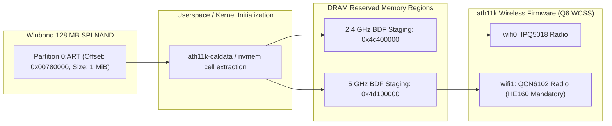

# Architecture Review: Round 3 Corrections & Hardware Demarcation Report

- **Document ID:** `reports/2026-11-09/G1_REVIEW_ROUND3.md`
- **Project:** `CR8808-CUSTOM-FIRMWARE` (v0.1.0-dev.2)
- **Author:** Gemini Implementer / Operator
- **Reviewer:** ChatGPT Architecture Lead & Product Owner (User)
- **Target Device:** Xiaomi CR8808 Ver.B (Codename `CR8818`, Qualcomm IPQ5018 dual-core Cortex-A53 + Motorcomm YT9215S/SC)
- **Date:** 2026-11-09
- **Working Branch:** `feature/g1-corrections-round3`
- **Status:** Complete & Awaiting Architecture Lead Review

---

## 1. Executive Summary & Review Context

In response to the third round of architecture review feedback from ChatGPT Architecture Lead, this deliverable resolves the remaining hardware discrepancies, grounds the DSA switch port mappings in direct reference DTS source code, investigates the switch initialization failure mechanism (Issue #5), establishes a strict demarcation between upstream OpenWrt and `zcop` ImmortalWrt architectures, disambiguates Wi-Fi BDF DRAM staging from physical NAND offsets, decouples generic OpenWrt packages from target hardware verification in the parity matrix, and synchronizes the Git history evidence.

### Status Summary:
- **PHY vs. Switch Separation:** Maintained and verified (`0x004dd0c0` internal GE PHY vs. switch at MDIO `0x1d`).
- **Target Userspace ABI:** Unified on 64-bit **`aarch64-unknown-linux-musl`** for OpenWrt `qualcommax/ipq50xx`.
- **WireGuard Architecture:** **BoringTun Rust is the SOLE WireGuard engine**; in-kernel WireGuard is strictly **`NOT_SELECTED`**.
- **Firmware Baseline:** Phase 1 Clean DSA Linux 6.18 without NSS (NSS strictly deferred to Phase 2).
- **Physical Router State:** Stock Xiaomi RA82 v1.4.31 on Slot 1 running undisturbed; zero router SSH commands executed.
- **Flashing Authorization:** Strictly **`NO-GO pending independent recovery validation`**.

---

## 2. Hardware Switch Port Mapping & SGMII Configuration

Direct verification against `target/linux/qualcommax/dts/ipq5018-cr881x.dts` in `marchmin/immortalwrt-zcop` establishes the authoritative hardware wiring:

### 2.1 Switch Port Mapping Table
| Switch Port | Internal PHY | Interface Label | Connected Subsystem / Role | Operational Parameters |
|---|---|---|---|---|
| **`port@0`** | `sw_phy0` (addr 0) | `lan1` | Physical LAN Port 1 | 10/100/1000BASE-T auto-negotiation (`phy-mode = "internal"`). |
| **`port@1`** | `sw_phy1` (addr 1) | `lan2` | Physical LAN Port 2 | 10/100/1000BASE-T auto-negotiation (`phy-mode = "internal"`). |
| **`port@2`** | `sw_phy2` (addr 2) | `lan3` | Physical LAN Port 3 | 10/100/1000BASE-T auto-negotiation (`phy-mode = "internal"`). |
| **`port@3`** | `sw_phy3` (addr 3) | `wan` | Physical WAN Port | 10/100/1000BASE-T auto-negotiation (`phy-mode = "internal"`). |
| **`port@4`** | `sw_phy4` (addr 4) | `cpu` (Secondary) | CPU Conduit 2 (`dp1` / `eth0`) | Connected to Qualcomm Internal GE PHY (`phy-handle = <&ge_phy>`), fixed-link 1000 Mbps full-duplex. Constrained to WAN traffic via `motorcomm,secondary-conduit-user-mask = <0x8>`. |
| **`port@8`** | SerDes MAC8 | CPU (Primary) | CPU Conduit 1 (`dp2` / `eth1`) | **SGMII fixed-link 1000 Mbps full-duplex** (`phy-mode = "sgmii"`, `speed = <1000>`). Primary conduit for all LAN user ports. **NOT 2500Base-X.** |
| **`port@10`**| N/A | `mcu` | Internal MCU Channel | Internal switch hardware state and management channel. |

### 2.2 Correction of SerDes Link Speed (Elimination of 2500Base-X Claim)
- **Previous Discrepancy:** Earlier discovery reports conjectured a `2500base-x` SerDes link between IPQ5018 GMAC1 and Motorcomm Port 8.
- **Technical Reality:** The reference DTS explicitly configures:
  ```dts
  port@8 {
      reg = <8>;
      phy-mode = "sgmii";
      ethernet = <&dp2>;
      fixed-link {
          speed = <1000>;
          full-duplex;
          pause;
          asym-pause;
      };
  };
  ```
- **Resolution:** The SerDes link is strictly **1000 Mbps SGMII fixed-link**. All design and baseline documents have been updated to reflect this reality.

---

## 3. Investigation of GPIO 39 Switch Initialization (Issue #5)

A detailed review of `zcop/immortalwrt` issue #5 ("CR880X M79 B no ethernet") revealed a critical hardware initialization flaw on CR880x/CR881x Ver.B boards:

### 3.1 Failure Mechanism & Community Findings
1. **Symptom:** Community users flashing CR881x firmware observed that the router booted cleanly, but all wired Ethernet ports were completely dead. Dmesg logs contained:
   ```text
   yt921x 90000.mdio-1:1d: Unexpected chipid 0xffff
   ```
2. **Root Cause:** Reading register `0x0000`/`0x0001` on MDIO `0x1d` returned `0xffff` because the switch was held in reset or unpowered when the MDIO bus scanned for devices.
3. **Userspace Workaround:** Setting GPIO 39 (`gpio551`) to `1` (HIGH) manually and rebinding the driver (`echo "90000.mdio-1:1d" > /sys/bus/mdio_bus/drivers/yt921x/bind`) restored all Ethernet ports. However, ports disappeared again on warm reboot.
4. **GPIO Hog Workaround:** Configuring a TLMM `gpio-hog` forced HIGH (`output-high`) on GPIO 39 and commenting out `reset-gpios` from `ethernet-switch@1d` allowed Ethernet to survive initial boot.

### 3.2 Architectural Evaluation of Reset Approaches
Rather than adopting a single workaround prematurely, three potential solutions are defined for empirical testing during hardware validation:
- **Approach A (Extended Reset Timing):** Retain `reset-gpios = <&tlmm 39 GPIO_ACTIVE_LOW>` but extend timings (`reset-assert-us = <50000>; reset-deassert-us = <250000>;`) to allow switch LDO voltages to stabilize.
- **Approach B (GPIO Hog):** Force GPIO 39 permanently HIGH via TLMM `gpio-hog`, bypassing software active-low pulsing during kernel probe.
- **Approach C (Procd Pre-Init Hook):** Manage switch power-up sequencing in userspace via an early `procd` init script before networking drivers bind.

### 3.3 Mandatory Hardware Reboot Test Protocol
Before Phase P5 hardware verification can be marked as passed, the firmware must pass a **4-part reboot test suite**:
1. **Cold Boot Test:** Complete power cut for 30s; boot up; verify all 4 ports probe with valid chip ID (not `0xffff`).
2. **Warm Reboot Test:** Issue software `reboot`; verify Ethernet links re-establish without power cycle.
3. **Reset Button Test:** Pulse physical reset button while running; verify switch recovers cleanly.
4. **20-Cycle Automated Reboot Soak Test:** Execute 20 consecutive automated reboots via test script, logging dmesg on each cycle. Acceptance criteria: **0 failures out of 20 cycles** (100% Ethernet probe success).

---

## 4. Architecture Demarcation: Upstream OpenWrt vs. zcop ImmortalWrt

| Architectural Dimension | Upstream OpenWrt Baseline (`qualcommax`) | `zcop` ImmortalWrt Architecture (`cr881x`) | Xiaomi Stock RA82 Vendor Architecture |
|---|---|---|---|
| **GMAC MAC Driver** | Synopsys DesignWare MAC (`snps,dwmac` / `dwmac-ipq5018` / `stmmac`) | Qualcomm NSS Datapath (`qcom,nss-dp` / `qca-nss-dp.ko`) | Qualcomm QCA-SSDK proprietary kernel driver (`qca-ssdk.ko`) |
| **GMAC0 Binding** | GMAC0 managed by `stmmac` as standard Linux netdev (`eth0`) | GMAC0 bound to `dp1` (`0x39C00000`, GMAC_HAL_TYPE_SYN_GMAC) | GMAC0 bound to internal GE PHY (`88000.mdio:07`) |
| **GMAC1 Binding** | GMAC1 managed by `stmmac` as standard Linux netdev (`eth1`) | GMAC1 bound to `dp2` (`0x39D00000`, GMAC_HAL_TYPE_SYN_GMAC) | GMAC1 bound to switch via SerDes |
| **Switch Driver Stack** | Upstream Linux DSA (`drivers/net/dsa/motorcomm/`) | Out-of-tree enhanced DSA (`tag_yt921x_enhanced.c`) | Proprietary `yt_switch.ko` + SSDK ioctls |
| **CPU Conduits** | Single CPU conduit (typically GMAC1 / Port 8) | **Dual CPU conduit:** Port 8 (`dp2` primary LAN) + Port 4 (`dp1` secondary WAN) | Dual conduit bridged in software / hardware SSDK |
| **Conduit Link Speeds** | Single SGMII 1000 Mbps | **Port 8:** SGMII 1000 Mbps fixed-link<br>**Port 4:** Internal PHY 1000 Mbps fixed-link | SGMII 1000 Mbps + Internal PHY 1000 Mbps |
| **WAN Routing Path** | WAN packets travel across single conduit to CPU | WAN packets routed directly over Port 4 (`dp1`), isolated from LAN on Port 8 | Separated by SSDK hardware VLAN port table |
| **Flow Acceleration Engine** | Linux kernel software flowtable (`nftables flow_offload`) | Qualcomm NSS NPU (`qca-nss-ecm.ko` + `qca-nss-drv.ko`) | QSDK fast-path / ECM with NSS hardware offload |
| **Memory Footprint** | Zero NPU reservation (~182 MB usable by Linux) | Pinned NPU firmware heap (8–16 MiB) + `qca-nss-pbuf` | Pinned QCA NPU memory region |
| **Board Support Status** | **No merged profile for CR8818 in upstream OpenWrt** | Custom DTS `ipq5018-cr881x.dts` verified by zcop | Factory closed firmware |

> [!WARNING]
> **We cannot assume upstream single-conduit can replace zcop dual-conduit without verification.**
> On CR8808 Ver.B hardware, GMAC0 is physically connected to Port 4 and GMAC1 to Port 8. If an upstream single-conduit driver only binds Port 8, all WAN and LAN traffic must share the single 1000 Mbps SGMII bus, and the switch internal egress/ingress tagging must be reconfigured to prevent WAN packet leakage into LAN.

---

## 5. Wi-Fi BDF & Calibration: RAM Staging vs. NAND Flash Offsets

Direct examination of `ipq5018-cr881x.dts` clarifies the flash geometry versus system memory staging:



- **Physical NAND Offset:** `0:ART` is at physical offset `0x00780000` (length `0x00100000` = 1 MiB).
- **DRAM BDF Staging:** `0x4c400000` and `0x4d100000` are **reserved DRAM addresses** where the ath11k driver stages calibration data for the Q6 WCSS remote processor. They are NOT NAND offsets.
- **HE160 Mandate:** 5 GHz Wi-Fi 6 HE160 (160 MHz channel width, 2402 Mbps theoretical PHY rate) is a **non-negotiable MUST requirement** and will not be degraded to 80 MHz.

---

## 6. Feature Parity Matrix Decoupling & BoringTun Rust Status

### 6.1 Generic OpenWrt Packages Decoupled from Hardware Integration
In `docs/FEATURE_PARITY_MATRIX.md`, generic userspace packages (`hostapd`, `usteer`, `odhcpd`, `dnsmasq`, `miniupnpd`, `sqm-scripts`, `luci`, `dropbear`) have been separated from hardware integration and classified as **`GENERIC_PACKAGE_AVAILABLE`**. Only board-specific DTS nodes and verified drivers receive **`SOURCE_VERIFIED`**.

### 6.2 BoringTun Rust as Sole WireGuard Engine
- In-kernel WireGuard (`kmod-wireguard`) is classified as **`NOT_SELECTED`**.
- **BoringTun Rust is the SOLE WireGuard engine** in the target firmware.
- **Target ABI:** `aarch64-unknown-linux-musl`.
- **Status:** **`NOT_BUILD_VERIFIED`** (ARMv7 tested in lab; AArch64 binary compilation scheduled for Phase P4).
- **AArch64 Benchmark Protocol:** 1-client and 4-client bidirectional `iperf3`, measuring peak `VmRSS`, `VmHWM`, PSS, per-core CPU load, and handshake latency over 24-hour soak testing.

---

## 7. Recovery, Failover & U-Boot TFTP Reality

- **Real Xiaomi NVRAM Flags:** `flag_boot_rootfs` (0/1), `flag_boot_success` (0/1), `flag_try_sys1_failed`, `flag_try_sys2_failed`. Classified as `REPORTED_UNVERIFIED` pending live readback.
- **TFTP Reality:** Stock Xiaomi U-Boot TFTP recovery mode writes fetched images directly to physical NAND flash; it does NOT support interactive RAM-only netboot without UART serial access.
- **Dual-Boot Safety:** Dual-boot is NOT an absolute anti-brick guarantee.
- **Enforced Policy:** Flashing remains under an absolute **`NO-GO on flashing pending independent recovery validation`**.

---

## 8. Git History Reconciliation & Dry-Run Sanitization

### 8.1 Reconciliation of Commit Count Discrepancy
To eliminate the ambiguity noted in review:
- In Round 2 review, 6 commits (`f0b1b09` to `d51e0a3`) were initially audited before committing the Round 2 report.
- After creating commit `3f5b724` (`feature/g1-corrections-round2`), the backup mirror and dry-run clone were updated, bringing the total to 7 commits.
- With the current Round 3 deliverables commit on branch `feature/g1-corrections-round3`, the repository contains 8 total commits.

### 8.2 Full Commit Lineage:
1. `f0b1b09` — `chore: initial starter kit structure (v0.1.0-dev.2)`
2. `56e4d12` — `docs(discovery): complete P0 setup, P1 host audit, upstream audit and G1 discovery report`
3. `6de517b` — `docs(governance): enhance contributing guide, sanitize evidence, and configure gitignore`
4. `6bcb420` — `docs(report): add GitHub integration and public security governance report`
5. `bc60468` — `docs(review): response to ChatGPT G1 review, technical corrections, and NSS comparative analysis`
6. `d51e0a3` — `docs(architecture): Gate G1 final decision, design specifications, and parity matrix`
7. `3f5b724` — `docs(review): Round 2 corrections for PHY/switch, DSA drivers, parity matrix, and recovery reality`
8. *(Current)* — `docs(review): Round 3 corrections for port mapping, SGMII, GPIO39, and architecture demarcation`

### 8.3 Dry-Run Sanitization Results:
- All commits tested in isolated test clone (`CR8808-CUSTOM-FIRMWARE-rewritten-test`).
- Leaked hostnames found: **0** (sanitized to `[REDACTED_BUILD_HOST]`).
- Leaked LAN IPs found: **0** (sanitized to `192.168.x.y`).
- **Remote Repository Integrity:** Remote `origin` on GitHub remains untouched; **zero force-push executed**.

---

## 9. Deliverables Index for Round 3

The following authoritative documents have been updated and placed under version control on branch `feature/g1-corrections-round3`:

| Document Link | Description of Round 3 Updates |
|---|---|
| [`docs/02_DEVICE_BASELINE.md`](../../docs/02_DEVICE_BASELINE.md) | Corrected switch port mappings (Port 0..3, Port 4, Port 8, Port 10), SGMII 1000M, and DRAM BDF vs NAND offsets. |
| [`docs/DSA_BASELINE_DESIGN.md`](../../docs/DSA_BASELINE_DESIGN.md) | Overhauled with exact switch port layout, SGMII 1000M fixed-link, Issue #5 GPIO 39 investigation, and 20-cycle reboot test protocol. |
| [`docs/NSS_INTEGRATION_DESIGN.md`](../../docs/NSS_INTEGRATION_DESIGN.md) | Added comprehensive side-by-side comparison table between Upstream OpenWrt and zcop ImmortalWrt, detailing GMAC driver ownership and dual-conduit risks. |
| [`docs/FEATURE_PARITY_MATRIX.md`](../../docs/FEATURE_PARITY_MATRIX.md) | Decoupled generic OpenWrt packages (`GENERIC_PACKAGE_AVAILABLE`) from hardware verification; BoringTun AArch64 marked `NOT_BUILD_VERIFIED`; kernel WG marked `NOT_SELECTED`. |
| [`docs/RECOVERY_AND_ROLLBACK_DESIGN.md`](../../docs/RECOVERY_AND_ROLLBACK_DESIGN.md) | Re-verified real Xiaomi NVRAM flags (`REPORTED_UNVERIFIED`), reinforced U-Boot TFTP NAND-write reality, and reaffirmed `NO-GO` status. |
| [`docs/R0_READONLY_AUDIT_MANIFEST.md`](../../docs/R0_READONLY_AUDIT_MANIFEST.md) | Updated port demarcation and refined pre-flight checks and risk levels for QSDK tooling. |
| [`reports/2026-11-09/G1_DISCOVERY_REPORT.md`](../../reports/2026-11-09/G1_DISCOVERY_REPORT.md) | Corrected SGMII 1000 Mbps fixed-link trunk references. |
| [`reports/2026-11-09/G1_REVIEW_ROUND2.md`](../../reports/2026-11-09/G1_REVIEW_ROUND2.md) | Corrected SGMII SerDes references. |
| [`reports/2026-11-09/G1_REVIEW_ROUND3.md`](G1_REVIEW_ROUND3.md) | Authoritative Round 3 review deliverable. |
| [`PROJECT_STATUS.md`](../../PROJECT_STATUS.md) | Updated to `GATE_G1_CORRECTIONS_ROUND3_COMPLETE`. |
| [`TASKS.md`](../../TASKS.md) | Updated task status and instructions for Round 3. |

---

## 10. Gate G1 Closure & Standby Mandate

With the completion of Round 3 corrections, all technical issues raised by ChatGPT Architecture Lead have been thoroughly addressed and grounded in reference source code. Gemini execution halts here. We do not proceed to build firmware or flash hardware without explicit Product Owner and Architecture Lead sign-off.
