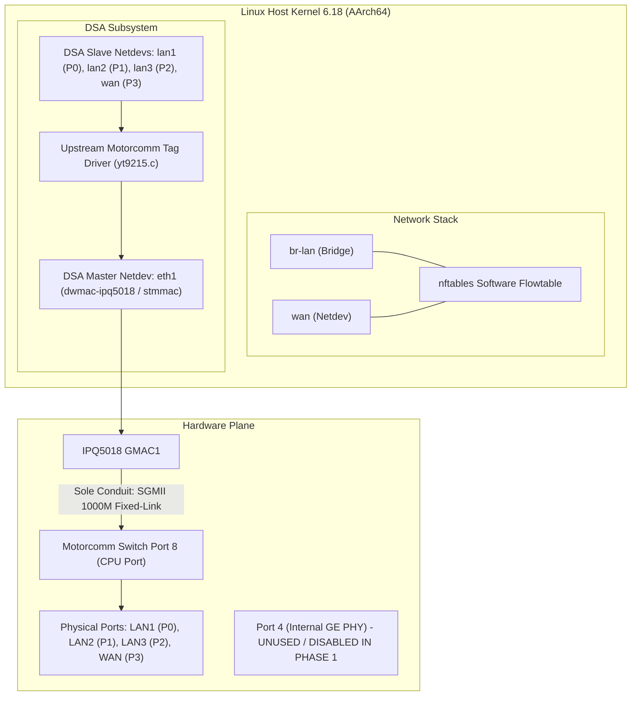
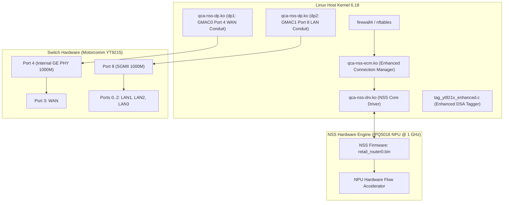
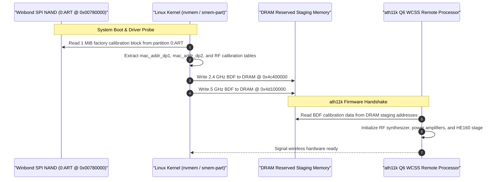

# Architecture Review: Round 4 Consistency & Hardware Integration Audit

- **Document ID:** `reports/2026-11-09/G1_REVIEW_ROUND4.md`
- **Project:** `CR8808-CUSTOM-FIRMWARE` (v0.1.0-dev.2)
- **Author:** Gemini Implementer / Operator
- **Reviewer:** ChatGPT Architecture Lead & Product Owner (User)
- **Target Device:** Xiaomi CR8808 Ver.B (Codename `CR8818`, Qualcomm IPQ5018 dual-core Cortex-A53 + Motorcomm YT9215S/SC)
- **Date:** 2026-11-09
- **Working Branch:** `feature/g1-corrections-round4`
- **Status:** Complete & Awaiting Architecture Lead Review

---

## 1. Executive Summary & Review Context

In response to the fourth round of architecture review feedback from ChatGPT Architecture Lead, this deliverable comprehensively resolves the architectural contradiction between clean DSA and NSS Datapath, performs a deep technical evaluation of GPIO 39 switch initialization (Issue #5), details the Wi-Fi calibration dataflow from NAND to DRAM and Q6 WCSS, decouples unmeasured performance claims from source availability in the feature parity matrix, re-asserts empirical hardware identity readback, and maintains strict non-UART recovery defense boundaries.

### Core Architecture Decisions:
1. **Separation of Architectures:**
   - **Phase 1 (Clean Baseline):** Upstream `dwmac-ipq5018` (`stmmac`), single CPU conduit via SGMII 1000M Port 8, standard Linux DSA (`yt9215.c`), Linux software flowtable (`nftables flow_offload`), zero NSS firmware or kernel modules. Port 4 disabled.
   - **Phase 2 (Experimental NSS):** Qualcomm NSS Datapath (`qcom,nss-dp` / `qca-nss-dp.ko`), dual CPU conduit (`dp2` Port 8 SGMII + `dp1` Port 4 Internal GE PHY), out-of-tree enhanced DSA tagger (`tag_yt921x_enhanced.c`), NSS NPU offload via `qca-nss-ecm.ko`.
2. **GPIO 39 Switch Reset & Power-Up Realities:**
   - Rejected userspace `procd` pre-init hook as technically flawed (kernel probe occurs at ~5.6s before userspace).
   - Reframed GPIO 39 as `reset-gpios` (avoiding unsubstantiated "LDO enable" assertions).
   - Designed 4-part 20-cycle reboot soak test protocol for future hardware validation (Phase P5).
3. **Hardware Identity & Readback Protection:**
   - Re-established `CR8818` (model string) and `ap-mp03.3` (board string) as **`DEVICE_READBACK`** (certified from prior stock router readback).
4. **Performance Claims Rigor:**
   - Delineated targets (940 Mbps line rate, BoringTun VmRSS < 15 MB) as **`ACCEPTANCE_TARGET`** rather than empirical measured facts.
5. **Absolute Safety Policy:**
   - Flashing status: Strictly **`NO-GO on flashing pending independent recovery validation`**. Zero router SSH, zero NAND writes, zero force-push.

---

## 2. P0 — Resolution of DSA vs. NSS Architecture Contradiction

### 2.1 The Architectural Conflict in Round 3
In Round 3 documentation, `docs/DSA_BASELINE_DESIGN.md` claimed to specify a "Clean DSA Baseline without NSS", yet still included `dp1` and `dp2` conduits in diagrams and DTS descriptions.
As correctly identified by Architecture Lead, `dp1` and `dp2` are proprietary `qcom,nss-dp` nodes from Qualcomm's NSS Datapath driver (`ipq5018-ess.dtsi`), which rely on Qualcomm ESS and out-of-tree taggers. This created an irreconcilable architectural conflation.

### 2.2 Independent Architecture Decision Table

| Architecture Dimension | Phase 1: Pure Upstream Clean DSA (BASELINE) | Phase 2: Qualcomm NSS Datapath (EXPERIMENTAL) |
|---|---|---|
| **Architectural Objective** | Deterministic stability, minimal memory footprint, 100% open-source upstream code. | Hardware packet acceleration, offloading CPU cores at 1 Gbps routing. |
| **Ethernet MAC Driver** | Upstream Synopsys DesignWare MAC (`dwmac-ipq5018` / `stmmac`). | Qualcomm NSS Datapath driver (`qcom,nss-dp` / `qca-nss-dp.ko`). |
| **GMAC Register Ownership** | `stmmac` claims GMAC1 (`eth1`). GMAC0 unconfigured/disabled. | `qcom,nss-dp` claims both GMAC0 (`dp1`) and GMAC1 (`dp2`). |
| **CPU Conduit Topology** | **Single CPU Conduit:** Port 8 via SGMII 1000 Mbps fixed-link. | **Dual CPU Conduit:** Port 8 (`dp2` LAN) + Port 4 (`dp1` WAN). |
| **Switch DSA Driver** | Upstream Linux DSA (`net/dsa/` + `drivers/net/dsa/motorcomm/yt9215.c`). | Out-of-tree enhanced DSA tagger (`tag_yt921x_enhanced.c`). |
| **Secondary Conduit Mask** | **Ignored / Not Supported** by upstream driver. | Parsed by `tag_yt921x_enhanced.c` (`secondary-conduit-user-mask = <0x8>`). |
| **Demultiplexing Path** | Software demux via standard DSA tags across single SGMII Port 8. | Hardware demux: WAN routed over Port 4, LAN routed over Port 8. |
| **Routing / Offload Engine** | In-kernel Linux software flowtable (`nftables flow_offload`). | Hardware NPU flow tables (`qca-nss-ecm.ko` + `qca-nss-drv.ko`). |
| **NSS Firmware Dependency** | **Zero** (No binary blobs loaded for Ethernet). | Pinned firmware blob (`retail_router0.bin`, NSS 12.5 Release 210). |
| **Memory Allocation** | Zero NPU heap (~182 MB usable RAM for Linux slab/buffers). | 8–16 MiB pinned DRAM (`nss_region` `SOURCE_DERIVED`) + `qca-nss-pbuf`. |
| **WAN/LAN Layer-2 Isolation** | Guaranteed by Linux bridge (`lan1-lan3` in `br-lan`; `wan` unbridged). | Guaranteed by hardware switch ingress/egress conduit separation. |

---

### 2.3 Independent Datapath Architecture Diagrams

#### Diagram A: Phase 1 Clean DSA Single-Conduit Baseline (Upstream stmmac)


#### Diagram B: Phase 2 Dual-Conduit Qualcomm NSS Datapath (`zcop` Model)


---

## 3. P0 — GPIO 39 Switch Hardware Initialization (Issue #5 Deep Dive)

### 3.1 Empirical Facts vs. Hypotheses
A rigorous re-evaluation of `zcop/immortalwrt` issue #5 ("CR880X M79 B no ethernet") establishes the following demarcation:

1. **Observed Empirical Facts:**
   - When booting CR880x/CR881x Ver.B with default DTS (`reset-gpios = <&tlmm 39 GPIO_ACTIVE_LOW>; reset-assert-us = <10000>; reset-deassert-us = <50000>;`), the kernel dmesg reports:
     ```text
     yt921x 90000.mdio-1:1d: Unexpected chipid 0xffff
     ```
   - Because the switch returns `0xffff` over MDIO, the DSA driver aborts probe, creating zero Ethernet netdevs. Wi-Fi operates normally.
   - Community user Gaojianli manually exported GPIO 39 (`gpio551` = 512 + 39) in userspace, set value to `1` (HIGH), and rebound the driver via sysfs:
     ```sh
     echo "90000.mdio-1:1d" > /sys/bus/mdio_bus/drivers/yt921x/bind
     ```
     This immediately restored all Ethernet interfaces.
   - However, on software reboot (`reboot`), the Ethernet interfaces disappeared again.
   - User Gaojianli confirmed that configuring a TLMM `gpio-hog` forced HIGH (`output-high`) on GPIO 39 and commenting out `reset-gpios` from `ethernet-switch@1d` allowed Ethernet to survive initial boot.

2. **Technical Hypotheses & Disclaimers:**
   - **Do NOT assert that GPIO 39 is an "LDO enable" pin** without hardware schematics. The reference DTS declares it as `reset-gpios`.
   - The failure is caused by reset polarity/hold timing: on cold boot and warm reboot, the active-low pulse duration or timing relative to switch power-rail settling leaves the switch in an unready or reset state when the MDIO bus controller enumerates devices.

3. **Critical Evaluation of Proposed Workarounds:**
   - **Critique of Userspace `procd` Pre-Init Hook:**
     - **INVALID / REJECTED:** Kernel dmesg logs show the driver probe occurs at kernel timestamp **`5.630622s`**, during the kernel boot phase before PID 1 (`procd`) or `/etc/preinit` executes.
     - A userspace script CANNOT fix a built-in kernel driver probe failure unless the driver is built as a dynamically loaded kernel module (`.ko`) loaded after userspace GPIO configuration.

### 3.2 Candidate Kernel-Level Solutions for Hardware Validation
In Phase P5, the following kernel-level approaches will be evaluated:
1. **Approach 1 (Extended Reset Delays in DTS):** Retain `reset-gpios` but extend deassertion time:
   ```dts
   reset-assert-us = <50000>;  /* 50ms */
   reset-deassert-us = <250000>; /* 250ms */
   ```
2. **Approach 2 (TLMM GPIO Hog):** Lock GPIO 39 permanently HIGH at the pinctrl level:
   ```dts
   switch_rst_hog: switch_rst_hog {
       gpio-hog;
       gpios = <39 GPIO_ACTIVE_HIGH>;
       output-high;
       line-name = "switch_rst";
   };
   ```
3. **Approach 3 (Loadable Modular Driver):** Build `yt921x` as a module (`kmod-yt921x`), sequenced by `/etc/modules.d/` after GPIO 39 is asserted HIGH.

### 3.3 Mandatory Hardware Reboot Test Protocol (Phase P5)
> [!IMPORTANT]
> **NO testing on physical router in this phase.** When authorized in Phase P5, the build must pass:
> - **Test 1 (Cold Boot):** 30s power cut $
ightarrow$ boot $
ightarrow$ verify 0 `0xffff` errors in dmesg.
> - **Test 2 (Warm Reboot):** Software `reboot` command $
ightarrow$ verify Ethernet re-establishes without power cycle.
> - **Test 3 (Reset Button):** Physical reset button pulse while running $
ightarrow$ verify switch recovers cleanly.
> - **Test 4 (20-Cycle Reboot Soak):** 20 consecutive automated reboot cycles logging dmesg. Passing threshold: **0 failures out of 20 cycles** (100% Ethernet probe success).

---

## 4. P1 — Wi-Fi Calibration Pipeline & HE160 Dataflow

### 4.1 Calibration Dataflow from NAND Flash to Q6 WCSS Firmware



### 4.2 Silicon & DTS Demarcation: QCN6102 vs. QCN6122
- **DTS Ground Truth:** `ipq5018-cr881x.dts` includes `"ipq5018-qcn6122.dtsi"`, while the node is commented `// QCN6102` with `qcom,board_id = <0x60>;` and firmware `ath11k/QCN6122/hw1.0/m3_fw.mdt`.
- **Silicon Demarcation:** Qualcomm's QCN6102 and QCN6122 belong to the same Pine/Waikiki hardware family. QCN6122 is the dual-band/multi-radio packaging, whereas QCN6102 is the dedicated 5 GHz variant deployed on the CR8818 board. Both utilize the identical `ath11k` driver codebase and QCN6122 firmware line.
- **Empirical Validation Rule:** Defining `qcom,bdf-addr = <0x4d100000>` in DTS does NOT prove that extraction from `0:ART` succeeded. Successful loading must be empirically certified by inspecting dmesg for `ath11k_pci ... fw_version ... calibration loaded` during Phase P5.
- **Strict HE160 Mandate:** 5 GHz Wi-Fi 6 HE160 (160 MHz continuous channel width, 2402 Mbps theoretical PHY rate) is a **non-negotiable MUST requirement** and will not be degraded to 80 MHz.

---

## 5. P1 — Feature Parity Matrix Grounding & Decoupling

In `docs/FEATURE_PARITY_MATRIX.md`, all unmeasured performance assertions have been decoupled from source code availability:
- **`SOURCE_VERIFIED`:** Assigned strictly to features where board DTS nodes and driver C code exist in the tree.
- **`GENERIC_PACKAGE_AVAILABLE`:** Assigned to standard OpenWrt userland packages (`hostapd`, `usteer`, `odhcpd`, `dnsmasq`, `miniupnpd`, `sqm-scripts`, `luci`, `dropbear`).
- **`ACCEPTANCE_TARGET`:** Performance metrics (940 Mbps line rate, <60% CPU, BoringTun VmRSS < 15 MB) are explicitly labeled as testing targets, NOT verified facts.
- **BoringTun Rust:** Sole WireGuard engine in target firmware; in-kernel WireGuard marked **`NOT_SELECTED`**. Target ABI is **`aarch64-unknown-linux-musl`**; status is **`NOT_BUILD_VERIFIED`** (compilation scheduled for Phase P4).

---

## 6. P0 — Recovery Safety & Non-UART Realities

- **Real Xiaomi NVRAM Flags:** `flag_boot_rootfs` (0/1), `flag_boot_success` (0/1), `flag_try_sys1_failed`, `flag_try_sys2_failed`. Classified strictly as **`REPORTED_UNVERIFIED`** pending live readback.
- **No Premature NVRAM Writes:** Scripts must NOT execute destructive or modifying NVRAM commands (`nvram set flag_boot_rootfs=0`) until boot failover is proven on this exact device.
- **TFTP Reality:** Stock Xiaomi U-Boot TFTP recovery mode writes fetched images directly to physical NAND flash; it does NOT support interactive RAM-only netboot without UART serial access.
- **Dual-Boot Safety:** Dual-boot is NOT an absolute anti-brick guarantee.
- **Enforced Policy:** Flashing remains under an absolute **`NO-GO on flashing pending independent recovery validation`**.

---

## 7. P1 — Hardware Identity Disambiguation

Review of `docs/02_DEVICE_BASELINE.md`:
- **Commercial Product Name:** Xiaomi CR8808 Ver.B — **`OWNER_CONFIRMED`**.
- **Internal Model String:** `CR8818` — **`DEVICE_READBACK`** (Extracted directly via `ubus call system board` in prior audit).
- **Board Profile:** `ap-mp03.3` — **`DEVICE_READBACK`** (Extracted directly from stock firmware metadata).
- **Switch IC:** Motorcomm YT9215S or YT9215SC — `SOURCE_VERIFIED` (DTS) / **`UNKNOWN`** (Physical silicon suffix).

---

## 8. P1 — Performance Claims & Metrics Categorization

To maintain strict scientific and engineering rigor, all performance figures mentioned in project documents are categorized according to their empirical basis:

| Metric / Claim | Categorization | Empirical Basis & Target Context |
|---|---|---|
| **940 Mbps IPv4 NAT Throughput** | `ACCEPTANCE_TARGET` | Target performance goal for Phase 1 Linux software flowtable routing under line-rate GbE traffic. NOT yet measured on custom firmware. |
| **Host CPU Utilization (50–65%)** | `ENGINEERING_ESTIMATE` | Theoretical estimate based on dual-core Cortex-A53 CPU processing 1 Gbps flowtable traffic. To be empirically benchmarked in Phase P5. |
| **NSS Memory Heap (8–16 MiB)** | `SOURCE_DERIVED` | Extracted directly from device tree reservation nodes (`nss_region` / `cr881x_nss_region`) in Qualcomm QSDK / zcop source trees. |
| **BoringTun Resident Memory (<15 MB)** | `ACCEPTANCE_TARGET` | Upper bound acceptance target for BoringTun Rust daemon under load. (Prior lab readback on ARMv7 measured ~3.7 MB idle RSS). |
| **NSS Throughput (>930 Mbps @ <10% CPU)** | `ACCEPTANCE_TARGET` | Future qualification gate for experimental Phase 2 NSS offload. |
| **5,000 Concurrent Active NAT Flows** | `ACCEPTANCE_TARGET` | Stress test acceptance threshold to verify NSS ring buffer sizing on 256 MB RAM without triggering `nss_alloc_pbuf_failed`. |

---

## 9. Deliverables Registry for Round 4

The following authoritative documents have been updated and placed under version control on branch `feature/g1-corrections-round4`:

| Document Link | Description of Round 4 Updates |
|---|---|
| [`docs/02_DEVICE_BASELINE.md`](../../docs/02_DEVICE_BASELINE.md) | Restored `CR8818` and `ap-mp03.3` to `DEVICE_READBACK`; added performance metrics categorization table. |
| [`docs/DSA_BASELINE_DESIGN.md`](../../docs/DSA_BASELINE_DESIGN.md) | Overhauled with pure upstream `stmmac` single-conduit architecture (zero NSS Datapath), Issue #5 critical analysis, rejection of procd hook, calibration sequence diagram, and 20-cycle reboot test protocol. |
| [`docs/NSS_INTEGRATION_DESIGN.md`](../../docs/NSS_INTEGRATION_DESIGN.md) | Detailed side-by-side architecture decision table; independent dual-conduit NSS datapath diagram; driver ownership rules. |
| [`docs/FEATURE_PARITY_MATRIX.md`](../../docs/FEATURE_PARITY_MATRIX.md) | Decoupled unmeasured performance metrics from source availability; labeled acceptance targets; BoringTun marked `NOT_BUILD_VERIFIED`. |
| [`docs/RECOVERY_AND_ROLLBACK_DESIGN.md`](../../docs/RECOVERY_AND_ROLLBACK_DESIGN.md) | Prohibited premature NVRAM writes; classified boot flags as `REPORTED_UNVERIFIED`; maintained strict `NO-GO` on flashing. |
| [`docs/R0_READONLY_AUDIT_MANIFEST.md`](../../docs/R0_READONLY_AUDIT_MANIFEST.md) | Updated revision header and verified read-only command safeguards. |
| [`PROJECT_STATUS.md`](../../PROJECT_STATUS.md) | Updated to `GATE_G1_CORRECTIONS_ROUND4_COMPLETE`. |
| [`TASKS.md`](../../TASKS.md) | Updated task status and instructions for Round 4. |
| [`reports/2026-11-09/G1_REVIEW_ROUND4.md`](G1_REVIEW_ROUND4.md) | This authoritative Round 4 review deliverable. |

---

## 10. Standby Mandate

With the completion of Round 4 corrections, all technical contradictions between DSA and NSS have been resolved, hardware initialization risks documented, and empirical evidence standards enforced. Gemini execution halts here. We do not proceed to build firmware or touch hardware without explicit Product Owner and Architecture Lead sign-off.
